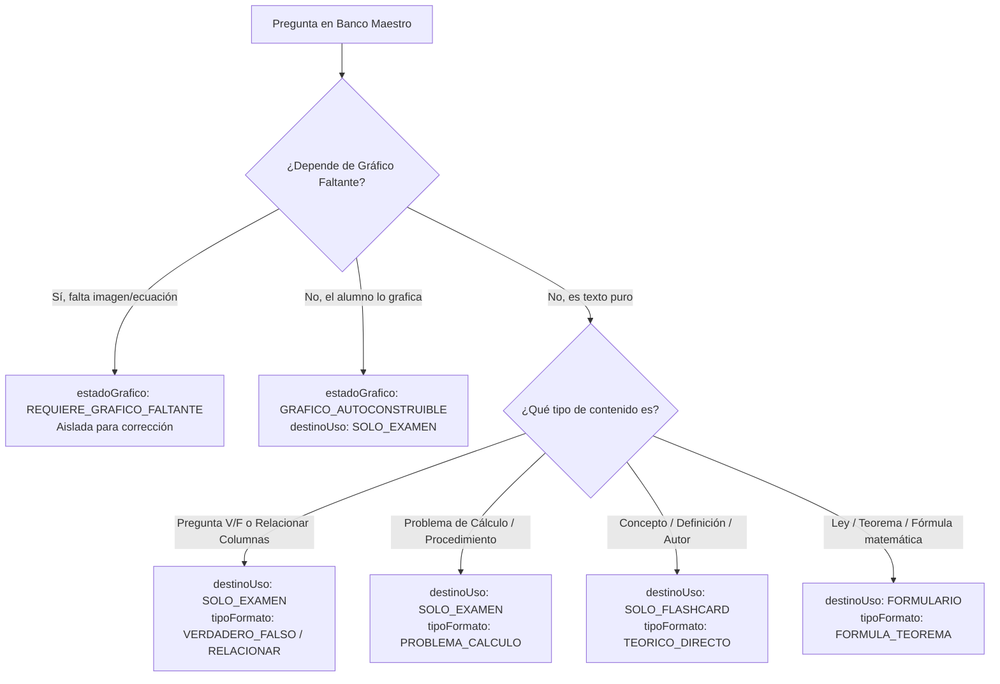

# 📊 CHECKLIST MAESTRO: CLASIFICACIÓN Y SANEAMIENTO DEL BANCO DE PREGUNTAS (4600+ ÍTEMS)

**Proyecto:** RASTRO UNSA (Plataforma de Preparación Preuniversitaria)  
**Archivo Maestro:** `copia rastro react/src/data/bancoPreguntasCepreunsa.json`  
**Objetivo:** Clasificar cada una de las ~4,600 preguntas agregando metadatos estructurados (`subtema`, `destinoUso`, `estadoGrafico`, `tipoFormato`, `observacion`) **sin fragmentar el archivo**, aislando las preguntas con gráficos rotos/faltantes y separando las aptas para **Flashcards**, **Formularios** y **Simulacros Oficiales**.

---

## 🎯 RESUMEN DE CRITERIOS DE CLASIFICACIÓN

---

## 📋 METADATOS QUE SE AGREGARÁN A CADA PREGUNTA

Cada objeto de pregunta conservará intactos sus campos base (`id`, `q`, `options`, `answer`, `asignatura`, `semana`, `explanation`) y recibirá estos 5 campos de clasificación:

| Campo | Tipo / Valores Permitidos | Descripción |
| :--- | :--- | :--- |
| **`subtema`** | `String` (ej. *"Vectores"*, *"Análisis Dimensional"*, *"Estequiometría"*) | Subtema curricular oficial según temario UNSA. |
| **`destinoUso`** | `"SOLO_FLASHCARD"` \| `"FORMULARIO"` \| `"SOLO_EXAMEN"` | Destino pedagógico en la aplicación móvil. |
| **`estadoGrafico`** | `"SIN_GRAFICO_TEXTUAL"` \| `"GRAFICO_AUTOCONSTRUIBLE"` \| `"REQUIERE_GRAFICO_FALTANTE"` | Diagnóstico de dependencia y estado visual. |
| **`tipoFormato`** | `"TEORICO_DIRECTO"` \| `"VERDADERO_FALSO"` \| `"RELACIONAR_COLUMNAS"` \| `"PROBLEMA_CALCULO"` \| `"DECO_CONTEXTO"` | Estructura y mecánica de la pregunta. |
| **`observacion`** | `String` (ej. *"Requiere gráfico de poleas que falta"* o *"Texto completo"*) | Notas técnicas para auditoría o corrección. |

---

## 📈 TABLERO DE PROGRESO POR FASES

- [x] **Fase 1: Definición de la Taxonomía y Criterios**
  - [x] Reglas para clasificar a `SOLO_FLASHCARD` (teoría y definiciones directas sin distractores complejos).
  - [x] Reglas para clasificar a `FORMULARIO` (fórmulas, identidades y leyes).
  - [x] Reglas para clasificar a `SOLO_EXAMEN` (cálculo, V/F, emparejamiento y ordenamiento).
  - [x] Heurísticas de detección de preguntas con gráficos o ecuaciones rotas/perdidas (`REQUIERE_GRAFICO_FALTANTE`).
  - [x] Mapeo oficial de subtemas por Asignatura y Semana (Resolución N.° 0028-2026).

- [x] **Fase 2: Construcción del Motor Clasificador en Python**
  - [x] Diseñar el normalizador de texto y eliminador de caracteres corruptos de codificación (mojibake).
  - [x] Implementar el diccionario de desambiguación de subtemas por palabras clave y semana.
  - [x] Implementar el clasificador de estado de gráfico (`REQUIERE_GRAFICO_FALTANTE` vs `GRAFICO_AUTOCONSTRUIBLE` vs `SIN_GRAFICO_TEXTUAL`).
  - [x] Implementar el clasificador de formato (V/F, relacionar, cálculo, teoría).
  - [x] Implementar el asignador de destino (`SOLO_FLASHCARD`, `FORMULARIO`, `SOLO_EXAMEN`).
  - [x] Script ejecutable listo en `tools/clasificar_banco_maestro.py` y lanzador `clasificar_banco_preguntas.bat`.

- [x] **Fase 3: Ejecución de Clasificación sobre el Archivo Maestro**
  - [x] Generar copia de respaldo segura (`bancoPreguntasCepreunsa_backup.json`).
  - [x] Ejecutar el procesamiento de los 4,600+ ítems.
  - [x] Guardar el archivo maestro enriquecido con los nuevos metadatos.

- [x] **Fase 4: Auditoría y Reporte Cuantitativo de Resultados**
  - [x] Conteo total clasificado por `destinoUso` (`SOLO_FLASHCARD`, `FORMULARIO`, `SOLO_EXAMEN`).
  - [x] Conteo de preguntas aisladas con `REQUIERE_GRAFICO_FALTANTE` por materia.
  - [x] Conteo de preguntas `VERDADERO_FALSO` y `RELACIONAR_COLUMNAS`.
  - [x] Reporte desglosado por asignatura y subtema.

---

### 📊 RESULTADOS DE LA CLASIFICACIÓN Y SANEAMIENTO (100% OPERATIVO)

| Métrica | Total Ítems | % del Banco | Estado / Destino |
| :--- | :--- | :--- | :--- |
| **Total Preguntas Procesadas** | **4673** | **100%** | Banco maestro saneado y enriquecido |
| **`SIN_GRAFICO_TEXTUAL` (100% autosuficientes)** | **4663** | **99.8%** | 🟢 **Ninguna pregunta rota ni faltante** |
| **`REQUIERE_GRAFICO_FALTANTE`** | **0** | **0.0%** | 🎉 **14/14 reparadas con contexto completo** |
| **`GRAFICO_AUTOCONSTRUIBLE` (Dibujable en papel)** | **10** | **0.2%** | Enunciados de geometría/física para trazar en borrador |
| **`FLASHCARD_Y_REPASO` (Nivel Medio/Alto)** | **3739** | **80.0%** | Preguntas teóricas de buen nivel para mazo y exámenes de repaso |
| **`SOLO_FLASHCARD` (Memoria Rápida / Básico)** | **529** | **11.3%** | Conceptos directos para memorización express en flashcards |
| **`SOLO_EXAMEN` (Cálculo / V-F / Columnas)** | **404** | **8.6%** | Preguntas analíticas exclusivas de simulacros con cronómetro |
| **`FORMULARIO` (Fórmulas / Teoremas canónicos)** | **1** | **0.0%** | Fórmulas explícitas aisladas para el módulo de leyes |
| **Dificultad `AVANZADO` (DECO / Complejos)** | **903** | **19.3%** | Análisis crítico, contexto situacional y cálculos avanzados |
| **Dificultad `INTERMEDIO` (Causa-Efecto / Explicativos)** | **3241** | **69.4%** | Relaciones conceptuales, funciones y problemas estándar |
| **Dificultad `BASICO` (Definición / Mnemotecnia)** | **529** | **11.3%** | Memoria unívoca y definiciones de un paso |
| **Subtemas Únicos Clasificados** | **172** | **-** | Cobertura curricular completa según temario oficial UNSA |

## 📚 MATRIZ DE ASIGNATURAS Y SUBTEMAS OFICIALES UNSA

### 1. Física
- [ ] **Semana 1:**
  - [ ] Subtema: *Análisis Dimensional*
  - [ ] Subtema: *Análisis Vectorial (Vectores)*
- [ ] **Semana 2:**
  - [ ] Subtema: *Cinemática 1D (MRU, MRUV)*
  - [ ] Subtema: *Gráficas del Movimiento (x vs t, v vs t)*
- [ ] **Semana 3:**
  - [ ] Subtema: *Movimiento Vertical de Caída Libre (MVCL)*
  - [ ] Subtema: *Movimiento Parabólico (MPCL)*
- [ ] **Semana 4:**
  - [ ] Subtema: *Movimiento Circular (MCU, MCUV)*
  - [ ] Subtema: *Transmisión de Movimiento Circular*
- [ ] **Semana 5:**
  - [ ] Subtema: *Estática I (Fuerzas y Primera Condición de Equilibrio)*
  - [ ] Subtema: *Estática II (Momento de Fuerza y Segunda Condición de Equilibrio)*
- [ ] **Semana 6:**
  - [ ] Subtema: *Dinámica Lineal (Segunda Ley de Newton)*
  - [ ] Subtema: *Dinámica Curvilínea / Circular*
- [ ] **Semana 7:**
  - [ ] Subtema: *Trabajo Mecánico*
  - [ ] Subtema: *Potencia y Eficiencia*
- [ ] **Semana 8:**
  - [ ] Subtema: *Energía Cinética y Potencial*
  - [ ] Subtema: *Conservación de la Energía Mecánica*
- [ ] **Semana 9:**
  - [ ] Subtema: *Impulso y Cantidad de Movimiento (Choques)*
  - [ ] Subtema: *Gravitación Universal y Leyes de Kepler*
- [ ] **Semana 10:**
  - [ ] Subtema: *Termometría y Dilatación Térmica*
  - [ ] Subtema: *Calorimetría y Primera Ley de la Termodinámica*
- [ ] **Semana 11:**
  - [ ] Subtema: *Hidrostática (Presión, Pascal, Arquímedes)*
  - [ ] Subtema: *Hidrodinámica (Ecuación de Continuidad y Bernoulli)*
- [ ] **Semana 12:**
  - [ ] Subtema: *Electrostática y Campo Eléctrico*
  - [ ] Subtema: *Circuitos Eléctricos y Ley de Ohm/Kirchhoff*
  - [ ] Subtema: *Electromagnetismo y Óptica*

---

### 2. Química
- [ ] **Semana 1-2:**
  - [ ] Subtema: *La Química como Ciencia y Método Científico*
  - [ ] Subtema: *Materia, Clasificación y Cambios de Estado*
  - [ ] Subtema: *Fenómenos Físicos, Químicos y Alotropía*
- [ ] **Semana 3:**
  - [ ] Subtema: *Estructura Atómica Fundamental*
  - [ ] Subtema: *Núclidos, Iones, Isótopos e Isóbaros*
- [ ] **Semana 4:**
  - [ ] Subtema: *Números Cuánticos*
  - [ ] Subtema: *Configuración Electrónica y Regla del Serrucho*
- [ ] **Semana 5:**
  - [ ] Subtema: *Tabla Periódica Moderna*
  - [ ] Subtema: *Propiedades Periódicas (Radio, Electronegatividad, EI)*
- [ ] **Semana 6-7:**
  - [ ] Subtema: *Enlace Iónico y Metálico*
  - [ ] Subtema: *Enlace Covalente (Polar, Apolar, Coordinado)*
  - [ ] Subtema: *Fuerzas Intermoleculares (Dipolo, London, Puente de H)*
- [ ] **Semana 8-9:**
  - [ ] Subtema: *Nomenclatura Inorgánica: Óxidos e Hidruros*
  - [ ] Subtema: *Nomenclatura Inorgánica: Hidróxidos y Ácidos*
  - [ ] Subtema: *Nomenclatura Inorgánica: Sales Haloideas y Oxisales*
- [ ] **Semana 10:**
  - [ ] Subtema: *Unidades Químicas de Masa (Mol, Masa Molar)*
  - [ ] Subtema: *Composición Centesimal y Fórmulas Empíricas*
- [ ] **Semana 11:**
  - [ ] Subtema: *Estado Gaseoso y Ecuación Universal de Gases Ideales*
  - [ ] Subtema: *Leyes Empíricas de Gases y Ley de Dalton*
- [ ] **Semana 12:**
  - [ ] Subtema: *Reacciones Químicas y Clasificación*
  - [ ] Subtema: *Balance de Ecuaciones (Tanteo, Redox e Ión-Electrón)*
- [ ] **Semana 13:**
  - [ ] Subtema: *Estequiometría: Relaciones Masa-Masa y Masa-Volumen*
  - [ ] Subtema: *Reactivo Limitante, Rendimiento y Pureza*
- [ ] **Semana 14:**
  - [ ] Subtema: *Soluciones: Unidades Físicas (%m/m, %v/v)*
  - [ ] Subtema: *Soluciones: Unidades Químicas (Molaridad, Normalidad)*
  - [ ] Subtema: *Dilución y Mezcla de Soluciones*
- [ ] **Semana 15:**
  - [ ] Subtema: *Cinética Química y Ley de Velocidad*
  - [ ] Subtema: *Equilibrio Químico y Principio de Le Châtelier*
- [ ] **Semana 16:**
  - [ ] Subtema: *Ácidos y Bases, pH y pOH*
  - [ ] Subtema: *Electroquímica (Celdas Galvánicas y Electrólisis)*
  - [ ] Subtema: *Química Orgánica: Hidrocarburos y Funciones Oxigenadas*

---

### 3. Matemática (Álgebra, Geometría, Trigonometría y Aritmética)
- [ ] **Álgebra:**
  - [ ] *Leyes de Exponentes y Radicales*
  - [ ] *Polinomios y Grados*
  - [ ] *Productos Notables*
  - [ ] *División de Polinomios, Horner y Ruffini*
  - [ ] *Factorización de Polinomios*
  - [ ] *Fracciones Algebraicas*
  - [ ] *Ecuaciones Lineales y de Segundo Grado*
  - [ ] *Inecuaciones y Valor Absoluto*
  - [ ] *Funciones: Dominio, Rango y Gráficas*
- [ ] **Geometría:**
  - [ ] *Segmentos y Ángulos*
  - [ ] *Triángulos: Propiedades y Líneas Notables*
  - [ ] *Congruencia y Semejanza de Triángulos*
  - [ ] *Polígonos y Cuadriláteros*
  - [ ] *Circunferencia y Posiciones Relativas*
  - [ ] *Relaciones Métricas*
  - [ ] *Áreas Triangulares, Cuadrangulares y Circulares*
  - [ ] *Geometría del Espacio y Sólidos*
  - [ ] *Geometría Analítica*
- [ ] **Trigonometría:**
  - [ ] *Sistemas de Medición Angular y Longitud de Arco*
  - [ ] *Sector Circular*
  - [ ] *Razones Trigonométricas en Triángulos Rectángulos*
  - [ ] *Ángulos Notables y Resolución de Triángulos*
  - [ ] *Ángulos en Posición Normal y Reducción al Primer Cuadrante*
  - [ ] *Circunferencia Trigonométrica*
  - [ ] *Identidades Fundamentales y Auxiliares*
  - [ ] *Ángulos Compuestos, Dobles y Triples*
  - [ ] *Transformaciones y Triángulos Oblicuángulos*
- [ ] **Aritmética:**
  - [ ] *Teoría de Conjuntos y Cardinales*
  - [ ] *Sistemas de Numeración y Descomposición*
  - [ ] *Divisibilidad, Números Primos y Divisores*
  - [ ] *MCD y MCM*
  - [ ] *Números Racionales, Fracciones y Decimales*
  - [ ] *Razones, Proporciones y Reparto Proporcional*
  - [ ] *Regla de Tres y Porcentajes*
  - [ ] *Sucesiones, Progresiones y Sumatorias*
  - [ ] *Estadística Descriptiva*
  - [ ] *Análisis Combinatorio y Probabilidades*

---

### 4. Biología
- [ ] *Método Científico y Ramas de la Biología*
- [ ] *Seres Vivos, Metabolismo y Niveles de Organización*
- [ ] *Bioelementos, Agua y Sales Minerales*
- [ ] *Biomoléculas Orgánicas: Glúcidos y Lípidos*
- [ ] *Biomoléculas Orgánicas: Proteínas y Ácidos Nucleicos*
- [ ] *Citología: Célula Procariota y Eucariota*
- [ ] *Fisiología Celular: Fotosíntesis (Luminosa y Oscura)*
- [ ] *Fisiología Celular: Respiración Celular y Fermentación*
- [ ] *Histología Vegetal y Animal*
- [ ] *Fisiología Humana: Digestivo, Respiratorio y Circulatorio*
- [ ] *Fisiología Humana: Excretor, Nervioso y Endocrino*
- [ ] *Reproducción Celular: Ciclo Celular, Mitosis y Meiosis*
- [ ] *Gametogénesis y Ciclo Menstrual*
- [ ] *Genética Mendeliana, ABO/Rh y Ligada al Sexo*
- [ ] *Mutaciones y Aneuploidías*
- [ ] *Origen de la Vida, Evolución y Taxonomía*
- [ ] *Ecología, Relaciones Biológicas y Áreas Naturales*

---

### 5. Letras y Humanidades (Historia, Geografía, Cívica, Filosofía, Psicología, Lenguaje, Literatura e Inglés)
- [ ] **Historia:** *Hominización y Prehistoria*, *Oriente*, *Grecia y Roma*, *Edad Media*, *Edad Moderna*, *Poblamiento Americano y Preínca*, *Tahuantinsuyo*, *Virreinato*, *Emancipación*, *República XIX y XX*.
- [ ] **Geografía:** *Geosistema y Cartografía*, *Geosfera y Relieve*, *8 Regiones Naturales*, *Hidrografía y Climas*, *Demografía y Recursos Naturales*.
- [ ] **Educación Cívica:** *Persona y Derechos Humanos*, *Garantías Constitucionales*, *Familia y Parentesco*, *Poderes del Estado*, *Organismos Autónomos*, *Ley Universitaria 30220*.
- [ ] **Filosofía y Psicología:** *Disciplinas Filosóficas*, *Filosofía Griega, Moderna y Contemporánea*, *Procesos Cognitivos (Percepción, Memoria, Inteligencia)*, *Afectividad y Personalidad*.
- [ ] **Lenguaje y Literatura:** *Comunicación y Signo*, *Fonología y Acentuación*, *Morfología y Sintaxis*, *Semántica*, *Literatura Clásica, Española, Peruana y Universal*.
- [ ] **Inglés:** *Reading Comprehension*, *Present & Past Tenses*, *Future Systems*, *Modals & Conditionals*, *Vocabulary in Context*.

---

## 🔍 REGISTRO DE AUDITORÍA Y HALLAZGOS (EN TIEMPO REAL)

*(Esta sección se actualizará automáticamente con el desglose exacto de conteos al procesar el archivo).*

| Métrica | Cantidad de Preguntas | Porcentaje |
| :--- | :---: | :---: |
| **Total de Preguntas en Banco Maestro** | *Calculando...* | 100.0% |
| **Aptas para SOLO_FLASHCARD** | *Pendiente* | - |
| **Aptas para FORMULARIO** | *Pendiente* | - |
| **Aptas para SOLO_EXAMEN (Simulacros)** | *Pendiente* | - |
| **Con Gráfico Roto / Faltante (Aisladas)** | *Pendiente* | - |
| **Verdadero / Falso (Examen)** | *Pendiente* | - |
| **Relacionar Columnas (Examen)** | *Pendiente* | - |
