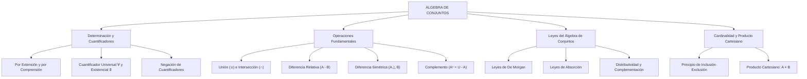

## 1. MARCO CONCEPTUAL Y ONTOLOGÍA
## 1. FICHA TÉCNICA Y MATRIZ DE COMPETENCIAS

| Parámetro | Especificación Oficial |
| :--- | :--- |
| **Eje Temático** | EJE II: Matemática |
| **Asignatura / Componente** | Álgebra |
| **Tema Oficial N.°** | Tema I: Conjuntos y operaciones |
| **Referencia Prospecto UNSA** | Resolución de Consejo Universitario N.° 0028-2026 (Págs. 9, 44-45) |
| **Ponderación por Pregunta** | **Ingenierías:** 1.658337400 pts (4 preg. = 6.633350 pts) **Biomédicas:** 1.265447400 pts (3 preg. = 3.796342 pts) **Sociales:** 0.824574000 pts (3 preg. = 2.473722 pts) |
| **Nivel de Complejidad Cognitiva** | Bloom: Análisis Lógico-Algebraico, Demostración Formal y Resolución Estructural |
| **Conexión Interuniversitaria** | **UNSA:** Simplificación booleana de expresiones conjuntistas complejas, cuantificadores con negación y problemas de 3 conjuntos con regiones vacías. **UNMSM (DECO):** Encuestas poblacionales de mercado, análisis epidemiológico de comorbilidades y optimización de grupos focales. **UNI:** Demostración axiomática de leyes de absorción y De Morgan en reticulados booleanos, producto cartesiano infinito y familias indexadas de conjuntos. |

### Matriz de Indicadores de Logro Evaluados
1. **Lógica de Cuantificadores y Determinación de Conjuntos:** Expresar y negar proposiciones cuantificadas universalmente (\forall) y existencialmente (\exists) en universos numéricos.
2. **Álgebra Booleana de Conjuntos:** Demostrar y aplicar las leyes del álgebra de conjuntos (idempotencia, De Morgan, distributividad y absorción) para simplificar esquemas complejos sin diagramas.
3. **Cardinalidad y Operaciones Combinadas:** Resolver problemas de cardinalidad de dos y tres conjuntos utilizando el principio de inclusión-exclusión y diagramas de Venn-Euler y Carroll.
4. **Producto Cartesiano y Relaciones:** Construir el producto cartesiano A \times B, determinar su cardinal n(A \times B) = n(A) \cdot n(B) y analizar sus propiedades en el plano \mathbb{R}^2.

---

## 2. MAPA TAXONÓMICO Y ONTOLOGÍA

---

## 2. DESARROLLO TEÓRICO FORMAL - PARTE I
### 3. DESARROLLO TEÓRICO FORMAL

### 3.1 Noción Primitiva y Cuantificadores Lógicos en Álgebra
Un conjunto es una colección bien definida de objetos llamados **elementos**. La relación de **pertenencia** (\in) vincula exclusivamente un elemento con un conjunto:
x \in A \quad (x \text{ pertenece a } A)

#### Determinación de Conjuntos
1. **Por Extensión (Forma Tabular):** Se enumeran explícitamente todos sus elementos: A = \{2, 3, 5, 7, 11\}.
2. **Por Comprensión (Forma Constructiva):** Se enuncia la propiedad común definitoria:
   A = \{x \in \mathbb{U} \mid P(x)\}

#### Cuantificadores Lógicos
* **Cuantificador Universal (\forall):** "Para todo", "para cualquier", "para cada".
  \forall x \in A: P(x) \iff P(x_1) \land P(x_2) \land \dots \land P(x_n)
* **Cuantificador Existencial (\exists):** "Existe al menos un", "para algún".
  \exists x \in A: P(x) \iff P(x_1) \lor P(x_2) \lor \dots \lor P(x_n)
* **Leyes de Negación de Cuantificadores:**
  \sim[\forall x \in A: P(x)] \equiv \exists x \in A: \sim P(x)
  \sim[\exists x \in A: P(x)] \equiv \forall x \in A: \sim P(x)

---

### 3.2 Operaciones Fundamentales entre Conjuntos

1. **Unión (\cup):**
   A \cup B = \{x \mid x \in A \lor x \in B\}
2. **Intersección (\cap):**
   A \cap B = \{x \mid x \in A \land x \in B\}
3. **Diferencia Relativa (A - B):**
   A - B = \{x \mid x \in A \land x \notin B\} = A \cap B^c
4. **Complemento (A^c o A' o \complement A):**
   A^c = \{x \in \mathbb{U} \mid x \notin A\} = \mathbb{U} - A
5. **Diferencia Simétrica (A \triangle B):**
   A \triangle B = (A \cup B) - (A \cap B) = (A - B) \cup (B - A)
   A \triangle B = \{x \mid (x \in A \land x \notin B) \lor (x \in B \land x \notin A)\}

---

### 3.3 Leyes del Álgebra de Conjuntos (Estructura de Álgebra de Boole)

| Denominación de la Ley | Operación con Unión (\cup) | Operación con Intersección (\cap) |
| :--- | :--- | :--- |

## 3. FORMULARIO FUNDAMENTAL Y LEYES BASE
### 4. FORMULARIO MAESTRO (LATEX ESTRICTO)

| Ley / Identidad | Expresión Matemática Rigurosa |
| :--- | :--- |
| **Negación Universal** | \sim[\forall x: P(x)] \equiv \exists x: \sim P(x) |
| **Negación Existencial** | \sim[\exists x: P(x)] \equiv \forall x: \sim P(x) |
| **Leyes de De Morgan** | (A \cup B)^c = A^c \cap B^c, \quad (A \cap B)^c = A^c \cup B^c |
| **Absorción Total** | A \cup (A \cap B) = A, \quad A \cap (A \cup B) = A |

## Conjuntos: notación, pertenencia e inclusión

Un conjunto reúne elementos definidos por una condición. Por extensión, A = {2, 4, 6}; por comprensión, A = {x ∈ ℕ : x es par y 2 ≤ x ≤ 6}. Las llaves representan el conjunto; ∈ relaciona un elemento con un conjunto y ⊆ relaciona dos conjuntos. Por ello, 2 ∈ A y {2, 4} ⊆ A son afirmaciones distintas. El conjunto vacío es subconjunto de cualquier conjunto, pero no necesariamente es un elemento suyo.

La unión A ∪ B reúne lo que pertenece a alguno; la intersección A ∩ B exige pertenecer a ambos. A − B conserva elementos de A que no están en B. El complemento depende del universo U elegido: no puede determinarse sin saber qué elementos se consideran posibles. En un diagrama de Venn, sombrea primero la condición y después tradúcela a símbolos.

Los irracionales son números reales que no pueden expresarse como cociente de enteros con denominador distinto de cero. Su desarrollo decimal es infinito no periódico: √2 y π son ejemplos. Un decimal periódico sí es racional. Se cumple ℝ = ℚ ∪ (ℝ − ℚ), sin elementos comunes entre racionales e irracionales.
