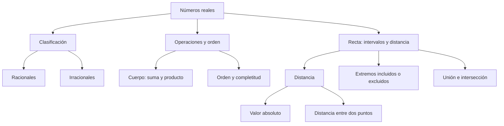

# Números reales, intervalos y distancia

## Introducción
La recta real permite ordenar números, describir rangos y expresar distancias. Un número negativo puede representar una posición a la izquierda de cero, pero una distancia nunca es negativa. Mantener esa diferencia ayuda a comprender el valor absoluto y a evitar errores al operar con signos.

En este nivel se revisan los números racionales e irracionales, las operaciones de los reales, el orden y los intervalos. Las propiedades se aplican bajo sus condiciones: no existe inverso multiplicativo de cero y los símbolos de infinito no son extremos reales que puedan incluirse en un intervalo.

## 2.1.1 · Racionales e irracionales en la recta
Un número **racional** se puede expresar como $p/q$, con $p$ y $q$ enteros y $q\ne0$. Esto incluye enteros, fracciones y decimales finitos o periódicos. El mismo racional admite diferentes escrituras: $1/2=2/4=0.5$. Las escrituras no representan tres puntos diferentes.

Un número **irracional** no admite esa expresión como cociente de enteros. Su desarrollo decimal es infinito y no periódico. Por ejemplo, $\sqrt{2}$ es irracional. Escribir una aproximación como $1.414$ no lo transforma en racional: el decimal finito es un racional próximo, no el valor exacto de la raíz.

Los racionales y los irracionales forman, sin superponerse, el conjunto de los reales: $\mathbb{R}=\mathbb{Q}\cup(\mathbb{R}\setminus\mathbb{Q})$. Cada real corresponde a una posición de la recta. Que un número tenga muchas cifras decimales escritas no demuestra que sea irracional; importa la naturaleza del desarrollo completo o una justificación exacta.

| Número o expresión | Clasificación | Razón |
| --- | --- | --- |
| $-4$ | Racional | Se escribe como $-4/1$. |
| $5/6$ | Racional | Es un cociente de enteros con denominador no nulo. |
| $0.125$ | Racional | Equivale exactamente a $1/8$. |
| $\sqrt{2}$ | Irracional | No puede expresarse como cociente de enteros. |

Para sumar fracciones se requiere un denominador común. En $4/3+5/6$, el denominador $6$ permite escribir $4/3=8/6$. Entonces $8/6+5/6=13/6$. Se suman numeradores de fracciones equivalentes, no los denominadores originales.

Otra comprobación útil es $2+7/6=12/6+7/6=19/6$. La parte entera también debe expresarse con el mismo denominador si se quiere combinar todo en una fracción. Una aproximación decimal puede orientar, pero la fracción conserva el resultado exacto.

## 2.1.2 · Operaciones, orden y completitud
La suma y el producto de reales vuelven a ser reales. Ambas operaciones son asociativas y conmutativas; además, el producto se distribuye respecto de la suma. Cero es el neutro aditivo y uno es el neutro multiplicativo. Cada real tiene un opuesto aditivo; solo los reales distintos de cero tienen inverso multiplicativo.

No confundas **opuesto** e **inverso**. El opuesto de $4/5$ es $-4/5$ porque su suma con $4/5$ da cero. Su inverso es $5/4$ porque su producto da uno. Invertir una fracción no consiste en cambiarle el signo.

| Propiedad | Escritura | Condición o interpretación |
| --- | --- | --- |
| Opuesto aditivo | $a+(-a)=0$ | Existe para todo real $a$. |
| Inverso multiplicativo | $a\cdot(1/a)=1$ | Requiere $a\ne0$. |
| Distributividad | $a(b+c)=ab+ac$ | Es válida para reales. |
| Orden al sumar | $a<b\Rightarrow a+c<b+c$ | Se suma la misma cantidad a ambos miembros. |
| Orden al multiplicar | $a<b,\ c<0\Rightarrow ac>bc$ | Un factor negativo invierte la desigualdad. |

Restar un negativo equivale a sumar su opuesto: $6-(-4)=6+4=10$. No basta con contar signos visibles; hay que reconocer qué operación se aplica. En cambio, $(-6)-4=-10$: aquí se resta un positivo a una cantidad negativa.

El orden compara posiciones. Entre dos reales diferentes, uno es menor que el otro; la relación es transitiva. Si $a<b$ y $b<c$, entonces $a<c$. Sobre la recta, multiplicar por una cantidad negativa invierte la orientación y explica por qué cambia el signo de una desigualdad.

La **completitud** se expresa mediante el principio del supremo: un conjunto no vacío de reales que tenga una cota superior posee una menor cota superior real. No afirma que todo conjunto tenga máximo. Por ejemplo, $(0,1)$ tiene supremo $1$, pero no contiene ese número y por tanto no tiene máximo.

Conviene distinguir las palabras: una cota superior puede quedar por encima de todo el conjunto sin ser la menor; el supremo es la menor de esas cotas; el máximo, si existe, pertenece al conjunto. Para $[0,1]$, el número $1$ es simultáneamente máximo y supremo. En $(0,1)$ solo es supremo.

## 2.1.3 · Intervalos y operaciones entre conjuntos
Un **intervalo** contiene todos los reales situados entre cualesquiera dos de sus puntos. Los extremos finitos pueden pertenecer o no al conjunto. El paréntesis indica exclusión y el corchete, inclusión. En algunos materiales se usan paréntesis angulares para los intervalos abiertos; aquí se mantienen los paréntesis ordinarios.

| Condición | Intervalo | Lectura |
| --- | --- | --- |
| $-2<x<4$ | $(-2,4)$ | No incluye ninguno de los extremos. |
| $-2\le x\le4$ | $[-2,4]$ | Incluye ambos extremos. |
| $-2\le x<4$ | $[-2,4)$ | Incluye solo el extremo izquierdo. |
| $x\ge-2$ | $[-2,+\infty)$ | Se prolonga sin cota superior. |
| $x<4$ | $(-\infty,4)$ | Se prolonga sin cota inferior. |

Los símbolos $+\infty$ y $-\infty$ indican que el recorrido no está acotado en una dirección. No son números reales ni se encierran con un corchete de inclusión. Toda la recta se escribe $(-\infty,+\infty)=\mathbb{R}$.

La **unión** reúne lo que pertenece a uno u otro conjunto; la **intersección** exige pertenecer a ambos. La **diferencia** retira del primer conjunto los elementos del segundo. Para el complemento se debe indicar el universo; en este tema se utiliza la recta real cuando no se establece otro.

Toma $A=[-2,3)$ y $B=(1,5]$. Entonces $A\cap B=(1,3)$: el extremo $1$ no pertenece a $B$ y $3$ no pertenece a $A$. La unión es $[-2,5]$, porque los conjuntos se superponen y no dejan un hueco intermedio. La diferencia $A\setminus B=[-2,1]$ conserva $1$, ya que ese número no se elimina al no pertenecer a $B$.

Los casos de un solo punto también importan. Se puede escribir $[a,a]=\{a\}$. En cambio, $(a,a)$ es vacío. Dos intervalos pueden tocarse sin superponerse: $(0,1)$ y $(1,2)$ no contienen $1$, de modo que su unión no equivale a $(0,2)$.

## 2.1.4 · Valor absoluto como distancia
El **valor absoluto** de $x$ es su distancia a cero. Por definición, $\lvert x\rvert=x$ cuando $x\ge0$ y $\lvert x\rvert=-x$ cuando $x<0$. La segunda expresión también es no negativa: si $x=-4$, entonces $-x=4$.

La distancia entre dos reales $a$ y $b$ es $\lvert a-b\rvert$. No depende del orden de los puntos porque $\lvert a-b\rvert=\lvert b-a\rvert$. Entre $-4$ y $5$ hay $\lvert5-(-4)\rvert=9$ unidades, y entre $-5$ y $6$ hay $11$.

| Expresión | Resultado | Interpretación |
| --- | --- | --- |
| $\lvert-4\rvert$ | $4$ | Distancia de $-4$ a cero. |
| $\lvert-4\rvert-\lvert5\rvert$ | $-1$ | Diferencia de dos distancias; puede ser negativa. |
| $\lvert5-(-4)\rvert$ | $9$ | Distancia entre dos posiciones. |
| $\sqrt{x^2}$ | $\lvert x\rvert$ | La raíz cuadrada principal es no negativa. |

La expresión $\lvert x-a\rvert$ mide distancia respecto de un **centro** $a$. Pedir $\lvert x-a\rvert\le r$, con $r\ge0$, significa buscar puntos cuya distancia al centro no supere $r$. Los límites son $a-r$ y $a+r$. El gráfico de esta sección permite cambiar el centro, la distancia y la inclusión de esos extremos.

No confundas $\lvert a-b\rvert$ con $\lvert a\rvert-\lvert b\rvert$. Para $a=-4$ y $b=5$, la primera expresión vale $9$ y la segunda vale $-1$. La diferencia de distancias a cero no es la distancia entre los puntos.

La desigualdad triangular establece $\lvert a+b\rvert\le\lvert a\rvert+\lvert b\rvert$. La suma de dos desplazamientos puede compensarse: con $a=-4$ y $b=5$, el módulo de la suma es $1$, mientras la suma de los módulos es $9$. Esta propiedad se utilizará para comparar y acotar expresiones.

## Importante
El inverso multiplicativo exige un número distinto de cero. Infinito no es un extremo real incluido. Un intervalo que omite su cota puede tener supremo sin máximo. El valor absoluto es no negativo, pero la diferencia de dos valores absolutos puede ser negativa. Para una distancia entre puntos, toma primero la diferencia de sus posiciones y después su valor absoluto.

## Síntesis
Los reales permiten operar y ordenar posiciones en una recta completa. Los intervalos expresan rangos con extremos incluidos o excluidos, y sus operaciones se justifican por pertenencia. El valor absoluto permite pasar de posiciones con signo a distancias no negativas. Antes de calcular, identifica qué representa cada expresión y bajo qué condiciones es válida la operación.
