## 1. MARCO CONCEPTUAL Y ONTOLOGÍA
## 1. FICHA TÉCNICA Y MATRIZ DE COMPETENCIAS

| Parámetro | Especificación Oficial |
| :--- | :--- |
| **Eje Temático** | EJE II: Matemática |
| **Asignatura / Componente** | Álgebra |
| **Tema Oficial N.°** | Tema II: Números reales (\mathbb{R}): recta numérica, intervalos, operaciones, valor absoluto |
| **Referencia Prospecto UNSA** | Resolución de Consejo Universitario N.° 0028-2026 (Págs. 9, 44-45) |
| **Ponderación por Pregunta** | **Ingenierías:** 1.658337400 pts (4 preg. = 6.633350 pts) **Biomédicas:** 1.265447400 pts (3 preg. = 3.796342 pts) **Sociales:** 0.824574000 pts (3 preg. = 2.473722 pts) |
| **Nivel de Complejidad Cognitiva** | Bloom: Análisis Topológico, Modelado Desigual y Demostración en Cuerpos Ordenados |
| **Conexión Interuniversitaria** | **UNSA:** Operaciones con intervalos continuos, ecuaciones e inecuaciones con valor absoluto y axioma del supremo. **UNMSM (DECO):** Tolerancias de manufactura en ingeniería mecánica (|x - x_0| \le \epsilon), rangos de calibración térmica y márgenes de error en metrología. **UNI:** Completitud de Dedekind/Cantor, demostración rigurosa de desigualdades de Cauchy-Schwarz y medias geométrica-aritmética en \mathbb{R}^+. |

### Matriz de Indicadores de Logro Evaluados
1. **Estructura de Cuerpo Ordenado Completo:** Demostrar y aplicar los axiomas de cuerpo conmutativo, axiomas de orden y axioma del supremo (completitud de \mathbb{R}).
2. **Topología de Intervalos en la Recta Real:** Operar algebraicamente intervalos abiertos, cerrados, semiabiertos y no acotados mediante unión, intersección, diferencia y complemento.
3. **Ecuaciones e Inecuaciones con Valor Absoluto:** Resolver analíticamente expresiones modales |P(x)| = Q(x) y |P(x)| \le Q(x) utilizando propiedades y partición en zonas críticas.
4. **Desigualdades Notables:** Aplicar teoremas de positividad, transitividad y la desigualdad de las medias (MA \ge MG) para acotar expresiones algebraicas.

---

## 2. MAPA TAXONÓMICO Y ONTOLOGÍA

```mermaid
graph TD
    A["SISTEMA DE LOS NÚMEROS REALES ℝ"] --> B["Axiomática y Recta Real"]
    A --> C["Teoría de Intervalos"]
    A --> D["Valor Absoluto"]
    A --> E["Desigualdades Notables"]

    B --> B1["ℝ = ℚ ∪ 𝕀 (Cuerpo Ordenado Completo)"]
    B --> B2["Axiomas de Adición y Multiplicación"]
    B --> B3["Axiomas de Orden: Tricotomía y Transitividad"]
    B --> B4["Axioma de Completitud: Supremo e Ínfimo"]

    C --> C1["Intervalos Acotados: Abiertos, Cerrados, Mixtos"]
    C --> C2["Intervalos No Acotados: Hacia ±∞"]
    C --> C3["Operaciones: ∪, ∩, -, Complemento"]

    D --> D1["Definición por Ramas: |x|"]
    D --> D2["Teoremas: |x| = b ⇔ b ≥ 0 ∧ (x = b ∨ x = -b)"]
    D --> D3["Inecuaciones: |x| ≤ b y |x| ≥ b"]
    D --> D4["Desigualdad Triangular: |a + b| ≤ |a| + |b|"]

    E --> E1["x + 1/x ≥ 2 (para x > 0)"]
    E --> E2["Media Aritmética ≥ Media Geométrica"]
```

---

## 2. DESARROLLO TEÓRICO FORMAL - PARTE I
### 3. DESARROLLO TEÓRICO FORMAL

### 3.1 Estructura Axiomática de los Números Reales (\mathbb{R})
El conjunto de los números reales \mathbb{R} es la unión disjunta de los números racionales \mathbb{Q} y los irracionales \mathbb{I} (\mathbb{R} = \mathbb{Q} \cup \mathbb{I}, \mathbb{Q} \cap \mathbb{I} = \emptyset).
El sistema (\mathbb{R}, +, \cdot, \le) se define formalmente como un **cuerpo conmutativo ordenado y completo**.

#### 1. Axiomas de Cuerpo Conmutativo
* **Para la adición (+):** Clausura, conmutatividad, asociatividad, elemento neutro aditivo (0) y opuesto aditivo (-a).
* **Para la multiplicación (\cdot):** Clausura, conmutatividad, asociatividad, elemento neutro multiplicativo (1 \neq 0) e inverso multiplicativo (a^{-1} = \frac{1}{a} para todo a \neq 0).
* **Distributividad:** a \cdot (b + c) = a \cdot b + a \cdot c.

#### 2. Axiomas de Orden
Existe un subconjunto no vacío \mathbb{R}^+ \subset \mathbb{R} (reales positivos) tal que:
* Si a, b \in \mathbb{R}^+ \implies a + b \in \mathbb{R}^+ y a \cdot b \in \mathbb{R}^+.
* **Ley de Tricotomía:** Para todo a \in \mathbb{R}, se cumple exactamente una de las siguientes proposiciones:
  a \in \mathbb{R}^+ \quad \lor \quad a = 0 \quad \lor \quad -a \in \mathbb{R}^+
Se define la relación "a < b" como b - a \in \mathbb{R}^+.

#### 3. Axioma de Completitud (Axioma del Supremo)
Todo conjunto no vacío de números reales que esté acotado superiormente posee un **supremo** (mínima cota superior) en \mathbb{R}.
*Este axioma distingue formalmente a \mathbb{R} de \mathbb{Q} y garantiza que la recta numérica no posea "huecos" o discontinuidades.*

---

### 3.2 Intervalos en la Recta Real y Operatoria
Un intervalo es un subconjunto conexo de \mathbb{R} comprendido entre dos puntos extremos a y b (a \le b):

| Tipo de Intervalo | Notación de Conjunto | Notación de Intervalo | Representación Gráfica |
| :--- | :--- | :---: | :---: |
| **Abierto** | \{x \in \mathbb{R} \mid a < x < b\} | \langle a, b \rangle o (a, b) | Extremos sin pintar (\circ) |
| **Cerrado** | \{x \in \mathbb{R} \mid a \le x \le b\} | [a, b] | Extremos pintados (\bullet) |
| **Semiabierto a la derecha** | \{x \in \mathbb{R} \mid a \le x < b\} | [a, b\rangle | Cerrado en a, abierto en b |
| **Semiabierto a la izquierda** | \{x \in \mathbb{R} \mid a < x \le b\} | \langle a, b] | Abierto en a, cerrado en b |
| **No acotado superiormente** | \{x \in \mathbb{R} \mid x \ge a\} | [a, +\infty\rangle | Rayo hacia +\infty |
| **No acotado inferiormente** | \{x \in \mathbb{R} \mid x < b\} | \langle -\infty, b\rangle | Rayo hacia -\infty |
| **Toda la recta real** | \{x \in \mathbb{R}\} | \langle -\infty, +\infty\rangle = \mathbb{R} | Recta completa |

---

### 3.3 Valor Absoluto en \mathbb{R}
Función denotada por |\cdot|: \mathbb{R} \to \mathbb{R}_0^+ definida formalmente por ramas:
|x| = \begin{cases} x, & \text{si } x \ge 0 \\ -x, & \text{si } x < 0 \end{cases}

#### Teoremas y Propiedades Fundamentales

## 3. FORMULARIO FUNDAMENTAL Y LEYES BASE
### 4. FORMULARIO MAESTRO (LATEX ESTRICTO)

| Teorema / Identidad | Expresión Matemática Rigurosa |
| :--- | :--- |
| **Identidad Fundamental** | \sqrt{x^2} = |x| |
| **Ecuación |A| = B** | |A| = B \iff B \ge 0 \land (A = B \lor A = -B) |
| **Ecuación |A| = |B|** | |A| = |B| \iff (A - B)(A + B) = 0 |
| **Inecuación |A| \le B** | |A| \le B \iff B \ge 0 \land -B \le A \le B |
