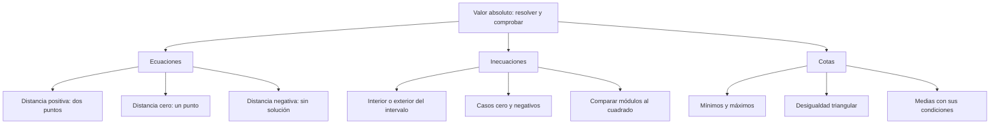

# Ecuaciones, inecuaciones y cotas con valor absoluto

## Introducción
Una expresión con valor absoluto se puede interpretar como una distancia o analizar según el signo de su interior. Ambas vías son válidas. La elección depende del problema: lo importante es conservar las condiciones que hacen equivalente cada transformación.

Antes de separar casos, observa el término con el que se compara la distancia. Una distancia no puede ser negativa. El caso cero tampoco se comporta exactamente como una distancia positiva: puede dar un único punto, el conjunto vacío, toda la recta o dos rayos abiertos, según el signo de la relación.

## 2.2.1 · Ecuaciones de distancia
La ecuación $\lvert x-a\rvert=r$ pide posiciones que estén exactamente a distancia $r$ del centro $a$. Si $r>0$, hay dos: $x=a-r$ y $x=a+r$. Si $r=0$, ambas expresiones coinciden y solo queda $x=a$. Si $r<0$, no existe una distancia real que cumpla la condición.

| Condición de r | Solución de $\lvert x-a\rvert=r$ | Interpretación |
| --- | --- | --- |
| $r>0$ | $\{a-r,a+r\}$ | Dos puntos a la misma distancia del centro. |
| $r=0$ | $\{a\}$ | Un solo punto, el centro. |
| $r<0$ | $\varnothing$ | Una distancia no puede ser negativa. |

**Ejemplo resuelto.** Para $\lvert x-4\rvert=5$, el centro es $4$ y la distancia es $5$. Se obtiene $x=4-5=-1$ o $x=4+5=9$. La mayor solución es $9$, pero el conjunto completo contiene los dos valores. Al comprobar, $\lvert-1-4\rvert=5$ y $\lvert9-4\rvert=5$.

Si se tiene $\lvert A(x)\rvert=B(x)$, antes de elegir ramas debe imponerse $B(x)\ge0$ y conservar el dominio de las expresiones. Después se resuelven $A(x)=B(x)$ y $A(x)=-B(x)$, manteniendo solo los resultados que cumplen la condición y el enunciado original.

Por ejemplo, $\lvert3x-5\rvert=2x-10$ exige $x\ge5$. La primera rama da $x=-5$ y la segunda $x=3$. Ninguno cumple esa condición. Por tanto, el conjunto solución es vacío; no corresponde aceptar las dos raíces obtenidas por cálculo sin verificarlas.

La equivalencia $\lvert A\rvert=\lvert B\rvert$ puede expresarse como $A=B$ o $A=-B$, para valores reales definidos. También equivale a $A^2=B^2$. En cambio, quitar directamente ambos valores absolutos dejando solo $A=B$ descartaría una rama posible.

## 2.2.2 · Inecuaciones: interior, exterior y extremos
Para $r>0$, $\lvert x-a\rvert<r$ pide el interior del intervalo $(a-r,a+r)$. Con $\le$ se incluyen los extremos. Las relaciones $>$ y $\ge$ piden puntos exteriores, sin olvidar si la distancia exacta está admitida.

| Relación, con $r>0$ | Forma equivalente | Solución |
| --- | --- | --- |
| $\lvert x-a\rvert<r$ | $a-r<x<a+r$ | $(a-r,a+r)$ |
| $\lvert x-a\rvert\le r$ | $a-r\le x\le a+r$ | $[a-r,a+r]$ |
| $\lvert x-a\rvert>r$ | $x<a-r$ o $x>a+r$ | $(-\infty,a-r)\cup(a+r,+\infty)$ |
| $\lvert x-a\rvert\ge r$ | $x\le a-r$ o $x\ge a+r$ | $(-\infty,a-r]\cup[a+r,+\infty)$ |

**Ejemplo resuelto.** En $\lvert x-4\rvert<5$, se obtiene $-1<x<9$. Los extremos no se incluyen: los enteros posibles son $0,1,2,3,4,5,6,7,8$, nueve en total. Contar desde $-1$ hasta $9$ como si el intervalo fuera cerrado daría una respuesta distinta y equivocada.

El caso $r=0$ requiere su propia lectura. $\lvert x-a\rvert<0$ no tiene soluciones; $\lvert x-a\rvert\le0$ solo admite el centro; $\lvert x-a\rvert>0$ admite todos los reales salvo el centro; $\lvert x-a\rvert\ge0$ admite toda la recta. Los dos rayos de esta última relación no deben describirse como disjuntos, pues juntos ya incluyen todo.

Si $r<0$, las relaciones $\lvert x-a\rvert<r$ y $\lvert x-a\rvert\le r$ son imposibles. Las relaciones $\lvert x-a\rvert>r$ y $\lvert x-a\rvert\ge r$ son verdaderas para todo $x$ real. La regla gráfica de interior y exterior presupone una distancia no negativa y no debe aplicarse sin revisar ese dato.

| Comparación con cero | Solución | Razón |
| --- | --- | --- |
| $\lvert x-a\rvert<0$ | $\varnothing$ | El valor absoluto no es negativo. |
| $\lvert x-a\rvert\le0$ | $\{a\}$ | Solo una distancia nula cumple. |
| $\lvert x-a\rvert>0$ | $\mathbb{R}\setminus\{a\}$ | Se excluye únicamente el centro. |
| $\lvert x-a\rvert\ge0$ | $\mathbb{R}$ | La propiedad vale para cualquier real. |

## 2.2.3 · Comparación de módulos y análisis de signos
Elevar al cuadrado conserva una comparación entre cantidades **no negativas**: para $u,v\ge0$, $u<v$ equivale a $u^2<v^2$. Esto permite comparar dos valores absolutos, pero no legitima elevar cualquier desigualdad al cuadrado sin examinar los signos.

Resuelve $\lvert2x-3\rvert<\lvert x+4\rvert$. Como ambos miembros son no negativos, se puede escribir $(2x-3)^2<(x+4)^2$. Al pasar todo a la izquierda y factorizar la diferencia de cuadrados, queda $(x-7)(3x+1)<0$.

Los puntos críticos son $-1/3$ y $7$. Entre ellos el primer factor es negativo y el segundo positivo, por lo que el producto es negativo. Fuera de ese intervalo ambos factores tienen el mismo signo. Como la relación es estricta, no se incluyen los puntos donde el producto se anula: $x\in(-1/3,7)$.

Este procedimiento no vuelve incorrecto el análisis por regiones de signo del interior de los módulos. Ambos métodos pueden ser válidos. Debe elegirse el que permita una solución clara y verificable, no descartar un procedimiento correcto por presentarlo como menos rápido.

Una segunda precaución aparece al multiplicar por una variable de signo desconocido. En $1/x<2$, el dominio exige $x\ne0$. No se puede pasar de inmediato a $1<2x$ para todo el dominio. Si $x<0$, el cociente ya es negativo y satisface la relación. Si $x>0$, se obtiene $x>1/2$. La solución es $(-\infty,0)\cup(1/2,+\infty)$.

## 2.2.4 · Cotas, extremos y desigualdades
Como $\lvert x-a\rvert\ge0$, la expresión $\lvert x-a\rvert+k$ tiene mínimo $k$, alcanzado en $x=a$. A su vez, $k-\lvert x-a\rvert$ tiene máximo $k$, alcanzado en el mismo punto. El signo que acompaña al valor absoluto determina si se busca un mínimo o un máximo.

| Expresión, con x real | Extremo | Dónde se alcanza |
| --- | --- | --- |
| $\lvert x-4\rvert+5$ | Mínimo $5$ | $x=4$ |
| $5-\lvert x-4\rvert$ | Máximo $5$ | $x=4$ |
| $\lvert x-5\rvert+6$ | Mínimo $6$ | $x=5$ |
| $6-\lvert x-5\rvert$ | Máximo $6$ | $x=5$ |

No se afirma que la primera expresión tenga también máximo o que la segunda tenga mínimo en toda la recta. El valor absoluto puede crecer sin cota cuando $x$ se aleja del centro. Una gráfica o un ejemplo numérico ayudan a distinguir qué extremo está garantizado.

La **desigualdad triangular** establece $\lvert a+b\rvert\le\lvert a\rvert+\lvert b\rvert$; la igualdad se produce cuando $ab\ge0$. La desigualdad inversa da $\lvert a-b\rvert\ge\bigl\lvert\lvert a\rvert-\lvert b\rvert\bigr\rvert$. Ambas comparan distancias y no justifican reemplazar siempre un módulo de suma por la suma de módulos.

De $(a-b)^2\ge0$ se obtiene $a^2+b^2\ge2ab$. Para $a,b\ge0$ se deduce la desigualdad entre media aritmética y geométrica: $(a+b)/2\ge\sqrt{ab}$, con igualdad cuando $a=b$. Si además se emplea la media armónica $2ab/(a+b)$, conviene trabajar con $a,b>0$ para que toda la cadena quede definida sin casos adicionales.

Para $x>0$, $x+1/x\ge2$; para $x<0$, $x+1/x\le-2$. No es válido borrar la condición de signo y usar la primera cota para todo real no nulo. Por ejemplo, $x=-1$ produce $-2$, no una cantidad mayor o igual que $2$.

## Aplicación con datos supuestos
Supón que una pieza debe medir $50$ mm y se admite una desviación máxima de $0.08$ mm. El modelo es $\lvert D-50\rvert\le0.08$, de donde $49.92\le D\le50.08$. Se incluyen los límites porque la desviación máxima también está permitida. Es un ejemplo construido para estudiar tolerancia; no se atribuye a una empresa o especificación industrial real.

## Importante
Revisa el dominio y el signo del término comparado con el valor absoluto. Cero y los valores negativos merecen casos explícitos. Elevar al cuadrado una comparación exige condiciones; multiplicar una desigualdad por una cantidad negativa invierte su orientación. Comprueba los candidatos en la expresión original y distingue extremos alcanzados de cotas que no pertenecen al conjunto.

## Síntesis
Interpretar valor absoluto como distancia explica ecuaciones, intervalos y casos límite. La factorización y el análisis de signos permiten comparaciones más complejas, mientras la no negatividad proporciona cotas y extremos. Cada transformación debe conservar su ámbito de validez: una regla aplicada sin sus condiciones puede cambiar el conjunto solución.
