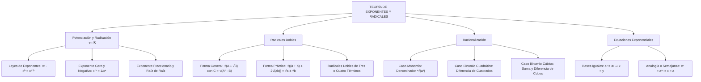

## 1. MARCO CONCEPTUAL Y ONTOLOGÍA
## 1. FICHA TÉCNICA Y MATRIZ DE COMPETENCIAS

| Parámetro | Especificación Oficial |
| :--- | :--- |
| **Eje Temático** | EJE II: Matemática |
| **Asignatura / Componente** | Álgebra |
| **Tema Oficial N.°** | Tema III: Potenciación y radicación: propiedades, racionalización |
| **Referencia Prospecto UNSA** | Resolución de Consejo Universitario N.° 0028-2026 (Págs. 9, 44-45) |
| **Ponderación por Pregunta** | **Ingenierías:** 1.658337400 pts (4 preg. = 6.633350 pts) **Biomédicas:** 1.265447400 pts (3 preg. = 3.796342 pts) **Sociales:** 0.824574000 pts (3 preg. = 2.473722 pts) |
| **Nivel de Complejidad Cognitiva** | Bloom: Análisis Operativo, Transformación de Estructuras Irracionales y Cálculo Algebraico |
| **Conexión Interuniversitaria** | **UNSA:** Transformación de radicales dobles a simples, ecuaciones exponenciales con analogía y racionalización con binomios cúbicos. **UNMSM (DECO):** Modelación del decaimiento radiactivo mediante exponentes fraccionarios y simplificación de circuitos de impedancia irracional. **UNI:** Racionalización de denominadores de la forma \sqrt[n]{a} \pm \sqrt[n]{b}, límites algebraicos con indeterminación 0/0 y radicales anidados infinitos. |

### Matriz de Indicadores de Logro Evaluados
1. **Teoría de Exponentes Rigurosa:** Aplicar con precisión los teoremas de potenciación y radicación en \mathbb{R}, evitando indeterminaciones (0^0) y raíces de índice par de números negativos.
2. **Transformación de Radicales Dobles a Simples:** Descomponer radicales de la forma \sqrt{A \pm \sqrt{B}} y de la forma práctica \sqrt{(a+b) \pm 2\sqrt{ab}} en sumas o diferencias de radicales simples.
3. **Técnicas Avanzadas de Racionalización:** Determinar el factor racionalizante (FR) para denominadores monomios, binomios cuadráticos, binomios cúbicos y expresiones de orden superior.
4. **Resolución de Ecuaciones Exponenciales:** Resolver igualdades trascendentes elementales mediante criterios de bases iguales, exponentes iguales y analogía estructural.

---

## 2. MAPA TAXONÓMICO Y ONTOLOGÍA

---

## 2. DESARROLLO TEÓRICO FORMAL - PARTE I
### 3. DESARROLLO TEÓRICO FORMAL

### 3.1 Potenciación en \mathbb{R}
Operación algebraica que consiste en encontrar una cantidad llamada **potencia** (P), a partir de dos cantidades denominadas **base** (b \in \mathbb{R}) y **exponente** (n):
P = b^n

#### Definiciones Básicas:
1. **Exponente Natural (n \in \mathbb{N}, n \ge 2):**
   b^n = \underbrace{b \cdot b \cdot b \dots b}_{n \text{ factores}}
2. **Exponente Uno:** b^1 = b.
3. **Exponente Cero (b \neq 0):**
   b^0 = 1 \quad (\forall b \in \mathbb{R} \setminus \{0\})
   > [!IMPORTANT]
   > La expresión 0^0 es una **indeterminación matemática** (no está definida en \mathbb{R}).
4. **Exponente Negativo (b \neq 0, n \in \mathbb{Z}^+):**
   b^{-n} = \frac{1}{b^n} = \left(\frac{1}{b}\right)^n
   \left(\frac{a}{b}\right)^{-n} = \left(\frac{b}{a}\right)^n \quad (a \neq 0, b \neq 0)

#### Teoremas Fundamentales de la Potenciación:
1. Multiplicación de bases iguales: x^a \cdot x^b = x^{a+b}
2. División de bases iguales (x \neq 0): \frac{x^a}{x^b} = x^{a-b}
3. Potencia de una multiplicación: (x \cdot y)^n = x^n \cdot y^n
4. Potencia de una división (y \neq 0): \left(\frac{x}{y}\right)^n = \frac{x^n}{y^n}
5. Potencia de potencia: \left(x^a\right)^b = x^{a \cdot b} = \left(x^b\right)^a
   > [!CAUTION]
   > No confundir con la cadena de exponentes: x^{a^b} \neq (x^a)^b. En x^{a^b} se opera de arriba hacia abajo.

---

### 3.2 Radicación en \mathbb{R}
Operación inversa a la potenciación donde, dados el **radicando o cantidad subradical** (a) y el **índice** (n \in \mathbb{Z}^+, n \ge 2), se halla la **raíz** (b):
\sqrt[n]{a} = b \iff b^n = a
* **Regla de Signos en \mathbb{R}:**
  - \sqrt[\text{par}]{+} = +
  - \sqrt[\text{par}]{-} \notin \mathbb{R} (pertenece al cuerpo complejo \mathbb{C})
  - \sqrt[\text{impar}]{+} = +
  - \sqrt[\text{impar}]{-} = -

#### Teoremas Fundamentales de la Radicación:
1. **Exponente Fraccionario:**
   x^{\frac{m}{n}} = \sqrt[n]{x^m} = (\sqrt[n]{x})^m
2. **Raíz de un Producto:**
   \sqrt[n]{x \cdot y} = \sqrt[n]{x} \cdot \sqrt[n]{y}
3. **Raíz de un Cociente (y \neq 0):**
   \sqrt[n]{\frac{x}{y}} = \frac{\sqrt[n]{x}}{\sqrt[n]{y}}
4. **Raíz de Raíz:**
   \sqrt[m]{\sqrt[n]{\sqrt[p]{x}}} = \sqrt[m \cdot n \cdot p]{x}
5. **Radicales Consecutivos (Regla del "Por-Más-Por-Más"):**

## 3. FORMULARIO FUNDAMENTAL Y LEYES BASE
### 4. FORMULARIO MAESTRO (LATEX ESTRICTO)

| Ley / Identidad | Expresión Matemática Rigurosa |
| :--- | :--- |
| **Exponente Negativo** | x^{-n} = \frac{1}{x^n} \quad (x \neq 0) |
| **Exponente Fraccionario** | x^{m/n} = \sqrt[n]{x^m} |
| **Regla del Producto Mixto** | \sqrt[m]{x^a \sqrt[n]{x^b \sqrt[p]{x^c}}} = x^{\frac{(a \cdot n + b)p + c}{mnp}} |
| **Radicales Dobles (General)** | \sqrt{A \pm \sqrt{B}} = \sqrt{\frac{A+C}{2}} \pm \sqrt{\frac{A-C}{2}} \quad (C = \sqrt{A^2 - B}) |
