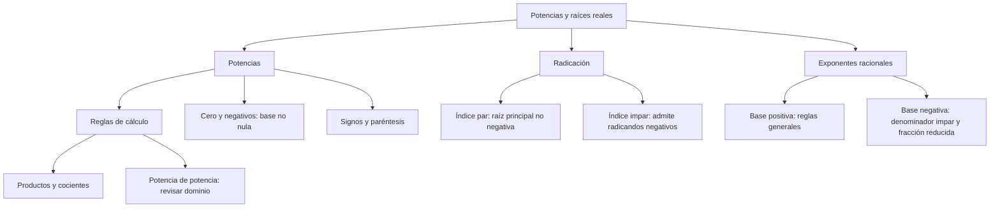

# Potencias y raíces reales: reglas con sus condiciones

## Introducción
Las potencias condensan productos y las raíces permiten recuperar cantidades a partir de una potencia conocida. Sin embargo, no todas las reglas se pueden aplicar a cualquier base y exponente. En los reales, las bases negativas y las raíces de índice par requieren atención particular.

La notación también importa. El signo de una base negativa debe quedar dentro de paréntesis si forma parte de la potencia. La raíz cuadrada principal no representa simultáneamente dos números: $\sqrt{25}=5$, aunque la ecuación $x^2=25$ tenga las soluciones $5$ y $-5$.

## 3.1.1 · Exponentes enteros y signos
Para un entero positivo $n$, la potencia $a^n$ representa un producto de $n$ factores iguales a $a$. En particular, $a^1=a$. Si la base es distinta de cero, se define $a^0=1$. En el marco de estas operaciones algebraicas no se asigna un valor a $0^0$ por la misma regla.

Un exponente negativo indica un **recíproco**, no un cambio de signo: $a^{-n}=1/a^n$, con $a\ne0$ y $n$ entero positivo. Así, $2^{-4}=1/16$ y no $-16$. El denominador no puede ser cero, de modo que $0^{-n}$ no está definido.

| Expresión | Resultado | Justificación |
| --- | --- | --- |
| $2^4$ | $16$ | Producto de cuatro factores iguales a dos. |
| $(-2)^4$ | $16$ | La base negativa está dentro de la potencia par. |
| $-2^4$ | $-16$ | Primero se calcula la potencia y después el opuesto. |
| $(-2)^3$ | $-8$ | Producto de un número impar de factores negativos. |
| $2^{-4}$ | $1/16$ | Recíproco de la cuarta potencia. |

Los paréntesis distinguen $(-2)^4$ de $-2^4$. No se trata de dos modos equivalentes de escribir lo mismo. Para evitar errores, identifica qué parte del enunciado constituye la base antes de aplicar la regla del signo.

En una cadena de exponentes, la agrupación también debe estar clara. $2^{3^2}=2^9=512$ mientras $(2^3)^2=2^6=64$. La segunda es una potencia de potencia; la primera tiene como exponente una potencia completa. No se pueden intercambiar esas estructuras por parecerse sus símbolos.

## 3.1.2 · Reglas de potenciación
Con exponentes enteros, las leyes se justifican por el producto y el recíproco, siempre que las expresiones estén definidas. Si aparece un exponente cero o negativo sobre una base, se conserva la restricción correspondiente. El cociente necesita además denominador distinto de cero.

| Operación | Regla | Condición de este uso |
| --- | --- | --- |
| Producto de base común | $a^m a^n=a^{m+n}$ | Exponentes enteros y expresiones definidas. |
| Cociente de base común | $a^m/a^n=a^{m-n}$ | $a\ne0$. |
| Potencia de producto | $(ab)^n=a^n b^n$ | Entero n y todas las expresiones definidas. |
| Potencia de cociente | $(a/b)^n=a^n/b^n$ | $b\ne0$ y demás restricciones del exponente. |
| Potencia de potencia | $(a^m)^n=a^{mn}$ | Enteros m, n y expresiones definidas. |

**Ejemplo resuelto.** $2^4\cdot2^5=2^{4+5}=2^9=512$. Solo se suman exponentes porque hay un producto con base común. En $2^4+2^5$ hay una suma, y esa misma regla no permite escribir $2^9$.

**Ejemplo resuelto.** $3^5/3^4=3^{5-4}=3$. El denominador es distinto de cero. En $(2^4)^2$, en cambio, se multiplican exponentes: $2^{4\cdot2}=2^8=256$.

Si los exponentes dejan de ser enteros, no se deben conservar estas reglas sin revisar la base. Para bases **positivas** se dispone de las leyes usuales con exponentes reales. Con bases negativas, algunas transformaciones aparentes cambian el significado o hacen aparecer expresiones no definidas en los reales.

Un caso concreto lo muestra: $\bigl((-1)^2\bigr)^{1/2}=\sqrt{1}=1$, pero $(-1)^{2(1/2)}=(-1)^1=-1$. No es una contradicción de la aritmética: se aplicó fuera de sus condiciones una regla generalizada a exponentes fraccionarios sobre base negativa.

## 3.1.3 · Raíces reales y raíz principal
Para índice **impar**, cada real $a$ tiene una única raíz real $b$ que satisface $b^n=a$. Por ejemplo, $\sqrt[3]{64}=4$ y $\sqrt[3]{-64}=-4$. El signo del radicando no impide la existencia de una raíz real de índice impar.

Para índice **par**, el radical real exige un radicando no negativo y designa su raíz **principal**, también no negativa. En particular, $\sqrt{25}=5$. La ecuación $b^2=25$ sí admite dos soluciones, porque pregunta por todos los números cuyo cuadrado es veinticinco.

| Expresión o ecuación | Resultado real | Diferencia relevante |
| --- | --- | --- |
| $\sqrt{25}$ | $5$ | El símbolo radical designa la raíz principal. |
| $b^2=25$ | $b=5$ o $b=-5$ | Se buscan todas las soluciones de una ecuación. |
| $\sqrt{0}$ | $0$ | La raíz principal puede ser cero. |
| $\sqrt{-25}$ | No está definida en los reales | El índice es par y el radicando negativo. |
| $\sqrt[3]{-125}$ | $-5$ | La raíz de índice impar admite radicando negativo. |

La identidad correcta es $\sqrt{x^2}=\lvert x\rvert$. Si $x=-4$, el cuadrado es $16$ y su raíz principal es $4$. Escribir simplemente $\sqrt{x^2}=x$ descartaría la condición de no negatividad de la raíz. El gráfico de esta sección permite comprobarlo con valores positivos, negativos y cero.

En general, para $n$ par se tiene $\sqrt[n]{x^n}=\lvert x\rvert$ y para $n$ impar se tiene $\sqrt[n]{x^n}=x$. Ambas afirmaciones trabajan en los reales. La distinción de paridad no se elimina cancelando visualmente índice y exponente.

Las reglas de producto y cociente de raíces también requieren condiciones. Con índice par, $\sqrt[n]{ab}=\sqrt[n]{a}\sqrt[n]{b}$ se aplica en los reales si $a,b\ge0$; para el cociente, además, $b>0$. Con índice impar, los factores pueden ser negativos y el denominador sigue necesitando ser no nulo.

Por ejemplo, $\sqrt{(-1)(-1)}=1$ está definida, pero $\sqrt{-1}\sqrt{-1}$ no es una expresión real. Separar el radical en ese caso no es una transformación válida dentro del ámbito de la lección.

## 3.1.4 · Exponentes racionales y radicales anidados
Para $a>0$, un exponente racional se interpreta mediante raíces: $a^{m/n}=\sqrt[n]{a^m}=(\sqrt[n]{a})^m$, con $n>0$. Se puede trabajar con exponentes negativos porque la base no es cero. Para la base cero, solo se admiten aquí exponentes positivos.

Con base negativa, la definición real de una potencia racional exige escribir la fracción **reducida** y que su denominador sea impar. Esta precaución evita que dos fracciones equivalentes aparenten producir resultados distintos al llevarse a radicales con índices diferentes.

| Base y exponente | Resultado | Condición |
| --- | --- | --- |
| $16^{3/4}$ | $8$ | Base positiva: cuarta raíz y después cubo. |
| $(-8)^{1/3}$ | $-2$ | Denominador impar. |
| $(-8)^{2/3}$ | $4$ | La fracción está reducida y la raíz cúbica es real. |
| $(-8)^{1/2}$ | No es real | Denominador par. |

El caso $(-8)^{2/6}$ muestra por qué no se usan reglas sin condiciones: $2/6=1/3$, y la potencia racional reducida vale $-2$. En cambio, $\sqrt[6]{(-8)^2}=\sqrt[6]{64}=2$. Por tanto, la identidad entre esas dos formas no puede extenderse sin restricción a bases negativas.

Para una base positiva, los radicales anidados pueden convertirse a exponentes fraccionarios y combinarse. Por ejemplo, $\sqrt{x^2\sqrt[3]{x^3}}=\sqrt{x^2x}=x^{3/2}$ cuando $x>0$. La condición no es un adorno: garantiza que las conversiones se aplican en un dominio común.

La raíz de una raíz se puede combinar cuando las expresiones están definidas: $\sqrt[m]{\sqrt[n]{x}}=\sqrt[mn]{x}$ en un dominio real compatible con los índices. Para evitar casos ocultos en una fórmula general de varios niveles, puede declararse $x>0$ y explicar por separado los casos de bases negativas que realmente se requieran.

## Importante
Distingue una raíz principal de todas las soluciones de una ecuación. El cero puede ser raíz; no debe exigirse que toda raíz principal sea estrictamente positiva. Los exponentes cero y negativos necesitan sus restricciones, y las bases negativas no admiten automáticamente todas las leyes de exponentes fraccionarios. Simplificar una expresión requiere conservar el dominio además del valor.

## Síntesis
Con exponentes enteros se combinan productos, cocientes y potencias bajo sus condiciones de definición. La paridad del índice distingue las raíces reales pares e impares. Una base positiva permite usar las reglas generales de exponentes racionales; con base negativa se revisa la fracción reducida y la paridad. Antes de cancelar símbolos, comprueba qué cantidad está definida y cuál es su signo.
