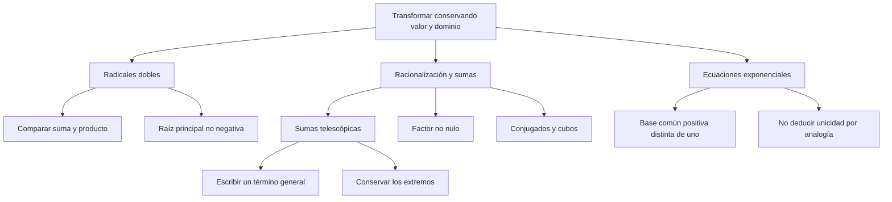

# Radicales dobles, racionalización y ecuaciones exponenciales

## Introducción
Simplificar una expresión no significa cambiar su valor ni ampliar su dominio sin avisar. Una transformación útil debe conservar las condiciones de las raíces, los denominadores y las operaciones que se emplean. Esta idea une la descomposición de radicales dobles, la racionalización y las ecuaciones exponenciales.

En este nivel se distingue una identidad válida de una semejanza visual. Un candidato obtenido por inspección puede ser correcto, pero no demuestra que sea la única solución. También se comprueba que el factor usado para racionalizar sea distinto de cero antes de multiplicar numerador y denominador por él.

## 3.2.1 · Radicales dobles y signo de la raíz
Para $a,b\ge0$, al desarrollar el cuadrado se obtiene $(\sqrt{a}+\sqrt{b})^2=a+b+2\sqrt{ab}$. Como la suma de las raíces es no negativa, se deduce $\sqrt{a+b+2\sqrt{ab}}=\sqrt{a}+\sqrt{b}$.

Con la resta, la identidad debe conservar el valor absoluto: $\sqrt{a+b-2\sqrt{ab}}=\lvert\sqrt{a}-\sqrt{b}\rvert$. Solo se elimina el valor absoluto como $\sqrt{a}-\sqrt{b}$ cuando $a\ge b$. La igualdad $a=b$ también está permitida y produce cero.

| Radical | Identificación | Resultado principal |
| --- | --- | --- |
| $\sqrt{10+2\sqrt{21}}$ | $7+3=10$, $7\cdot3=21$ | $\sqrt{7}+\sqrt{3}$ |
| $\sqrt{5-2\sqrt{6}}$ | $3+2=5$, $3\cdot2=6$ | $\sqrt{3}-\sqrt{2}$ |
| $\sqrt{2+3-2\sqrt{6}}$ | La diferencia $\sqrt{2}-\sqrt{3}$ es negativa | $\sqrt{3}-\sqrt{2}$ |
| $\sqrt{4+4-2\sqrt{16}}$ | $a=b=4$ | $0$ |

Para descomponer $\sqrt{A+2\sqrt{B}}$, se buscan números no negativos $a,b$ con $a+b=A$ y $ab=B$. La condición se puede comprobar desarrollando el cuadrado. No basta con encontrar una suma o un producto por separado: deben cumplirse ambas relaciones.

La forma más general utiliza $C=\sqrt{A^2-B}$. Si $A\ge0$, $B\ge0$ y $A^2\ge B$, define $u=(A+C)/2$ y $v=(A-C)/2$. Entonces $u,v\ge0$, $u+v=A$ y $uv=B/4$. De ahí se obtienen $\sqrt{A+\sqrt{B}}=\sqrt{u}+\sqrt{v}$ y $\sqrt{A-\sqrt{B}}=\sqrt{u}-\sqrt{v}$, pues $u\ge v$.

No se exige que $C$ sea racional para que esas identidades sean válidas bajo sus condiciones. Si $A,B$ son racionales y $C$ también lo es, los radicandos $u,v$ resultan racionales y la expresión puede quedar más sencilla. Racionalidad útil para una simplificación y existencia de una identidad no son la misma afirmación.

Como comprobación independiente, $\sqrt{32}=\sqrt{16\cdot2}=4\sqrt{2}$. La extracción utiliza un factor cuadrado no negativo. En $\sqrt{50}$ se extrae $25$ y en $\sqrt{72}$ se extrae $36$, de modo que se obtienen $5\sqrt{2}$ y $6\sqrt{2}$.

## 3.2.2 · Racionalización y denominadores
**Racionalizar** es reescribir una fracción eliminando radicales del denominador mediante una identidad. La fracción conserva su valor si se multiplica por $F/F$ con $F\ne0$. Un factor cero no representa uno dividido por sí mismo: vuelve inválida la operación.

Para un monomio, $1/\sqrt{5}$ se multiplica por $\sqrt{5}/\sqrt{5}$ y queda $\sqrt{5}/5$. Si aparece $1/\sqrt{4}$, puede calcularse directamente $1/2$; escribirla como $\sqrt{4}/4$ es otra expresión equivalente, no una obligación de dejar un radical que ya se puede evaluar.

| Expresión | Factor que se utiliza | Resultado |
| --- | --- | --- |
| $1/\sqrt{5}$ | $\sqrt{5}$ | $\sqrt{5}/5$ |
| $1/(\sqrt{3}+\sqrt{2})$ | $\sqrt{3}-\sqrt{2}$ | $\sqrt{3}-\sqrt{2}$ |
| $1/(\sqrt{3}-\sqrt{2})$ | $\sqrt{3}+\sqrt{2}$ | $\sqrt{3}+\sqrt{2}$ |
| $1/(\sqrt[3]{2}+1)$ | $\sqrt[3]{4}-\sqrt[3]{2}+1$ | $(\sqrt[3]{4}-\sqrt[3]{2}+1)/3$ |

El conjugado se apoya en $(p+q)(p-q)=p^2-q^2$. Para raíces cuadradas se toma $p=\sqrt{a}$ y $q=\sqrt{b}$, de modo que el producto es $a-b$. En los reales, esas raíces exigen $a,b\ge0$ y el denominador original debe ser distinto de cero.

Si $a=b>0$, la suma $\sqrt{a}+\sqrt{b}$ no es cero, pero su supuesto factor conjugado $\sqrt{a}-\sqrt{b}$ sí lo es. No se puede usar ese factor como si fuera válido. Se simplifica antes la suma a $2\sqrt{a}$ y, si se requiere racionalizar, se trabaja con ese monomio.

Para cubos se utilizan dos identidades: $(p+q)(p^2-pq+q^2)=p^3+q^3$ y $(p-q)(p^2+pq+q^2)=p^3-q^3$. El signo del término mixto cambia con la identidad; no se elige por imitación del caso cuadrático.

Con $p=\sqrt[3]{a}$ y $q=\sqrt[3]{b}$, los denominadores finales son $a+b$ o $a-b$. Si se desea un denominador racional, $a,b$ deben ser racionales en este uso. Con variables generales, que desaparezca el signo radical no demuestra por sí solo que el valor de cada variable sea racional.

## 3.2.3 · Cancelación telescópica
Una suma es **telescópica** cuando, después de una transformación válida, sus términos intermedios se cancelan. Primero se obtiene una fórmula para un término y luego se comprueba qué extremos permanecen. No se borra una raíz solo por aparecer cerca de otra.

Para $k\ge1$, el término $1/(\sqrt{k+1}+\sqrt{k})$ se racionaliza como $\sqrt{k+1}-\sqrt{k}$, porque $(k+1)-k=1$. El factor utilizado es positivo y, por tanto, no nulo.

En la suma desde $k=1$ hasta $k=99$, se obtiene $(\sqrt{2}-1)+(\sqrt{3}-\sqrt{2})+\cdots+(\sqrt{100}-\sqrt{99})$. Cada raíz intermedia aparece una vez sumando y otra restando. Quedan $\sqrt{100}-1=9$. Hay **99 términos**, no cien: el conteo debe corresponder a los índices escritos.

| Suma parcial | Después de racionalizar | Resultado |
| --- | --- | --- |
| Desde $k=1$ hasta $k=1$ | $\sqrt{2}-1$ | $\sqrt{2}-1$ |
| Desde $k=1$ hasta $k=2$ | $(\sqrt{2}-1)+(\sqrt{3}-\sqrt{2})$ | $\sqrt{3}-1$ |
| Desde $k=1$ hasta $k=n$ | Cancelan las raíces interiores | $\sqrt{n+1}-1$ |
| Desde $k=1$ hasta $k=99$ | Permanecen los extremos | $9$ |

La cancelación ocurre entre términos de una suma ya desarrollada. No autoriza a cancelar sumandos de numerador y denominador como si fueran factores. Por ejemplo, en $(a+b)/a$ no se borra directamente la letra $a$ de la suma; si $a\ne0$, se separa como $1+b/a$.

## 3.2.4 · Ecuaciones exponenciales sin analogías falsas
Si la base común satisface $a>0$ y $a\ne1$, la función $a^t$ toma valores diferentes para exponentes reales diferentes. Por ello, $a^{f(x)}=a^{g(x)}$ equivale a $f(x)=g(x)$ dentro del dominio de las expresiones. Esa propiedad no se aplica con base uno, cuya potencia vale uno para cualquier exponente real.

**Ejemplo resuelto.** En $3^{2x-1}=27$, se escribe $27=3^3$. Como la base tres cumple las condiciones, $2x-1=3$ y $x=2$. La comprobación da $3^{2\cdot2-1}=3^3=27$.

Si dos potencias tienen el mismo exponente entero positivo, la paridad importa. Para $u^n=v^n$ con $n$ impar, se obtiene $u=v$. Con $n$ par, se obtiene $u=v$ o $u=-v$. No se traslada esta conclusión sin análisis a exponentes variables, cero o fraccionarios.

La igualdad $x^x=a^a$ no obliga, por su sola apariencia, a que $x=a$. Con bases positivas existe este contraejemplo: $(1/4)^{1/4}=(1/2)^{1/2}$. En efecto, $1/4=(1/2)^2$ y la potencia de base positiva se transforma como $((1/2)^2)^{1/4}=(1/2)^{1/2}$.

Por tanto, en $x^x=(1/2)^{1/2}$ se comprueban al menos $x=1/2$ y $x=1/4$. Encontrar una coincidencia visual ofrece un candidato, pero no demuestra que sea el único ni reemplaza el estudio del dominio y de las propiedades de la función.

| Forma de ecuación | Procedimiento justificado | Precaución |
| --- | --- | --- |
| $a^{f(x)}=a^{g(x)}$ | Igualar exponentes | Base positiva y distinta de uno. |
| $u^{2n}=v^{2n}$ | Considerar $u=v$ y $u=-v$ | No descartar la rama de signo. |
| $x^x=a^a$ | Verificar candidatos y estudiar el ámbito | La coincidencia $x=a$ no prueba unicidad. |
| $\sqrt{A(x)}=B(x)$ | Exigir $B(x)\ge0$, transformar y comprobar | Elevar al cuadrado puede introducir candidatos no válidos. |

Como ejemplo construido de aplicación, un modelo $Q(t)=500(1/2)^t$ da $Q(3)=500/8=62.5$. El cálculo usa una expresión supuesta para estudiar exponentes. No afirma que todo proceso físico siga esa ley ni se atribuye a un laboratorio real sin evidencia.

## Importante
Las raíces principales son no negativas, también cuando valen cero. Un factor racionalizante debe ser no nulo. Conserva las condiciones sobre radicandos y denominadores, comprueba el número de términos en una suma y no deduzcas unicidad por analogía. Transformaciones equivalentes y cálculos correctos deben mantenerse dentro del dominio que se está estudiando.

## Síntesis
Los radicales dobles se analizan comparando suma, producto y signo principal. La racionalización utiliza identidades y factores no nulos; la cancelación telescópica conserva sus extremos. En las ecuaciones exponenciales se especifican las condiciones de la base y se verifican los candidatos. La forma de una expresión puede sugerir un método, pero la justificación es la que conserva su valor y sus soluciones.
