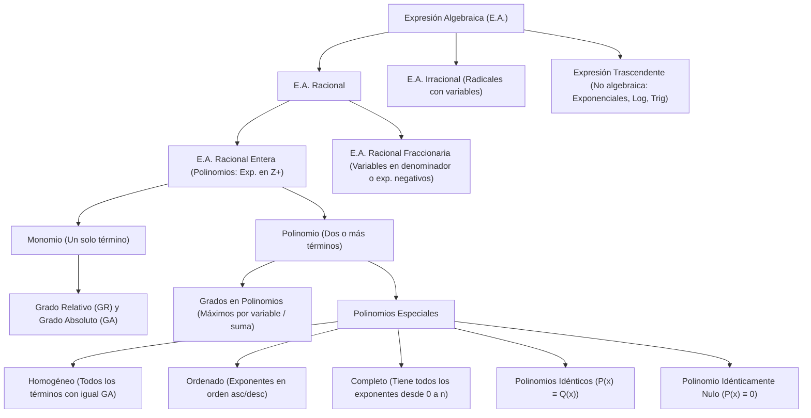

## 1. MARCO CONCEPTUAL Y ONTOLOGÍA
## 1. FICHA TÉCNICA Y MATRIZ DE COMPETENCIAS

| Parámetro | Detalle Institucional |
| :--- | :--- |
| **Resolución Oficial** | Resolución de Consejo Universitario N° 0028-2026 (Admisión UNSA 2027) |
| **Eje Curricular** | Eje 02: Matemática / Álgebra Superior |
| **Peso Ponderado UNSA** | **Ingenierías:** 1.658337400 pts/preg (4 preg. = 6.63 pts) \| **Biomédicas:** 1.265447400 pts \| **Sociales:** 0.824574000 pts |
| **Frecuencia en Exámenes** | **Crítica / Alta (94%):** Aparece como pregunta directa de polinomios especiales o implícito en simplificaciones y ecuaciones. |
| **Modelos de Examen** | UNSA (Ordinario y CEPREUNSA), UNMSM (Preguntas DECO contextualizadas), UNI (Álgebra analítica rigurosa). |
| **Competencia Cardinal** | Clasificar expresiones matemáticas, operar términos semejantes, calcular grados relativos y absolutos en monomios y polinomios, y resolver sistemas paramétricos aplicando las propiedades de polinomios homogéneos, ordenados, completos e idénticos. |

---

## 2. MAPA TAXONÓMICO Y ONTOLOGÍA DE CONCEPTOS

---

## 2. DESARROLLO TEÓRICO FORMAL - PARTE I
### EJE 02: MATEMÁTICA — ÁLGEBRA
### TEMA IV: EXPRESIONES ALGEBRAICAS, MONOMIOS Y POLINOMIOS ESPECIALES

---

### 3. DESARROLLO TEÓRICO FORMAL (ESTÁNDAR LUMBRERAS / CUZCANO / UNI)

### 3.1. Definición Formal de Expresión Algebraica (E.A.)
Una **Expresión Algebraica** es una combinación finita de constantes (números reales) y variables (letras que representan cantidades indeterminadas), vinculadas exclusivamente mediante un número finito de operaciones fundamentales de adición, sustracción, multiplicación, división, potenciación y radicación.

\text{E.A.} = P(x, y, z) = a_1 x^{m_1} y^{n_1} + a_2 x^{m_2} y^{n_2} + \dots + a_k x^{m_k} y^{n_k}

#### Clasificación Rigurosa:
1. **Expresión Algebraica Racional (E.A.R.):** Las variables no se encuentran afectadas por el operador de radicación ni actúan como exponentes.
   - **E.A. Racional Entera (E.A.R.E.):** Todos los exponentes de sus variables son números enteros no negativos (\mathbb{Z}_0^+ = \{0, 1, 2, 3, \dots\}). Corresponde al concepto formal de **Polinomio**.
     P(x, y) = 4x^3 y^2 - \sqrt{7} x y^5 + 9 (Nótese que \sqrt{7} es coeficiente real, no variable bajo raíz).
   - **E.A. Racional Fraccionaria (E.A.R.F.):** Al menos una variable presenta exponente entero negativo, o se ubica en el denominador.
     Q(x, y) = \frac{5x^2 + 1}{y^3} - 4x^{-2} y
2. **Expresión Algebraica Irracional (E.A.I.):** Al menos una variable se encuentra bajo el signo radical o presenta exponente fraccionario irreductible.
   R(x, y) = 3\sqrt{x^3 y} + 5x^{2/3} y - 11
3. **Expresiones No Algebraicas o Trascendentes:** Aquellas que contienen infinitos términos, variables en los exponentes, o funciones trascendentes (trigonométricas, logarítmicas, hiperbólicas):
   - Exponenciales: f(x) = 2^x + 5
   - Logarítmicas: g(x) = \ln(x^2 + 1)
   - Trigonométricas: h(x) = \text{sen}(x) + \cos(2x)
   - Sumatorias infinitas: S(x) = 1 + x + x^2 + x^3 + \dots

---

### 3.2. Término Algebraico y Términos Semejantes
Un **término algebraico** es la mínima unidad de una expresión algebraica donde no intervienen la suma ni la resta entre variables.
Se compone de:
- **Parte Constante (Coeficiente):** Incluye el signo y los números reales que multiplican a las variables.
- **Parte Variable (Parte Literal):** Las variables con sus respectivos exponentes.

\underbrace{-12 \sqrt{5}}_{\text{Coeficiente}} \cdot \underbrace{x^4 y^7 z}_{\text{Parte Literal}}

#### Términos Semejantes:
Dos o más términos son **semejantes** si y solo si poseen **exactamente las mismas variables afectadas por los mismos exponentes**, sin importar sus coeficientes.
- T_1(x, y) = (a + 3) x^5 y^{n-2} y T_2(x, y) = (2b - 1) x^m y^8 son semejantes si:
  m = 5 \quad \text{y} \quad n - 2 = 8 \implies n = 10
- **Reducción:** Solo los términos semejantes pueden sumarse o restarse algebraicamente sumando sus coeficientes.

---

### 3.3. Teoría de Grados en Monomios y Polinomios

El grado es una característica exclusiva de los polinomios (E.A. Racionales Enteras) relacionada con los exponentes de sus variables.

#### A. En Monomios:
Sea el monomio M(x, y, z) = c \cdot x^a y^b z^k, con c \neq 0:

## 3. FORMULARIO FUNDAMENTAL Y LEYES BASE
### 4. FORMULARIO MAESTRO (LATEX ESTRICTO)

| Concepto / Teorema | Fórmula Matemática | Condición / Aplicación |
| :--- | :--- | :--- |
| **Grado Absoluto Monomio** | \text{GA}(c x^a y^b z^k) = a + b + k | c \neq 0, variables x, y, z |
| **Grado Relativo Monomio** | \text{GR}_x(M) = a | Exponente de x |
| **Grado de Polinomio** | \text{GA}(P) = \max_i \{\text{GA}(T_i)\} | Mayor suma de exp. por término |
| **Suma de Coeficientes** | \sum \text{coef.} = P(1, 1, \dots, 1) | Evaluación en 1 |
