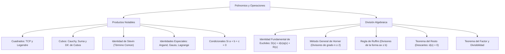

## 1. MARCO CONCEPTUAL Y ONTOLOGÍA
## 1. FICHA TÉCNICA Y MATRIZ DE COMPETENCIAS

| Parámetro | Detalle Institucional |
| :--- | :--- |
| **Resolución Oficial** | Resolución de Consejo Universitario N° 0028-2026 (Admisión UNSA 2027) |
| **Eje Curricular** | Eje 02: Matemática / Álgebra Fundamental y Analítica |
| **Peso Ponderado UNSA** | **Ingenierías:** 1.658337400 pts/preg (4 preg. = 6.63 pts) \| **Biomédicas:** 1.265447400 pts \| **Sociales:** 0.824574000 pts |
| **Frecuencia en Exámenes** | **Máxima / Obligatoria (99%):** Es el corazón del álgebra preuniversitaria. Siempre viene mínimo un ejercicio directo de productos notables o de división por Horner/Resto. |
| **Modelos de Examen** | UNSA (Ordinario, CEPREUNSA), UNMSM (DECO contextualizado en áreas y volúmenes), UNI (Condicionales complejas y restos de grado superior). |
| **Competencia Cardinal** | Dominar con soltura y velocidad mental las identidades algebraicas notables, desarrollar divisiones polinómicas mediante los esquemas de Horner y Ruffini, y calcular restos directos aplicando el teorema de Descartes sin efectuar la división. |

---

## 2. MAPA TAXONÓMICO Y ONTOLOGÍA DE CONCEPTOS

---

## 2. DESARROLLO TEÓRICO FORMAL - PARTE I
### EJE 02: MATEMÁTICA — ÁLGEBRA
### TEMA V: POLINOMIOS, PRODUCTOS NOTABLES Y DIVISIÓN ALGEBRAICA

---

### 3. DESARROLLO TEÓRICO FORMAL (ESTÁNDAR LUMBRERAS / CUZCANO / UNI)

### 3.1. Productos Notables Fundamentales
Los **Productos Notables** son multiplicaciones polinómicas cuyos resultados pueden escribirse por simple inspección, sin necesidad de ejecutar el algoritmo distributivo tradicional.

#### 1. Trinomio Cuadrado Perfecto (Binomio al Cuadrado):
(a \pm b)^2 = a^2 \pm 2ab + b^2

#### 2. Identidades de Legendre:
(a + b)^2 + (a - b)^2 = 2(a^2 + b^2)
(a + b)^2 - (a - b)^2 = 4ab
(a + b)^4 - (a - b)^4 = 8ab(a^2 + b^2)

#### 3. Diferencia de Cuadrados:
(a + b)(a - b) = a^2 - b^2

#### 4. Binomio al Cubo:
- **Forma Desarrollada:**
  (a + b)^3 = a^3 + 3a^2b + 3ab^2 + b^3
  (a - b)^3 = a^3 - 3a^2b + 3ab^2 - b^3
- **Forma Semidesarrollada (Identidad de Cauchy - ¡Uso constante en exámenes!):**
  (a + b)^3 = a^3 + b^3 + 3ab(a + b)
  (a - b)^3 = a^3 - b^3 - 3ab(a - b)

#### 5. Suma y Diferencia de Cubos:
(a + b)(a^2 - ab + b^2) = a^3 + b^3
(a - b)(a^2 + ab + b^2) = a^3 - b^3

#### 6. Multiplicación de Binomios con Término Común (Identidad de Stevin):
(x + a)(x + b) = x^2 + (a + b)x + ab
(x + a)(x + b)(x + c) = x^3 + (a + b + c)x^2 + (ab + bc + ca)x + abc

#### 7. Trinomio al Cuadrado y al Cubo:
(a + b + c)^2 = a^2 + b^2 + c^2 + 2(ab + bc + ca)
(a + b + c)^3 = a^3 + b^3 + c^3 + 3(a + b)(b + c)(c + a)
(a + b + c)^3 = a^3 + b^3 + c^3 + 3(a + b + c)(ab + bc + ca) - 3abc

#### 8. Identidades de Argand:
(x^{2m} + x^m y^n + y^{2n})(x^{2m} - x^m y^n + y^{2n}) = x^{4m} + x^{2m}y^{2n} + y^{4n}
- Caso clásico frecuente (m=1, y=1):
  (x^2 + x + 1)(x^2 - x + 1) = x^4 + x^2 + 1

#### 9. Identidad de Gauss:
a^3 + b^3 + c^3 - 3abc = (a + b + c)(a^2 + b^2 + c^2 - ab - bc - ca)
Equivalente:
a^3 + b^3 + c^3 - 3abc = \frac{1}{2}(a + b + c)\left[(a - b)^2 + (b - c)^2 + (c - a)^2\right]

#### 10. Identidades Condicionales (Si a + b + c = 0):
Si la suma de tres números reales es cero, se cumplen rigurosamente las siguientes propiedades:
1. a^3 + b^3 + c^3 = 3abc
2. a^2 + b^2 + c^2 = -2(ab + bc + ca)
3. (ab + bc + ca)^2 = (ab)^2 + (bc)^2 + (ca)^2
4. a^4 + b^4 + c^4 = 2(ab + bc + ca)^2 = \frac{1}{2}(a^2 + b^2 + c^2)^2
5. \frac{a^5 + b^5 + c^5}{5} = \left(\frac{a^2 + b^2 + c^2}{2}\right)\left(\frac{a^3 + b^3 + c^3}{3}\right)

---

### 3.2. División Algebraica de Polinomios

## 3. FORMULARIO FUNDAMENTAL Y LEYES BASE
### 4. FORMULARIO MAESTRO (LATEX ESTRICTO)

| Identidad / Teorema | Expresión Matemática Formal | Campo de Aplicación |
| :--- | :--- | :--- |
| **Cauchy (Suma)** | (a+b)^3 = a^3 + b^3 + 3ab(a+b) | Hallar a^3+b^3 conociendo a+b y ab |
| **Cauchy (Resta)** | (a-b)^3 = a^3 - b^3 - 3ab(a-b) | Hallar a^3-b^3 conociendo a-b y ab |
| **Legendre I** | (a+b)^2 + (a-b)^2 = 2(a^2+b^2) | Simplificación de sumas simétricas |
| **Legendre II** | (a+b)^2 - (a-b)^2 = 4ab | Reducción de diferencias simétricas |
| **Suma de Cubos** | a^3 + b^3 = (a+b)(a^2 - ab + b^2) | Factorización y simplificación |
