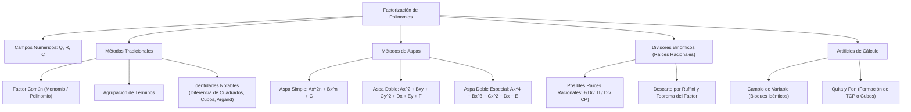

## 1. MARCO CONCEPTUAL Y ONTOLOGÍA
## 1. FICHA TÉCNICA Y MATRIZ DE COMPETENCIAS

| Parámetro | Detalle Institucional |
| :--- | :--- |
| **Resolución Oficial** | Resolución de Consejo Universitario N° 0028-2026 (Admisión UNSA 2027) |
| **Eje Curricular** | Eje 02: Matemática / Álgebra Superior |
| **Peso Ponderado UNSA** | **Ingenierías:** 1.658337400 pts/preg (4 preg. = 6.63 pts) \| **Biomédicas:** 1.265447400 pts \| **Sociales:** 0.824574000 pts |
| **Frecuencia en Exámenes** | **Crítica / Imprescindible (96%):** Es una herramienta obligatoria en simplificación de fracciones, resolución de ecuaciones de grado superior e inecuaciones. |
| **Modelos de Examen** | UNSA (Ordinario, CEPREUNSA), UNMSM (DECO modelado en dimensiones geométricas), UNI (Aspa doble especial y sumas/restas especiales). |
| **Competencia Cardinal** | Descomponer polinomios en el producto indicado de sus factores primos sobre \mathbb{Q}, \mathbb{R} y \mathbb{C}, dominando aspa simple, aspa doble, aspa doble especial, divisores binómicos y artificios de cambio de variable. |

---

## 2. MAPA TAXONÓMICO Y ONTOLOGÍA DE CONCEPTOS

---

## 2. DESARROLLO TEÓRICO FORMAL - PARTE I
### EJE 02: MATEMÁTICA — ÁLGEBRA
### TEMA VI: FACTORIZACIÓN SOBRE DIFERENTES CAMPOS NUMÉRICOS

---

### 3. DESARROLLO TEÓRICO FORMAL (ESTÁNDAR LUMBRERAS / CUZCANO / UNI)

### 3.1. Definición Formal de Factorización
La **factorización** es el proceso algebraico inverso a la multiplicación que consiste en transformar un polinomio racional entero en una multiplicación indicada de dos o más **factores primos** (polinomios irreductibles) dentro de un campo numérico determinado.

P(x) \xrightarrow{\text{Factorización}} f_1(x)^{\alpha} \cdot f_2(x)^{\beta} \cdots f_k(x)^{\gamma}

#### Campos Numéricos y Criterio de Irreductibilidad:
Un polinomio es **irreductible (primo)** sobre un campo numérico \mathbb{K} si no puede descomponerse como el producto de dos o más polinomios no constantes con coeficientes en \mathbb{K}.
- **Sobre \mathbb{Q} (Racionales):** Por defecto, en todo examen preuniversitario (UNSA, UNMSM, UNI), si no se especifica el campo, **se sobreentiende que se factoriza sobre \mathbb{Q}**.
  P(x) = x^2 - 5 \quad \text{es primo en } \mathbb{Q}
- **Sobre \mathbb{R} (Reales):**
  P(x) = (x - \sqrt{5})(x + \sqrt{5}) \quad \text{es reducible en } \mathbb{R}
  Q(x) = x^2 + 4 \quad \text{es primo en } \mathbb{R}
- **Sobre \mathbb{C} (Complejos):** Todo polinomio de grado n \geq 1 se descompone completamente en n factores lineales (Teorema Fundamental del Álgebra):
  Q(x) = (x - 2i)(x + 2i) \quad \text{en } \mathbb{C}

#### Conteo de Factores:
Sea el polinomio factorizado P(x) = A \cdot [f_1(x)]^{\alpha} \cdot [f_2(x)]^{\beta} \cdot [f_3(x)]^{\gamma}, donde A es constante no nula y f_i(x) son factores primos:
1. **Número de Factores Primos:**
   \text{N.° F.P.} = 3 \quad (\text{las bases irreductibles distintas})
2. **Número Total de Factores Algebraicos:**
   \text{N.° Factores Totales} = (\alpha + 1)(\beta + 1)(\gamma + 1)
   \text{N.° Factores Algebraicos} = (\alpha + 1)(\beta + 1)(\gamma + 1) - 1
   *(Se resta 1 porque la constante 1 no se considera factor algebraico).*

---

### 3.2. Métodos Clásicos de Factorización

#### 1. Factor Común y Agrupación:
Consiste en extraer el Máximo Común Divisor (M.C.D.) de los coeficientes y las variables repetidas elevadas a su **menor exponente**. Si no hay factor común a simple vista, se agrupan términos simétricos convenientemente.

#### 2. Método de las Identidades Notables:
Utiliza directamente los productos notables en sentido inverso:
- Diferencia de Cuadrados: a^2 - b^2 = (a - b)(a + b)
- Trinomio Cuadrado Perfecto (TCP): a^2 \pm 2ab + b^2 = (a \pm b)^2
- Suma y Diferencia de Cubos: a^3 \pm b^3 = (a \pm b)(a^2 \mp ab + b^2)
- Identidad de Argand: x^4 + x^2 + 1 = (x^2 + x + 1)(x^2 - x + 1)

---

## 3. FORMULARIO FUNDAMENTAL Y LEYES BASE
### 4. FORMULARIO MAESTRO (LATEX ESTRICTO)

| Método / Teorema | Estructura / Fórmula Matemática | Regla Operativa |
| :--- | :--- | :--- |
| **N.° Factores Primos** | P(x) = K \prod_{i=1}^m f_i(x)^{\alpha_i} \implies N_{FP} = m | Conteo de bases algebraicas |
| **N.° Factores Totales** | N_F = \prod_{i=1}^m (\alpha_i + 1) - 1 | Excluye a la constante 1 |
| **Aspa Simple** | Ax^2 + Bx + C = (a_1 x + c_1)(a_2 x + c_2) | a_1 c_2 + a_2 c_1 = B |
