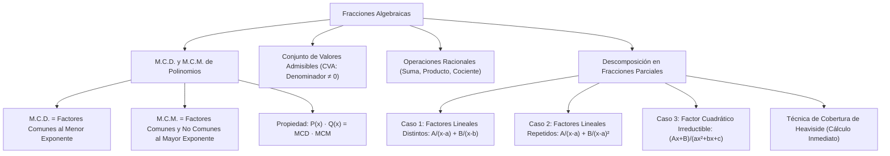

## 1. MARCO CONCEPTUAL Y ONTOLOGÍA
## 1. FICHA TÉCNICA Y MATRIZ DE COMPETENCIAS

| Parámetro | Detalle Institucional |
| :--- | :--- |
| **Resolución Oficial** | Resolución de Consejo Universitario N° 0028-2026 (Admisión UNSA 2027) |
| **Eje Curricular** | Eje 02: Matemática / Álgebra Superior y Cálculo Previo |
| **Peso Ponderado UNSA** | **Ingenierías:** 1.658337400 pts/preg (4 preg. = 6.63 pts) \| **Biomédicas:** 1.265447400 pts \| **Sociales:** 0.824574000 pts |
| **Frecuencia en Exámenes** | **Alta (88%):** Preguntas directas de simplificación, cálculo de MCD/MCM de polinomios o descomposición en fracciones parciales (puente hacia integrales en la universidad). |
| **Modelos de Examen** | UNSA (Ordinario, CEPREUNSA), UNMSM (DECO de razones de cambio y mezclas), UNI (Fracciones complejas y descomposición en fracciones parciales de casos cuadráticos). |
| **Competencia Cardinal** | Calcular el MCD y MCM de familias de polinomios mediante factorización, simplificar expresiones racionales complejas definiendo su conjunto de valores admisibles (CVA) y descomponer fracciones racionales propias en fracciones parciales. |

---

## 2. MAPA TAXONÓMICO Y ONTOLOGÍA DE CONCEPTOS

---

## 2. DESARROLLO TEÓRICO FORMAL - PARTE I
### EJE 02: MATEMÁTICA — ÁLGEBRA
### TEMA VII: FRACCIONES ALGEBRAICAS, MCD, MCM Y FRACCIONES PARCIALES

---

### 3. DESARROLLO TEÓRICO FORMAL (ESTÁNDAR LUMBRERAS / CUZCANO / UNI)

### 3.1. Definición Formal de Fracción Algebraica
Una **fracción algebraica** es el cociente indicado de dos polinomios racionales enteros P(x) y Q(x), donde el denominador Q(x) es no constante (de grado \geq 1):

F(x) = \frac{P(x)}{Q(x)}, \quad \text{con } \text{gr}(Q) \geq 1

#### Conjunto de Valores Admisibles (C.V.A.):
Es el subconjunto de números reales para los cuales la fracción algebraica está perfectamente definida. Quedan excluidos todos aquellos valores reales que anulan el denominador:

\text{C.V.A.} = \{x \in \mathbb{R} \mid Q(x) \neq 0\} = \mathbb{R} \setminus \{x \in \mathbb{R} \mid Q(x) = 0\}

#### Fracción Irreductible o Canónica:
Una fracción \frac{P(x)}{Q(x)} es **irreductible** si y solo si sus términos son polinomios primos entre sí (PESI), es decir:
\text{MCD}[P(x), Q(x)] = 1

---

### 3.2. M.C.D. y M.C.M. de Polinomios

Sean los polinomios factorizados completamente sobre un campo numérico determinado:

1. **Máximo Común Divisor (M.C.D.):**
   Es el polinomio de mayor grado que divide exactamente a cada uno de los polinomios dados.
   - **Regla Práctica:** Se factorizan los polinomios y el M.C.D. se forma multiplicando **únicamente los factores primos comunes elevados a su menor exponente**.

2. **Mínimo Común Múltiplo (M.C.M.):**

## 3. FORMULARIO FUNDAMENTAL Y LEYES BASE
### 4. FORMULARIO MAESTRO (LATEX ESTRICTO)

| Concepto / Teorema | Expresión Matemática | Condición Operativa |
| :--- | :--- | :--- |
| **M.C.D. Polinómico** | \text{MCD} = \prod (f_{\text{comunes}})^{\min(\alpha_i)} | Factores comunes al menor exponente |
| **M.C.M. Polinómico** | \text{MCM} = \prod (f_{\text{todos}})^{\max(\beta_i)} | Factores comunes y no comunes al mayor |
| **Producto de Polinomios** | A(x) \cdot B(x) = \text{MCD} \cdot \text{MCM} | Válido para dos polinomios |
