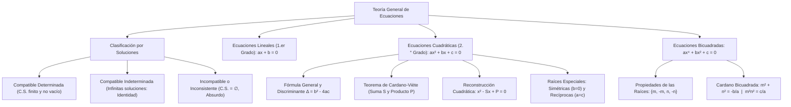

## 1. MARCO CONCEPTUAL Y ONTOLOGÍA
## 1. FICHA TÉCNICA Y MATRIZ DE COMPETENCIAS

| Parámetro | Detalle Institucional |
| :--- | :--- |
| **Resolución Oficial** | Resolución de Consejo Universitario N° 0028-2026 (Admisión UNSA 2027) |
| **Eje Curricular** | Eje 02: Matemática / Álgebra Superior y Modelación Cuantitativa |
| **Peso Ponderado UNSA** | **Ingenierías:** 1.658337400 pts/preg (4 preg. = 6.63 pts) \| **Biomédicas:** 1.265447400 pts \| **Sociales:** 0.824574000 pts |
| **Frecuencia en Exámenes** | **Máxima / Vital (98%):** Todo examen de admisión contiene como mínimo un problema directo de ecuaciones cuadráticas o bicuadradas. |
| **Modelos de Examen** | UNSA (Ordinario, CEPREUNSA), UNMSM (DECO de ingresos, costos y proyectiles), UNI (Discusión analítica paramétrica de raíces y ecuaciones bicuadradas). |
| **Competencia Cardinal** | Clasificar ecuaciones por su compatibilidad, determinar la naturaleza de las raíces cuadráticas mediante el discriminante, aplicar el Teorema de Cardano-Viète para relaciones simétricas y reconstruir ecuaciones polinomiales bicuadradas. |

---

## 2. MAPA TAXONÓMICO Y ONTOLOGÍA DE CONCEPTOS

---

## 2. DESARROLLO TEÓRICO FORMAL - PARTE I
### EJE 02: MATEMÁTICA — ÁLGEBRA
### TEMA VIII: ECUACIONES LINEALES, CUADRÁTICAS Y BICUADRADAS

---

### 3. DESARROLLO TEÓRICO FORMAL (ESTÁNDAR LUMBRERAS / CUZCANO / UNI)

### 3.1. Teoría General y Clasificación de Ecuaciones
Una **ecuación** es una igualdad condicional entre dos expresiones algebraicas que contiene una o más variables denominadas incógnitas, y que solo se satisface para valores específicos pertenecientes a su Conjunto Solución (C.S.).

#### Clasificación Rigurosa por la Naturaleza de su Conjunto Solución:
1. **Ecuación Compatible:** Posee al menos una solución.
   - **Compatible Determinada:** El número de soluciones es finito (C.S. = \{x_1, x_2, \dots, x_n\}).
   - **Compatible Indeterminada:** Admite infinitas soluciones (C.S. = \mathbb{R} o un intervalo continuo; se reduce a una identidad matemática 0 = 0).
2. **Ecuación Incompatible (Inconsistente o Absurda):** No existe ningún valor real que verifique la igualdad (C.S. = \emptyset). Se reduce a una contradicción aritmética (ej. 0 = 7).

---

### 3.2. Ecuaciones Lineales (Primer Grado)
Forma general canónica:
a x + b = 0, \quad \text{con } a, b \in \mathbb{R}

#### Análisis Paramétrico de Existencia y Unicidad:
- **Caso 1: Compatible Determinada:**
  a \neq 0 \implies x = -\frac{b}{a} \quad (\text{Solución única: } C.S. = \{-b/a\})
- **Caso 2: Compatible Indeterminada:**
  a = 0 \quad \land \quad b = 0 \implies 0x = 0 \quad (\forall x \in \mathbb{R} \implies C.S. = \mathbb{R})
- **Caso 3: Incompatible:**
  a = 0 \quad \land \quad b \neq 0 \implies 0x = -b \quad (\text{Absurdo} \implies C.S. = \emptyset)

---

### 3.3. Ecuaciones Cuadráticas (Segundo Grado)
Forma general canónica:
a x^2 + b x + c = 0, \quad \text{con } a \neq 0; \ a, b, c \in \mathbb{R}

#### Fórmula General de Resolución:
x = \frac{-b \pm \sqrt{b^2 - 4ac}}{2a}

#### Estudio Riguroso del Discriminante (\Delta = b^2 - 4ac):
El discriminante \Delta define la naturaleza matemática de las dos raíces x_1 y x_2:
1. **Si \Delta > 0:** Las raíces son **reales y diferentes** (x_1 \neq x_2 \in \mathbb{R}). La parábola corta al eje X en dos puntos distintos.
   - Si además a, b, c \in \mathbb{Q} y \Delta es un cuadrado perfecto (\Delta = k^2), las raíces son **racionales**.
   - Si \Delta no es cuadrado perfecto, las raíces son **irracionales conjugadas** (m \pm \sqrt{n}).
2. **Si \Delta = 0:** Las raíces son **reales e iguales** (x_1 = x_2 = -b/(2a)). La ecuación presenta una **raíz doble** (solución única, multiplicidad 2). El trinomio es un Trinomio Cuadrado Perfecto (TCP) y la parábola es tangente al eje X.
3. **Si \Delta < 0:** Las raíces son **complejas imaginarias conjugadas** (x_{1,2} = \alpha \pm \beta i, con \beta \neq 0). La gráfica no interseca al eje real X.

#### Teorema de Cardano-Viète para Ecuaciones Cuadráticas:

## 3. FORMULARIO FUNDAMENTAL Y LEYES BASE
### 4. FORMULARIO MAESTRO (LATEX ESTRICTO)

| Ecuación / Teorema | Fórmula Matemática | Propiedad / Condición |
| :--- | :--- | :--- |
| **Lineal Compatible Indet.** | ax + b = 0 \iff a = 0 \land b = 0 | C.S. = \mathbb{R} |
| **Lineal Incompatible** | ax + b = 0 \iff a = 0 \land b \neq 0 | C.S. = \emptyset |
| **Discriminante Cuadrático** | \Delta = b^2 - 4ac | Caracteriza la naturaleza de raíces |
| **Cardano (Suma Cuadrática)** | x_1 + x_2 = -b/a | Suma de soluciones |
| **Cardano (Producto Cuad.)** | x_1 x_2 = c/a | Producto de soluciones |
