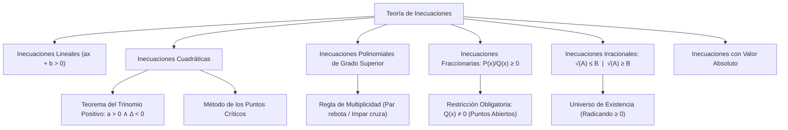

## 1. MARCO CONCEPTUAL Y ONTOLOGÍA
## 1. FICHA TÉCNICA Y MATRIZ DE COMPETENCIAS

| Parámetro | Detalle Institucional |
| :--- | :--- |
| **Resolución Oficial** | Resolución de Consejo Universitario N° 0028-2026 (Admisión UNSA 2027) |
| **Eje Curricular** | Eje 02: Matemática / Análisis de Desigualdades e Intervalos |
| **Peso Ponderado UNSA** | **Ingenierías:** 1.658337400 pts/preg (4 preg. = 6.63 pts) \| **Biomédicas:** 1.265447400 pts \| **Sociales:** 0.824574000 pts |
| **Frecuencia en Exámenes** | **Crítica / Alta (95%):** Presente de manera directa en inecuaciones fraccionarias/irracionales y como fundamento del dominio de funciones. |
| **Modelos de Examen** | UNSA (Ordinario, CEPREUNSA), UNMSM (DECO de optimización de costos y restricciones operativas), UNI (Inecuaciones con multiplicidad par y radicales anidados). |
| **Competencia Cardinal** | Determinar el conjunto solución de desigualdades algebraicas mediante el método de los puntos críticos, el Teorema del Trinomio Positivo, la restricción del universo en expresiones fraccionarias e irracionales, y el análisis de valor absoluto. |

---

## 2. MAPA TAXONÓMICO Y ONTOLOGÍA DE CONCEPTOS

---

## 2. DESARROLLO TEÓRICO FORMAL - PARTE I
### EJE 02: MATEMÁTICA — ÁLGEBRA
### TEMA IX: INECUACIONES LINEALES, POLINOMIALES, FRACCIONARIAS E IRRACIONALES

---

### 3. DESARROLLO TEÓRICO FORMAL (ESTÁNDAR LUMBRERAS / CUZCANO / UNI)

### 3.1. Axiomas de Orden y Definición de Inecuación
Una **inecuación** es una desigualdad algebraica condicional entre dos expresiones que solo es válida para un conjunto de valores reales, denominado **Conjunto Solución (C.S.)**, el cual generalmente se expresa en forma de intervalos continuos o uniones de ellos.

#### Axiomas Cardinales de la Desigualdad:
1. **Ley de Tricotomía:** Dados a, b \in \mathbb{R}, se cumple una y solo una: a < b, a = b, o a > b.
2. **Monotonía de la Adición:** Si a < b \implies a + c < b + c, \ \forall c \in \mathbb{R}.
3. **Monotonía de la Multiplicación:**
   - Si c > 0 \land a < b \implies a \cdot c < b \cdot c (El sentido se conserva).
   - Si c < 0 \land a < b \implies a \cdot c > b \cdot c (**¡El sentido de la desigualdad se invierte!**).

---

### 3.2. Inecuaciones Cuadráticas y el Teorema del Trinomio Positivo
Forma general canónica:
a x^2 + b x + c \gtrless 0, \quad \text{con } a > 0

#### Teorema del Trinomio Positivo (Teorema Fundamental del Álgebra Real):
Sea el trinomio cuadrático P(x) = ax^2 + bx + c con coeficientes reales:
a x^2 + b x + c > 0, \quad \forall x \in \mathbb{R} \iff a > 0 \quad \land \quad \Delta = b^2 - 4ac < 0
- **Consecuencia:** Si un factor cuadrático tiene a > 0 y \Delta < 0, su valor numérico es siempre estrictamente positivo para cualquier x \in \mathbb{R}. Por ende, **se puede eliminar de cualquier inecuación sin alterar el conjunto solución ni el sentido**.

#### Teorema del Trinomio No Negativo:
a x^2 + b x + c \geq 0, \quad \forall x \in \mathbb{R} \iff a > 0 \quad \land \quad \Delta \leq 0

---

### 3.3. Método de los Puntos Críticos (Inecuaciones Polinomiales y Fraccionarias)
Se emplea para resolver inecuaciones de cualquier grado:

## 3. FORMULARIO FUNDAMENTAL Y LEYES BASE
### 4. FORMULARIO MAESTRO (LATEX ESTRICTO)

| Teorema / Inecuación | Formulación Matemática | Condición / Observación |
| :--- | :--- | :--- |
| **Trinomio Positivo** | ax^2 + bx + c > 0, \ \forall x \in \mathbb{R} \iff a > 0 \land \Delta < 0 | Se cancela directamente |
| **Fraccionaria** | \frac{P(x)}{Q(x)} \geq 0 \iff P(x) \cdot Q(x) \geq 0 \land Q(x) \neq 0 | Puntos del denominador abiertos |
| **Multiplicidad Par** | (x - a)^{2n} P(x) \geq 0 \implies P(x) \geq 0 \lor x = a | No cambia signo en la recta |
