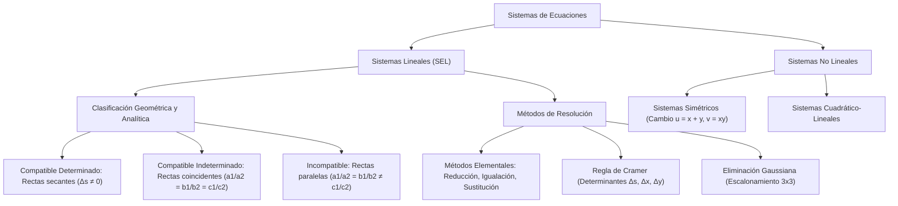

## 1. MARCO CONCEPTUAL Y ONTOLOGÍA
## 1. FICHA TÉCNICA Y MATRIZ DE COMPETENCIAS

| Parámetro | Detalle Institucional |
| :--- | :--- |
| **Resolución Oficial** | Resolución de Consejo Universitario N° 0028-2026 (Admisión UNSA 2027) |
| **Eje Curricular** | Eje 02: Matemática / Álgebra Lineal y Modelos Multivariables |
| **Peso Ponderado UNSA** | **Ingenierías:** 1.658337400 pts/preg (4 preg. = 6.63 pts) \| **Biomédicas:** 1.265447400 pts \| **Sociales:** 0.824574000 pts |
| **Frecuencia en Exámenes** | **Crítica / Alta (93%):** Preguntas recurrentes de discusión paramétrica de compatibilidad (solución única, infinitas soluciones o inconsistente) y problemas de planteo DECO. |
| **Modelos de Examen** | UNSA (Ordinario, CEPREUNSA), UNMSM (DECO de optimización logística y costos de mezclas), UNI (Sistemas homogéneos y determinantes de orden 3x3). |
| **Competencia Cardinal** | Resolver sistemas de ecuaciones lineales y no lineales mediante métodos analíticos y determinantes (Regla de Cramer), analizando rigurosamente las condiciones algebraicas y geométricas de compatibilidad e incompatibilidad. |

---

## 2. MAPA TAXONÓMICO Y ONTOLOGÍA DE CONCEPTOS

---

## 2. DESARROLLO TEÓRICO FORMAL - PARTE I
### EJE 02: MATEMÁTICA — ÁLGEBRA
### TEMA X: SISTEMAS DE ECUACIONES LINEALES Y NO LINEALES

---

### 3. DESARROLLO TEÓRICO FORMAL (ESTÁNDAR LUMBRERAS / CUZCANO / UNI)

### 3.1. Definición Formal de un Sistema de Ecuaciones
Un **sistema de ecuaciones** es un conjunto de dos o más ecuaciones con dos o más incógnitas que deben verificarse simultáneamente para una misma colección de valores numéricos, denominada **Solución del Sistema**.

\begin{cases} f_1(x_1, x_2, \dots, x_n) = 0 \\ f_2(x_1, x_2, \dots, x_n) = 0 \\ \quad \vdots \\ f_m(x_1, x_2, \dots, x_n) = 0 \end{cases}

El **Conjunto Solución (C.S.)** está formado por las n-tuplas ordenadas (x_1, x_2, \dots, x_n) que satisfacen todas las ecuaciones a la vez.

---

### 3.2. Sistemas de Ecuaciones Lineales de 2x2
Forma canónica de dos ecuaciones con dos incógnitas:
\begin{cases} a_1 x + b_1 y = c_1 \\ a_2 x + b_2 y = c_2 \end{cases}

#### A. Clasificación Analítica y Geométrica:

| Tipo de Sistema | Condición de Coeficientes | Determinantes | Interpretación Geométrica |
| :--- | :--- | :--- | :--- |
| **Compatible Determinado (SCD)** | \frac{a_1}{a_2} \neq \frac{b_1}{b_2} | \Delta_s \neq 0 | Dos rectas secantes que se cortan en un **único punto** (x_0, y_0). |
| **Compatible Indeterminado (SCI)** | \frac{a_1}{a_2} = \frac{b_1}{b_2} = \frac{c_1}{c_2} | \Delta_s = \Delta_x = \Delta_y = 0 | Dos rectas **coincidentes** (la misma recta); infinitos puntos comunes. |
| **Incompatible / Inconsistente (SI)** | \frac{a_1}{a_2} = \frac{b_1}{b_2} \neq \frac{c_1}{c_2} | \Delta_s = 0 \ \land \ (\Delta_x \neq 0 \lor \Delta_y \neq 0) | Dos rectas **paralelas y distintas**; jamás se intersecan (C.S. = \emptyset). |

---

## 3. FORMULARIO FUNDAMENTAL Y LEYES BASE
### 4. FORMULARIO MAESTRO (LATEX ESTRICTO)

| Concepto / Teorema | Fórmula Matemática | Condición Operativa |
| :--- | :--- | :--- |
| **SCD (Solución Única)** | \frac{a_1}{a_2} \neq \frac{b_1}{b_2} \iff \Delta_s \neq 0 | Rectas secantes |
| **SCI (Infinitas Soluciones)** | \frac{a_1}{a_2} = \frac{b_1}{b_2} = \frac{c_1}{c_2} | Rectas idénticas |
| **Incompatible (Sin Solución)** | \frac{a_1}{a_2} = \frac{b_1}{b_2} \neq \frac{c_1}{c_2} | Rectas paralelas |
