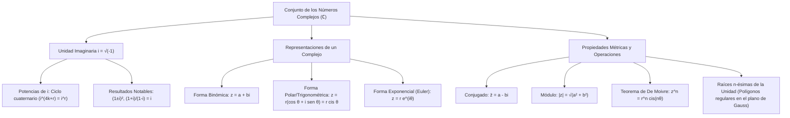

## 1. MARCO CONCEPTUAL Y ONTOLOGÍA
## 1. FICHA TÉCNICA Y MATRIZ DE COMPETENCIAS

| Parámetro | Detalle Institucional |
| :--- | :--- |
| **Resolución Oficial** | Resolución de Consejo Universitario N° 0028-2026 (Admisión UNSA 2027) |
| **Eje Curricular** | Eje 02: Matemática / Sistemas Numéricos Avanzados y Variable Compleja |
| **Peso Ponderado UNSA** | **Ingenierías:** 1.658337400 pts/preg (4 preg. = 6.63 pts) \| **Biomédicas:** 1.265447400 pts \| **Sociales:** 0.824574000 pts |
| **Frecuencia en Exámenes** | **Media / Alta (85%):** Muy frecuente en exámenes de área de Ingenierías y Biomédicas, evaluando potencias de i, módulos, conjugados y teorema de De Moivre. |
| **Modelos de Examen** | UNSA (Ordinario, CEPREUNSA), UNMSM (DECO de fasores y corriente alterna), UNI (Raíces enésimas de la unidad y geometría en el plano de Argand-Gauss). |
| **Competencia Cardinal** | Operar algebraicamente números complejos en forma binómica, polar y exponencial de Euler, dominando las propiedades del módulo, conjugado, argumento principal y la potenciación/radicación por el Teorema de De Moivre. |

---

## 2. MAPA TAXONÓMICO Y ONTOLOGÍA DE CONCEPTOS

---

## 2. DESARROLLO TEÓRICO FORMAL - PARTE I
### EJE 02: MATEMÁTICA — ÁLGEBRA
### TEMA XI: NÚMEROS COMPLEJOS Y FORMAS BINÓMICA, TRIGONOMÉTRICA Y EXPONENCIAL

---

### 3. DESARROLLO TEÓRICO FORMAL (ESTÁNDAR LUMBRERAS / CUZCANO / UNI)

### 3.1. Definición Formal y Unidad Imaginaria
El conjunto de los **números complejos (\mathbb{C})** se define formalmente como el conjunto de pares ordenados de números reales (a, b) \in \mathbb{R}^2 dotados de las operaciones de adición y multiplicación:
(a, b) + (c, d) = (a + c, \ b + d)
(a, b) \cdot (c, d) = (ac - bd, \ ad + bc)

#### La Unidad Imaginaria (i):
Se define como el par ordenado i = (0, 1), que verifica la propiedad fundamental:
i^2 = (0, 1) \cdot (0, 1) = (0 - 1, \ 0 + 0) = (-1, 0) \equiv -1
\mathbf{i = \sqrt{-1} \implies i^2 = -1}

#### Propiedad Cuaternaria de las Potencias de i:
Las potencias enteras de la unidad imaginaria se repiten en periodos de cuatro:
i^1 = i, \quad i^2 = -1, \quad i^3 = -i, \quad i^4 = 1
En general, para cualquier k \in \mathbb{Z}:
i^{4k} = 1, \quad i^{4k+1} = i, \quad i^{4k+2} = -1, \quad i^{4k+3} = -i
- **Teorema de la Suma Cuaternaria Consecutiva:**
  \sum_{j=1}^{4} i^j = i + i^2 + i^3 + i^4 = i - 1 - i + 1 = 0 \implies \sum_{j=k}^{k+3} i^j = 0

---

### 3.2. Forma Binómica (Cartesiana) y Clasificación
Todo número complejo z se expresa como:
z = a + bi, \quad \text{con } a, b \in \mathbb{R}
- **Parte Real:** \text{Re}(z) = a
- **Parte Imaginaria:** \text{Im}(z) = b (Nótese que \text{Im}(z) es un número real, no incluye a la letra i).

#### Clasificación Canónica:
1. **Complejo Real o Real Puro:** Si su parte imaginaria es nula: \text{Im}(z) = 0 \implies z = a.
2. **Complejo Imaginario Puro:** Si su parte real es nula y su parte imaginaria no: \text{Re}(z) = 0 \land \text{Im}(z) \neq 0 \implies z = bi.
3. **Complejo Nulo:** Si ambas partes son simultáneamente cero: z = 0 + 0i = 0.

#### Complejos Asociados:
- **Conjugado de z (\bar{z}):** Se invierte el signo de la parte imaginaria:
  \bar{z} = a - bi
- **Opuesto de z (z^* o -z):** Se invierten los signos de ambas partes:
  -z = -a - bi

---

## 3. FORMULARIO FUNDAMENTAL Y LEYES BASE
### 4. FORMULARIO MAESTRO (LATEX ESTRICTO)

| Propiedad / Teorema | Fórmula Matemática | Dominio / Aplicación |
| :--- | :--- | :--- |
| **Unidad Imaginaria** | i^2 = -1, \quad i^3 = -i, \quad i^4 = 1 | Ciclo periodo 4 |
| **Potencia de i** | i^{4k + r} = i^r | r \in \{0, 1, 2, 3\} |
| **Módulo** | \|z\| = \sqrt{a^2 + b^2} | Distancia al origen en Argand |
| **Identidad Métrica** | z \cdot \bar{z} = \|z\|^2 | Racionalización de complejos |
