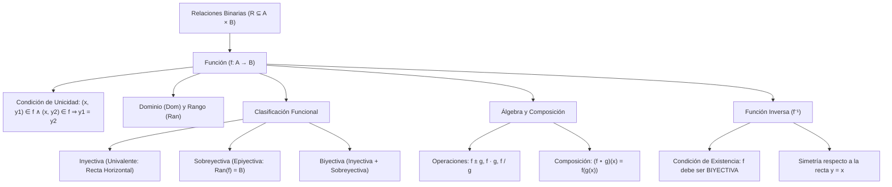

## 1. MARCO CONCEPTUAL Y ONTOLOGÍA
## 1. FICHA TÉCNICA Y MATRIZ DE COMPETENCIAS

| Parámetro | Detalle Institucional |
| :--- | :--- |
| **Resolución Oficial** | Resolución de Consejo Universitario N° 0028-2026 (Admisión UNSA 2027) |
| **Eje Curricular** | Eje 02: Matemática / Análisis Funcional y Correspondencia de Conjuntos |
| **Peso Ponderado UNSA** | **Ingenierías:** 1.658337400 pts/preg (4 preg. = 6.63 pts) \| **Biomédicas:** 1.265447400 pts \| **Sociales:** 0.824574000 pts |
| **Frecuencia en Exámenes** | **Crítica / Máxima (97%):** Tema vertebral del cálculo preuniversitario, presente como cálculo de dominios/rangos, composición o inversa. |
| **Modelos de Examen** | UNSA (Ordinario, CEPREUNSA), UNMSM (DECO modelando funciones de oferta-demanda y crecimiento), UNI (Composición con dominios acotados y biyectividad rigurosa). |
| **Competencia Cardinal** | Determinar analíticamente el dominio y rango de funciones reales de variable real, clasificar funciones inyectivas, sobreyectivas y biyectivas, operar el álgebra de funciones, componerlas y hallar su función inversa formal. |

---

## 2. MAPA TAXONÓMICO Y ONTOLOGÍA DE CONCEPTOS

---

## 2. DESARROLLO TEÓRICO FORMAL - PARTE I
### EJE 02: MATEMÁTICA — ÁLGEBRA
### TEMA XII: RELACIONES Y FUNCIONES, INYECTIVIDAD, COMPOSICIÓN E INVERSA

---

### 3. DESARROLLO TEÓRICO FORMAL (ESTÁNDAR LUMBRERAS / CUZCANO / UNI)

### 3.1. Producto Cartesiano y Relación Binaria
Sean dos conjuntos no vacíos A y B:
- **Par Ordenado:** Ente matemático (a, b) con primer elemento a \in A y segundo elemento b \in B, que verifica:
  (a, b) = (c, d) \iff a = c \quad \land \quad b = d
- **Producto Cartesiano (A \times B):**
  A \times B = \{(a, b) \mid a \in A \land b \in B\}
  \text{Card}(A \times B) = n(A) \cdot n(B)
- **Relación Binaria (R):** Todo subconjunto no vacío del producto cartesiano:
  R \subseteq A \times B

---

### 3.2. Definición Formal de Función
Una **función** f de A en B (denotada f: A \to B) es una relación que satisface el **Principio de Existencia y Unicidad**: a cada elemento del dominio le corresponde **un único** elemento en el codominio.

\forall x \in \text{Dom}(f), \ \exists! \ y \in B \ / \ (x, y) \in f

#### Criterio Analítico de Unicidad:
\text{Si } (x, y_1) \in f \quad \land \quad (x, y_2) \in f \implies y_1 = y_2

#### Criterio Geométrico de la Recta Vertical:
Una gráfica en el plano cartesiano \mathbb{R}^2 corresponde a una función si y solo si **cualquier recta vertical** x = k corta a la gráfica a lo más en **un solo punto**.

---

### 3.3. Dominio y Rango de una Función Real
1. **Dominio (\text{Dom}(f) o Preimagen):** Conjunto de todos los valores reales que puede tomar la variable independiente x para que la función esté bien definida:
   \text{Dom}(f) = \{x \in \mathbb{R} \mid \exists y \in \mathbb{R}, \ y = f(x)\}
   - *Restricciones analíticas obligatorias:*
     - Denominadores no nulos: \frac{P(x)}{Q(x)} \implies Q(x) \neq 0.
     - Radicales de índice par: \sqrt[2n]{A(x)} \implies A(x) \geq 0.
     - Argumentos logarítmicos: \log_b A(x) \implies A(x) > 0 \land b > 0 \land b \neq 1.
2. **Rango (\text{Ran}(f), Recorrido o Imagen):** Conjunto de todos los valores reales que efectivamente toma la variable dependiente y:
   \text{Ran}(f) = \{y \in \mathbb{R} \mid \exists x \in \text{Dom}(f), \ y = f(x)\}

---

### 3.4. Clasificación de Funciones

## 3. FORMULARIO FUNDAMENTAL Y LEYES BASE
### 4. FORMULARIO MAESTRO (LATEX ESTRICTO)

| Concepto / Teorema | Fórmula Matemática | Propiedad / Condición |
| :--- | :--- | :--- |
| **Unicidad de Función** | (x, y) \in f \land (x, z) \in f \implies y = z | Definición de función |
| **Recta Vertical** | Intersección con vertical \leq 1 punto | Prueba gráfica de función |
| **Inyectividad** | f(a) = f(b) \implies a = b | Recta horizontal \leq 1 punto |
