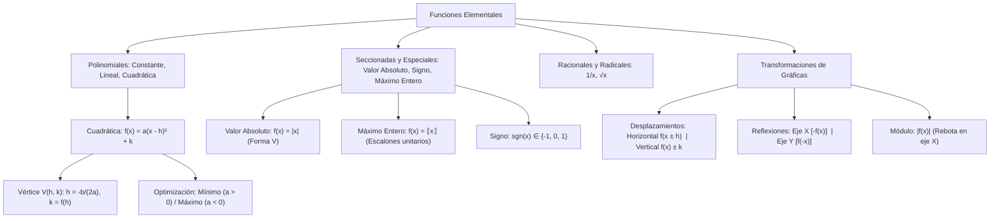

## 1. MARCO CONCEPTUAL Y ONTOLOGÍA
## 1. FICHA TÉCNICA Y MATRIZ DE COMPETENCIAS

| Parámetro | Detalle Institucional |
| :--- | :--- |
| **Resolución Oficial** | Resolución de Consejo Universitario N° 0028-2026 (Admisión UNSA 2027) |
| **Eje Curricular** | Eje 02: Matemática / Geometría Analítica de Funciones y Optimización |
| **Peso Ponderado UNSA** | **Ingenierías:** 1.658337400 pts/preg (4 preg. = 6.63 pts) \| **Biomédicas:** 1.265447400 pts \| **Sociales:** 0.824574000 pts |
| **Frecuencia en Exámenes** | **Crítica / Obligatoria (96%):** Aparece como optimización de parábolas (máximo ingreso / mínima pérdida), gráficas con valor absoluto y traslaciones rígidas. |
| **Modelos de Examen** | UNSA (Ordinario, CEPREUNSA), UNMSM (DECO de trayectorias y modelos de costos cuadráticos), UNI (Máximo entero, signo y transformaciones múltiples). |
| **Competencia Cardinal** | Graficar con precisión las funciones elementales (constante, lineal, cuadrática, raíz cuadrada, valor absoluto, máximo entero), calcular vértices analíticos y modelar traslaciones, compresiones y reflexiones geométricas en el plano cartesiano. |

---

## 2. MAPA TAXONÓMICO Y ONTOLOGÍA DE CONCEPTOS

---

## 2. DESARROLLO TEÓRICO FORMAL - PARTE I
### EJE 02: MATEMÁTICA — ÁLGEBRA
### TEMA XIII: FUNCIONES ELEMENTALES, GRÁFICAS Y TRANSFORMACIONES

---

### 3. DESARROLLO TEÓRICO FORMAL (ESTÁNDAR LUMBRERAS / CUZCANO / UNI)

### 3.1. Funciones Polinomiales Básicas

#### 1. Función Constante:
f(x) = c, \quad c \in \mathbb{R}
- \text{Dom}(f) = \mathbb{R}, \quad \text{Ran}(f) = \{c\}
- Su gráfica es una recta horizontal paralela al eje X con pendiente m = 0.

#### 2. Función Identidad:
f(x) = x
- \text{Dom}(f) = \mathbb{R}, \quad \text{Ran}(f) = \mathbb{R}
- Su gráfica es la bisectriz del primer y tercer cuadrante (recta a 45^\circ, pendiente m = 1).

#### 3. Función Lineal (Afín):
f(x) = mx + b, \quad m \neq 0
- \text{Dom}(f) = \mathbb{R}, \quad \text{Ran}(f) = \mathbb{R}
- m: pendiente (\tan \theta). Si m > 0 es creciente; si m < 0 es decreciente.
- b: ordenada al origen (corte con el eje Y en (0, b)).
- Corte con el eje X en (-b/m, 0).

---

### 3.2. Función Cuadrática y Optimización Analítica
f(x) = ax^2 + bx + c, \quad a \neq 0
- \text{Dom}(f) = \mathbb{R}
- Su gráfica es una **parábola** con eje de simetría vertical x = h.

#### Forma Canónica del Vértice:
f(x) = a(x - h)^2 + k
Donde las coordenadas del vértice V(h, k) son:
h = -\frac{b}{2a}, \qquad k = f(h) = c - \frac{b^2}{4a} = \frac{4ac - b^2}{4a}

#### Concavidad y Rango (Optimización):
1. **Si a > 0:** La parábola se abre hacia **arriba** (\bigcup).
   - Posee un **MÍNIMO ABSOLUTO** en el vértice: y_{\min} = k.
   - \text{Ran}(f) = [k, \ +\infty\rangle.
2. **Si a < 0:** La parábola se abre hacia **abajo** (\bigcap).
   - Posee un **MÁXIMO ABSOLUTO** en el vértice: y_{\max} = k.
   - \text{Ran}(f) = \langle -\infty, \ k].

---

## 3. FORMULARIO FUNDAMENTAL Y LEYES BASE
### 4. FORMULARIO MAESTRO (LATEX ESTRICTO)

| Función / Operación | Regla Analítica | Dominio / Rango |
| :--- | :--- | :--- |
| **Vértice de Parábola** | h = -\frac{b}{2a}, \quad k = f(h) | V(h, k) |
| **Rango Parábola (a > 0)** | \text{Ran}(f) = [k, \ +\infty\rangle | Mínimo en y = k |
| **Rango Parábola (a < 0)** | \text{Ran}(f) = \langle -\infty, \ k] | Máximo en y = k |
