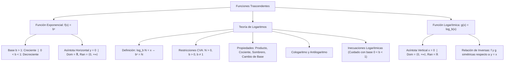

## 1. MARCO CONCEPTUAL Y ONTOLOGÍA
## 1. FICHA TÉCNICA Y MATRIZ DE COMPETENCIAS

| Parámetro | Detalle Institucional |
| :--- | :--- |
| **Resolución Oficial** | Resolución de Consejo Universitario N° 0028-2026 (Admisión UNSA 2027) |
| **Eje Curricular** | Eje 02: Matemática / Funciones Trascendentes y Álgebra de Logaritmos |
| **Peso Ponderado UNSA** | **Ingenierías:** 1.658337400 pts/preg (4 preg. = 6.63 pts) \| **Biomédicas:** 1.265447400 pts \| **Sociales:** 0.824574000 pts |
| **Frecuencia en Exámenes** | **Crítica / Alta (95%):** Es una de las preguntas fijas en el examen de Admisión UNSA y CEPREUNSA, tanto en cálculo analítico de logaritmos como en problemas DECO de pH, decibeles o desintegración radiactiva. |
| **Modelos de Examen** | UNSA (Ordinario, CEPREUNSA), UNMSM (DECO de escala de Richter, bacterias y capitalización compuesta), UNI (Inecuaciones logarítmicas con base variable). |
| **Competencia Cardinal** | Dominar los teoremas y propiedades del operador logarítmico, resolver ecuaciones e inecuaciones exponenciales y logarítmicas con restricción estricta de valores admisibles, y graficar funciones exponenciales y logarítmicas analizando su naturaleza inversa y sus asíntotas. |

---

## 2. MAPA TAXONÓMICO Y ONTOLOGÍA DE CONCEPTOS

---

## 2. DESARROLLO TEÓRICO FORMAL - PARTE I
### EJE 02: MATEMÁTICA — ÁLGEBRA
### TEMA XIV: FUNCIÓN EXPONENCIAL, TEORÍA DE LOGARITMOS Y FUNCIÓN LOGARÍTMICA

---

### 3. DESARROLLO TEÓRICO FORMAL (ESTÁNDAR LUMBRERAS / CUZCANO / UNI)

### 3.1. Función Exponencial
Sea b una constante real tal que b > 0 y b \neq 1. La **función exponencial** con base b se define como:

f(x) = b^x, \quad x \in \mathbb{R}

#### Propiedades Analíticas:
1. **Dominio y Rango:**
   \text{Dom}(f) = \mathbb{R}, \qquad \text{Ran}(f) = \mathbb{R}^+ = \langle 0, \ +\infty\rangle
2. **Punto de Paso Obligatorio:** Toda curva exponencial corta al eje Y en el punto (0, 1), ya que b^0 = 1.
3. **Asíntota Horizontal:** La recta y = 0 (eje X) es su asíntota horizontal.
4. **Monotonía según la Base:**
   - **Si b > 1:** La función es **estrictamente creciente**:
     x_1 < x_2 \iff b^{x_1} < b^{x_2}
   - **Si 0 < b < 1:** La función es **estrictamente decreciente**:
     x_1 < x_2 \iff b^{x_1} > b^{x_2}
5. **Función Exponencial Natural:** Base e \approx 2.718281828\dots:
   f(x) = e^x

---

### 3.2. Definición Formal de Logaritmo
El **logaritmo** de un número real positivo N en una base real positiva y diferente de la unidad b, es el exponente x al cual se debe elevar la base b para reproducir dicho número N:

\mathbf{\log_b N = x \iff b^x = N}

#### Condiciones de Existencia (C.V.A. Obligatorio):
Para que \log_b N exista en \mathbb{R}, deben cumplirse simultáneamente:
1. **Argumento estrictamente positivo:** N > 0.
2. **Base estrictamente positiva:** b > 0.
3. **Base diferente de la unidad:** b \neq 1.

#### Identidades Fundamentales:
b^{\log_b N} = N, \qquad \log_b(b^x) = x
\log_b 1 = 0, \qquad \log_b b = 1

---

### 3.3. Propiedades Cardinales de los Logaritmos
Sean x, y \in \mathbb{R}^+, b > 0, b \neq 1:

1. **Logaritmo de un Producto:**
   \log_b(x \cdot y) = \log_b x + \log_b y
2. **Logaritmo de un Cociente:**
   \log_b\left(\frac{x}{y}\right) = \log_b x - \log_b y
3. **Regla del Sombrero (Exponente en el Argumento):**
   \log_b(x^n) = n \cdot \log_b x
4. **Exponente en la Base y en el Argumento:**
   \log_{b^m}(x^n) = \frac{n}{m} \cdot \log_b x

## 3. FORMULARIO FUNDAMENTAL Y LEYES BASE
### 4. FORMULARIO MAESTRO (LATEX ESTRICTO)

| Propiedad / Teorema | Fórmula Matemática | Restricción / Aplicación |
| :--- | :--- | :--- |
| **Definición Logaritmo** | \log_b N = x \iff b^x = N | N > 0, \ b > 0, \ b \neq 1 |
| **Identidad Fundamental** | b^{\log_b N} = N | Base idéntica se cancela |
| **Regla del Sombrero** | \log_{b^m}(x^n) = \frac{n}{m} \log_b x | Exponentes salen como fracción |
| **Cambio de Base** | \log_b a = \frac{\ln a}{\ln b} | Conversión a base natural e |
