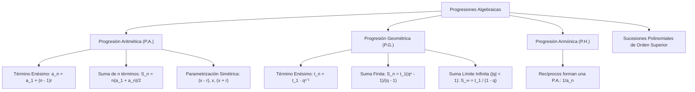

## 1. MARCO CONCEPTUAL Y ONTOLOGÍA
## 1. FICHA TÉCNICA Y MATRIZ DE COMPETENCIAS

| Parámetro | Detalle Institucional |
| :--- | :--- |
| **Resolución Oficial** | Resolución de Consejo Universitario N° 0028-2026 (Admisión UNSA 2027) |
| **Eje Curricular** | Eje 02: Matemática / Sucesiones Polinomiales y Series Finitas e Infinitas |
| **Peso Ponderado UNSA** | **Ingenierías:** 1.658337400 pts/preg (4 preg. = 6.63 pts) \| **Biomédicas:** 1.265447400 pts \| **Sociales:** 0.824574000 pts |
| **Frecuencia en Exámenes** | **Alta (89%):** Evaluado intensivamente con incógnitas algebraicas en raíces de polinomios (Cardano), interpolación y suma límite infinita. |
| **Modelos de Examen** | UNSA (Ordinario, CEPREUNSA), UNMSM (DECO de depreciación geométrica y cuotas de crédito), UNI (Sucesiones de orden superior y sumas límite dobles). |
| **Competencia Cardinal** | Formular y resolver problemas que involucran progresiones aritméticas, geométricas y armónicas mediante parametrizaciones simétricas, deduciendo términos enésimos, sumas finitas y sumas límites infinitas convergentes. |

---

## 2. MAPA TAXONÓMICO Y ONTOLOGÍA DE CONCEPTOS

---

## 2. DESARROLLO TEÓRICO FORMAL - PARTE I
### EJE 02: MATEMÁTICA — ÁLGEBRA
### TEMA XV: PROGRESIONES ARITMÉTICAS, GEOMÉTRICAS Y ARMÓNICAS EN CONTEXTO ALGEBRAICO

---

### 3. DESARROLLO TEÓRICO FORMAL (ESTÁNDAR LUMBRERAS / CUZCANO / UNI)

### 3.1. Progresión Aritmética (P.A.) en Álgebra
Una **Progresión Aritmética** (o sucesión por diferencias) es una sucesión de términos donde cada término consecutivo se obtiene sumando una cantidad constante r \in \mathbb{R} denominada **razón aritmética**:

\div a_1 \cdot a_2 \cdot a_3 \cdot \dots \cdot a_n \iff a_{k+1} - a_k = r, \quad \forall k \geq 1

#### Teoremas Fundamentales de la P.A.:
1. **Término General o Enésimo (a_n):**
   a_n = a_1 + (n - 1)r
2. **Propiedad de la Media Aritmética (Tres términos consecutivos):**
   Si a, b, c están en P.A.:
   b - a = c - b \implies 2b = a + c \iff b = \frac{a + c}{2}
3. **Suma de los n Primeros Términos (S_n):**
   S_n = \frac{n(a_1 + a_n)}{2} = \frac{n[2a_1 + (n - 1)r]}{2}
4. **Términos Equidistantes:**
   En toda P.A. finita, la suma de dos términos equidistantes de los extremos es constante:
   a_k + a_{n - k + 1} = a_1 + a_n
5. **Interpolación de m Medios Aritméticos:**
   Para intercalar m términos entre los extremos a y b, el número total de términos es n = m + 2. La razón de interpolación es:
   r = \frac{b - a}{m + 1}

#### Artificio de la Notación Simétrica para Incógnitas en P.A.:
- **Para 3 términos:**
  (x - r), \quad x, \quad (x + r) \implies \text{Suma} = 3x \quad (\text{se cancela la razón } r)
- **Para 4 términos (con razón 2r):**
  (x - 3r), \quad (x - r), \quad (x + r), \quad (x + 3r) \implies \text{Suma} = 4x
- **Para 5 términos:**
  (x - 2r), \quad (x - r), \quad x, \quad (x + r), \quad (x + 2r) \implies \text{Suma} = 5x

## 3. FORMULARIO FUNDAMENTAL Y LEYES BASE
### 4. FORMULARIO MAESTRO (LATEX ESTRICTO)

| Tipo de Progresión | Término Enésimo | Suma de Términos | Propiedad Central |
| :--- | :--- | :--- | :--- |
| **P.A. (Aritmética)** | a_n = a_1 + (n - 1)r | S_n = \frac{n(a_1 + a_n)}{2} | b = \frac{a + c}{2} |
| **P.A. Interpolación** | r = \frac{b - a}{m + 1} | — | a_k + a_{n-k+1} = a_1 + a_n |
