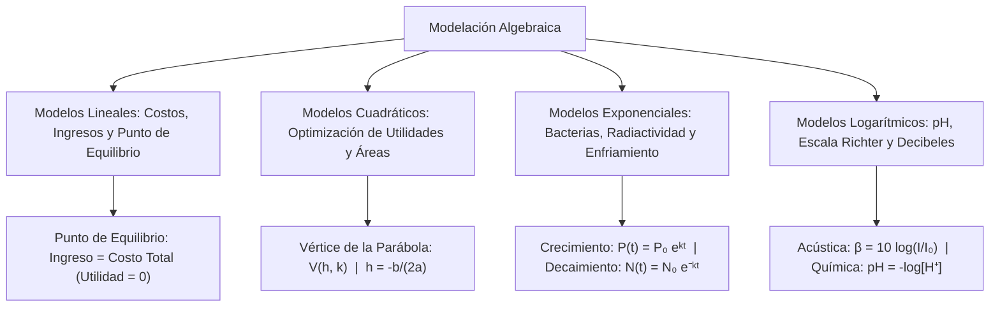

## 1. MARCO CONCEPTUAL Y ONTOLOGÍA
## 1. FICHA TÉCNICA Y MATRIZ DE COMPETENCIAS

| Parámetro | Detalle Institucional |
| :--- | :--- |
| **Resolución Oficial** | Resolución de Consejo Universitario N° 0028-2026 (Admisión UNSA 2027) |
| **Eje Curricular** | Eje 02: Matemática / Modelación Matemática, Optimización y Contexto DECO |
| **Peso Ponderado UNSA** | **Ingenierías:** 1.658337400 pts/preg (4 preg. = 6.63 pts) \| **Biomédicas:** 1.265447400 pts \| **Sociales:** 0.824574000 pts |
| **Frecuencia en Exámenes** | **Máxima (100% en DECO):** Integra todas las áreas del álgebra (lineal, cuadrática, exponencial y logarítmica) en problemas contextualizados de la vida real, economía, física y biología. |
| **Modelos de Examen** | UNSA (Ordinario, CEPREUNSA), UNMSM (Preguntas DECO transversales), UNI (Optimización de sistemas mecánicos y funciones compuestas multivariables). |
| **Competencia Cardinal** | Traducir situaciones problemáticas del entorno social, productivo y científico a modelos algebraicos explícitos, resolviendo mediante optimización cuadrática, puntos de equilibrio y leyes de decaimiento/crecimiento exponencial. |

---

## 2. MAPA TAXONÓMICO Y ONTOLOGÍA DE CONCEPTOS

---

## 2. DESARROLLO TEÓRICO FORMAL - PARTE I
### EJE 02: MATEMÁTICA — ÁLGEBRA
### TEMA XVI: APLICACIONES Y MODELACIÓN ALGEBRAICA EN CONTEXTOS REALES Y DECO

---

### 3. DESARROLLO TEÓRICO FORMAL (ESTÁNDAR LUMBRERAS / CUZCANO / UNI)

### 3.1. Metodología de la Modelación Algebraica
La **modelación matemática** es el proceso cognitivo formal que transforma una situación de la realidad empírica en un lenguaje simbólico algebraico riguroso:

\text{Problema Real} \xrightarrow{\text{Abstracción}} \text{Modelo Algebraico} \xrightarrow{\text{Resolución}} \text{Solución Matemática} \xrightarrow{\text{Validación}} \text{Decisión en la Realidad}

---

### 3.2. Modelos Económicos Lineales y Punto de Equilibrio
Sean q las unidades producidas y vendidas:

1. **Costo Total (C(q)):**
   C(q) = C_f + C_v \cdot q
   - C_f: Costos Fijos independientes de la producción (alquileres, seguros, salarios administrativos).
   - C_v: Costo Variable unitario por fabricar un artículo (materia prima, mano de obra directa).
2. **Ingreso Total (I(q)):**
   I(q) = p \cdot q
   - p: Precio de venta unitario.
3. **Utilidad Neta (U(q)):**
   U(q) = I(q) - C(q) = (p - C_v)q - C_f
4. **Punto de Equilibrio Financiero (q_e):**
   Es el nivel de producción donde los ingresos cubren con exactitud los costos, sin generar ganancia ni pérdida (U(q_e) = 0):
   I(q_e) = C(q_e) \implies p \cdot q_e = C_f + C_v \cdot q_e \implies \mathbf{q_e = \frac{C_f}{p - C_v}}
   El denominador (p - C_v) se denomina **Margen de Contribución Unitario**.

---

### 3.3. Modelos Cuadráticos y Optimización de la Demanda
En mercados competitivos, el precio no es constante sino que varía en función de la demanda según una ecuación de demanda lineal p(q) = a - bq, con a, b > 0:

1. **Función de Ingreso Cuadrático:**
   I(q) = p(q) \cdot q = (a - bq)q = -b q^2 + a q
2. **Optimización (Ingreso Máximo):**
   Como el coeficiente principal es -b < 0, la gráfica es una parábola con concavidad hacia abajo:
   - Nivel de producción para el máximo ingreso:
     q^* = -\frac{a}{2(-b)} = \frac{a}{2b}
   - Ingreso máximo alcanzable:
     I_{\max} = I(q^*) = \frac{a^2}{4b}

## 3. FORMULARIO FUNDAMENTAL Y LEYES BASE
### 4. FORMULARIO MAESTRO (LATEX ESTRICTO)

| Fenómeno Modelado | Formulación Matemática | Variables Clave |
| :--- | :--- | :--- |
| **Punto de Equilibrio** | q_e = \frac{C_f}{p - C_v} | C_f: costo fijo, p: precio, C_v: costo var. |
| **Ingreso Cuadrático Máx.** | I_{\max} = \frac{a^2}{4b} \quad \text{en } q^* = \frac{a}{2b} | p(q) = a - bq (Demanda lineal) |
| **Crecimiento Exponencial** | P(t) = P_0 e^{kt} | t_d = \frac{\ln 2}{k} (Tiempo de duplicación) |
