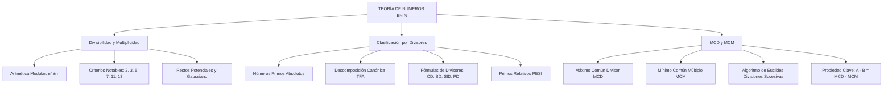

## 1. MARCO CONCEPTUAL Y ONTOLOGÍA
## 1. FICHA TÉCNICA Y MATRIZ DE COMPETENCIAS

| Parámetro | Especificación Oficial |
| :--- | :--- |
| **Eje Temático** | EJE II: Matemática |
| **Asignatura / Componente** | Aritmética |
| **Tema Oficial N.°** | Tema III: Divisibilidad en \mathbb{N}, primos y compuestos, descomposición canónica, cantidad de divisores, MCD (algoritmo de Euclides) y MCM |
| **Referencia Prospecto UNSA** | Resolución de Consejo Universitario N.° 0028-2026 (Págs. 9, 44-45) |
| **Ponderación por Pregunta** | **Ingenierías:** 1.658267400 pts (4 preg. = 6.633070 pts) **Biomédicas:** 1.265447400 pts (3 preg. = 3.796342 pts) **Sociales:** 0.824134300 pts (3 preg. = 2.472403 pts) |
| **Nivel de Complejidad Cognitiva** | Bloom: Análisis Estructural, Síntesis Algorítmica y Resolución Operativa Avanzada |
| **Conexión Interuniversitaria** | **UNSA:** Criterios de divisibilidad compuesta, restos potenciales, algoritmo de Euclides para MCD con cocientes sucesivos dados. **UNMSM (DECO):** Aplicaciones de MCD/MCM a sincronicidad de eventos, distribución óptima de áreas/volúmenes y conteo de divisores en criptografía. **UNI:** Ecuaciones diofánticas lineales, función indicatriz de Euler \phi(n), teorema de Wilson y propiedades algebraicas de divisores. |

### Matriz de Indicadores de Logro Evaluados
1. **Aritmética Modular y Divisibilidad:** Aplicar axiomas de múltiplos, divisores y criterios de divisibilidad (2^n, 5^n, 3, 9, 7, 11, 13, 33, 99) para determinar residuos sin efectuar la división extensa.
2. **Teorema Fundamental de la Aritmética:** Descomponer canónicamente cualquier número N \in \mathbb{N} y calcular analíticamente su cantidad de divisores CD(N), suma de divisores SD(N), producto PD(N) y suma de inversas SID(N).
3. **Números Primos entre Sí (PESI) y Clasificación:** Discriminar números primos absolutos, compuestos, simples y pares/ternas PESI dos a dos.
4. **Algoritmo de Euclides y Propiedades de MCD/MCM:** Reconstruir números originales a partir de los cocientes sucesivos del algoritmo de Euclides y aplicar la identidad fundamental A \cdot B = \text{MCD}(A, B) \cdot \text{MCM}(A, B).

---

## 2. MAPA TAXONÓMICO Y ONTOLOGÍA

---

## 2. DESARROLLO TEÓRICO FORMAL - PARTE I
### 3. DESARROLLO TEÓRICO FORMAL

### 3.1 Divisibilidad y Multiplicidad
Se dice que un entero A es **divisible** entre un entero positivo B (B \neq 0) si al dividir A entre B, el cociente es un número entero y el residuo es estrictamente cero.
A = B \cdot k \quad (k \in \mathbb{Z}) \iff A = \overset{\circ}{B} \quad (A \text{ es múltiplo de } B)

#### Propiedades Fundamentales de los Múltiplos
1. \overset{\circ}{n} \pm \overset{\circ}{n} = \overset{\circ}{n}
2. \overset{\circ}{n} \cdot k = \overset{\circ}{n} \quad (\forall k \in \mathbb{Z})
3. (\overset{\circ}{n})^k = \overset{\circ}{n} \quad (k \in \mathbb{Z}^+)
4. (\overset{\circ}{n} + r_1)(\overset{\circ}{n} + r_2) \dots (\overset{\circ}{n} + r_k) = \overset{\circ}{n} + (r_1 \cdot r_2 \dots r_k)
5. (\overset{\circ}{n} + r)^k = \overset{\circ}{n} + r^k
6. Si N = \overset{\circ}{a} \pm r, N = \overset{\circ}{b} \pm r y N = \overset{\circ}{c} \pm r \implies N = \overset{\circ}{\text{MCM}(a, b, c)} \pm r

### 3.2 Criterios Clásicos de Divisibilidad

| Módulo | Regla Operativa Fundamental | Fórmula / Algoritmo |
| :---: | :--- | :--- |
| **2^n** | Las últimas n cifras forman un múltiplo de 2^n. | Para 2: última cifra par. Para 4: \overline{de} = \overset{\circ}{4} o 2d + e = \overset{\circ}{4}. Para 8: 4c + 2d + e = \overset{\circ}{8}. |
| **5^n** | Las últimas n cifras forman un múltiplo de 5^n. | Para 5: última cifra \{0, 5\}. Para 25: últimas dos \{00, 25, 50, 75\}. |
| **3 y 9** | La suma de cifras del numeral es múltiplo de 3 o de 9. | \overline{abcdef} = \overset{\circ}{9} \iff a + b + c + d + e + f = \overset{\circ}{9} |
| **7** | Ponderadores periódicos de derecha a izquierda: +1, +3, +2, -1, -3, -2, \dots | \overline{abcdef} = \overset{\circ}{7} \iff -2a - 3b - c + 2d + 3e + f = \overset{\circ}{7} |
| **11** | Suma algebraica con signos alternados de derecha a izquierda: + - + - + - | \overline{abcdef} = \overset{\circ}{11} \iff -a + b - c + d - e + f = \overset{\circ}{11} |
| **13** | Ponderadores periódicos de derecha a izquierda: +1, -3, -4, -1, +3, +4, \dots | \overline{abcdef} = \overset{\circ}{13} \iff 4a + 3b - c - 4d - 3e + f = \overset{\circ}{13} |
| **33 y 99** | Suma de bloques de 2 cifras de derecha a izquierda. | \overline{abcdef} = \overset{\circ}{99} \iff \overline{ab} + \overline{cd} + \overline{ef} = \overset{\circ}{99} |

### 3.3 Números Primos y Compuestos
* **Número Primo Absoluto:** Aquel entero positivo mayor que 1 que posee exactamente dos divisores distintos: la unidad y él mismo (ej.: 2, 3, 5, 7, 11, 13, \dots). El único primo par es el 2.
* **Número Compuesto:** Posee más de dos divisores (ej.: 4, 6, 8, 9, 10, \dots).
* **Números Primos entre Sí (PESI):** Conjunto de números cuyo único divisor común positivo es la unidad.

### 3.4 Teorema Fundamental de la Aritmética (Descomposición Canónica)
Todo número entero N > 1 puede expresarse de manera única como el producto de sus factores primos elevados a exponentes enteros positivos:
N = p_1^{\alpha_1} \cdot p_2^{\alpha_2} \cdot p_3^{\alpha_3} \dots p_k^{\alpha_k}
donde p_1 < p_2 < \dots < p_k son números primos y \alpha_i \in \mathbb{Z}^+.

#### Fórmulas de Divisores de N
1. **Cantidad Total de Divisores (CD):**

## 3. FORMULARIO FUNDAMENTAL Y LEYES BASE
### 4. FORMULARIO MAESTRO (LATEX ESTRICTO)

| Concepto / Teorema | Expresión Matemática Rigurosa |
| :--- | :--- |
| **Identidad Fundamental de Divisibilidad** | N = \overset{\circ}{a} + r_d = \overset{\circ}{a} - r_e \implies r_d + r_e = a |
| **Propiedad Multi-Módulo** | N = \overset{\circ}{a} \pm r \land N = \overset{\circ}{b} \pm r \land N = \overset{\circ}{c} \pm r \iff N = \overset{\circ}{\text{MCM}(a,b,c)} \pm r |
| **Criterio del 7** | \overline{abcdef} \implies f + 3e + 2d - c - 3b - 2a = \overset{\circ}{7} |
| **Criterio del 11** | \overline{abcdef} \implies f - e + d - c + b - a = \overset{\circ}{11} |
| **Criterio del 13** | \overline{abcdef} \implies f - 3e - 4d - c + 3b + 4a = \overset{\circ}{13} |
