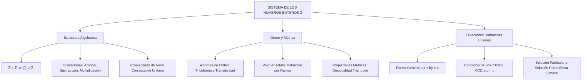

## 1. MARCO CONCEPTUAL Y ONTOLOGÍA
## 1. FICHA TÉCNICA Y MATRIZ DE COMPETENCIAS

| Parámetro | Especificación Oficial |
| :--- | :--- |
| **Eje Temático** | EJE II: Matemática |
| **Asignatura / Componente** | Aritmética |
| **Tema Oficial N.°** | Tema IV: Sistema de los números enteros (\mathbb{Z}): operaciones, orden, valor absoluto |
| **Referencia Prospecto UNSA** | Resolución de Consejo Universitario N.° 0028-2026 (Págs. 9, 44-45) |
| **Ponderación por Pregunta** | **Ingenierías:** 1.658267400 pts (4 preg. = 6.633070 pts) **Biomédicas:** 1.265447400 pts (3 preg. = 3.796342 pts) **Sociales:** 0.824134300 pts (3 preg. = 2.472403 pts) |
| **Nivel de Complejidad Cognitiva** | Bloom: Análisis Algebraico, Operación en Estructuras Discretas y Modelación Diofántica |
| **Conexión Interuniversitaria** | **UNSA:** Operaciones combinadas en \mathbb{Z}, ecuaciones diofánticas lineales de dos variables, propiedades de orden y valor absoluto. **UNMSM (DECO):** Situaciones de balance financiero (ganancias/pérdidas), temperaturas extremas, altitudes submarinas y optimización de compras discretas. **UNI:** Estructura de Dominio de Integridad de (\mathbb{Z}, +, \cdot), lema de Bezout y resolución general de sistemas diofánticos. |

### Matriz de Indicadores de Logro Evaluados
1. **Estructura Algebraica y Axiomática de \mathbb{Z}:** Demostrar y aplicar las propiedades de anillo conmutativo con elemento neutro (clausura, conmutatividad, asociatividad, elemento neutro, elemento opuesto simétrico, distributividad).
2. **Relación de Orden y Valor Absoluto:** Resolver desigualdades e inecuaciones aritméticas aplicando la definición estricta |x| y sus propiedades métricas (desigualdad triangular).
3. **Ecuaciones Diofánticas Lineales:** Determinar la existencia de soluciones enteras mediante el criterio del \text{MCD}(a, b) \mid c y hallar conjuntos de soluciones generales y restringidas a \mathbb{Z}^+.

---

## 2. MAPA TAXONÓMICO Y ONTOLOGÍA

---

## 2. DESARROLLO TEÓRICO FORMAL - PARTE I
### 3. DESARROLLO TEÓRICO FORMAL

### 3.1 Definición y Construcción de los Números Enteros (\mathbb{Z})
El conjunto de los números enteros se define formalmente como la unión disjunta de los enteros negativos, el elemento neutro cero y los enteros positivos:
\mathbb{Z} = \mathbb{Z}^- \cup \{0\} \cup \mathbb{Z}^+ = \{\dots, -3, -2, -1, 0, 1, 2, 3, \dots\}

Formalmente, \mathbb{Z} surge como el conjunto de clases de equivalencia de pares ordenados de números naturales (a, b) \in \mathbb{N} \times \mathbb{N} bajo la relación:
(a, b) \sim (c, d) \iff a + d = b + c
donde la clase [(a, b)] representa el entero a - b.

### 3.2 Operaciones y Estructura de (\mathbb{Z}, +, \cdot)
El sistema algebraico (\mathbb{Z}, +, \cdot) constituye un **anillo conmutativo unitario** y un **dominio de integridad**:

1. **Axiomas de la Adición (+):**
   - **Clausura:** \forall a, b \in \mathbb{Z} \implies a + b \in \mathbb{Z}.
   - **Conmutatividad:** a + b = b + a.
   - **Asociatividad:** (a + b) + c = a + (b + c).
   - **Elemento Neutro Aditivo:** Existe 0 \in \mathbb{Z} tal que a + 0 = a.
   - **Elemento Simétrico (Opuesto):** Para cada a \in \mathbb{Z}, existe -a \in \mathbb{Z} tal que a + (-a) = 0.

2. **Axiomas de la Multiplicación (\cdot):**
   - **Clausura:** \forall a, b \in \mathbb{Z} \implies a \cdot b \in \mathbb{Z}.
   - **Conmutatividad:** a \cdot b = b \cdot a.
   - **Asociatividad:** (a \cdot b) \cdot c = a \cdot (b \cdot c).
   - **Elemento Neutro Multiplicativo:** Existe 1 \in \mathbb{Z} (1 \neq 0) tal que a \cdot 1 = a.
   - **Distributividad respecto a la Adición:** a \cdot (b + c) = a \cdot b + a \cdot c.
   - **Cancelación (Dominio de Integridad):** Si a \cdot b = 0 \implies a = 0 \lor b = 0.

### 3.3 Relación de Orden en \mathbb{Z}
En \mathbb{Z} existe un subconjunto no vacío \mathbb{Z}^+ (enteros positivos) que satisface:
1. Si a, b \in \mathbb{Z}^+ \implies a + b \in \mathbb{Z}^+ y a \cdot b \in \mathbb{Z}^+.
2. **Ley de Tricotomía:** Para todo a \in \mathbb{Z}, se cumple exactamente una de las siguientes tres proposiciones:
   a \in \mathbb{Z}^+ \quad \lor \quad a = 0 \quad \lor \quad -a \in \mathbb{Z}^+

Se define la relación "a < b" si y solo si b - a \in \mathbb{Z}^+.

## 3. FORMULARIO FUNDAMENTAL Y LEYES BASE
### 4. FORMULARIO MAESTRO (LATEX ESTRICTO)

| Ley / Teorema | Expresión Matemática Rigurosa |
| :--- | :--- |
| **Definición de Valor Absoluto** | |x| = \begin{cases} x & (x \ge 0) \\ -x & (x < 0) \end{cases} |
| **Desigualdad Triangular** | |x + y| \le |x| + |y| \quad (\text{Igualdad si } x \cdot y \ge 0) |
