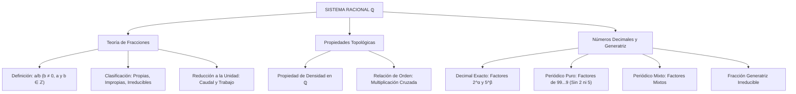

## 1. MARCO CONCEPTUAL Y ONTOLOGÍA
## 1. FICHA TÉCNICA Y MATRIZ DE COMPETENCIAS

| Parámetro | Especificación Oficial |
| :--- | :--- |
| **Eje Temático** | EJE II: Matemática |
| **Asignatura / Componente** | Aritmética |
| **Tema Oficial N.°** | Tema V: Sistema de los números racionales (\mathbb{Q}): fracciones (clases, operaciones, orden, representación decimal) |
| **Referencia Prospecto UNSA** | Resolución de Consejo Universitario N.° 0028-2026 (Págs. 9, 44-45) |
| **Ponderación por Pregunta** | **Ingenierías:** 1.658267400 pts (4 preg. = 6.633070 pts) **Biomédicas:** 1.265447400 pts (3 preg. = 3.796342 pts) **Sociales:** 0.824134300 pts (3 preg. = 2.472403 pts) |
| **Nivel de Complejidad Cognitiva** | Bloom: Análisis Analítico, Deducción Estructural y Modelación Operativa |
| **Conexión Interuniversitaria** | **UNSA:** Cantidad de cifras periódicas y no periódicas según factores primos del denominador, fracciones irreducibles continuas y reducción a la unidad. **UNMSM (DECO):** Problemas de grifos y llenado de tanques (reducción a la unidad), mezclas alcohólicas en fracciones sucesivas y dosificación farmacológica. **UNI:** Propiedad de densidad de \mathbb{Q}, aproximaciones diofánticas racionales, fracciones continuas simples y generatriz de numerales en bases no decimales. |

### Matriz de Indicadores de Logro Evaluados
1. **Taxonomía y Operatoria de Fracciones:** Clasificar fracciones según su valor respecto a la unidad, divisores comunes y denominadores; operar fracciones compuestas y continuas.
2. **Propiedad de Densidad y Orden en \mathbb{Q}:** Demostrar que entre dos números racionales distintos existen infinitos números racionales, e interpolar términos fraccionarios.
3. **Conversión y Fracción Generatriz:** Deducir analíticamente la fracción generatriz de decimales exactos, periódicos puros y periódicos mixtos en base decimal y en otras bases.
4. **Predicción de Cifras Decimales:** Determinar con precisión matemática la cantidad de cifras no periódicas (k = \max(\alpha, \beta) de 2^\alpha \cdot 5^\beta) y periódicas (mediante la tabla de nueves y orden multiplicativo).

---

## 2. MAPA TAXONÓMICO Y ONTOLOGÍA

---

## 2. DESARROLLO TEÓRICO FORMAL - PARTE I
### 3. DESARROLLO TEÓRICO FORMAL

### 3.1 Definición Formal del Conjunto de los Números Racionales (\mathbb{Q})
El conjunto de los números racionales \mathbb{Q} se define como el conjunto de clases de equivalencia de pares ordenados de enteros (a, b) \in \mathbb{Z} \times (\mathbb{Z} \setminus \{0\}) bajo la relación de equivalencia:
(a, b) \sim (c, d) \iff a \cdot d = b \cdot c
La clase de equivalencia [(a, b)] se denota convencionalmente como la fracción \frac{a}{b}:
\mathbb{Q} = \left\{ \frac{a}{b} \;\middle|\; a \in \mathbb{Z}, \; b \in \mathbb{Z}, \; b \neq 0 \right\}

El sistema (\mathbb{Q}, +, \cdot) forma un **cuerpo conmutativo (field)**: todo elemento no nulo posee inverso multiplicativo \left( \frac{a}{b} \right)^{-1} = \frac{b}{a}.

### 3.2 Clasificación Formal de Fracciones Aritméticas (a > 0, b > 0)

1. **Por la comparación de sus términos con la unidad:**
   - **Fracción Propia:** a < b \iff \frac{a}{b} < 1.
   - **Fracción Impropia:** a > b \iff \frac{a}{b} > 1. Toda fracción impropia puede escribirse como número mixto: \frac{a}{b} = q + \frac{r}{b} = q \frac{r}{b}.
   - **Fracción Aparente (Entera):** a = \overset{\circ}{b} \iff \frac{a}{b} \in \mathbb{Z}^+.

2. **Por los divisores comunes de sus términos:**
   - **Fracción Reducible:** \text{MCD}(a, b) = d > 1.
   - **Fracción Irreducible:** \text{MCD}(a, b) = 1 (a y b son **PESI**).

3. **Por la naturaleza de sus denominadores (entre dos o más fracciones):**
   - **Homogéneas:** Poseen el mismo denominador (\frac{a_1}{m}, \frac{a_2}{m}, \dots, \frac{a_k}{m}).
   - **Heterogéneas:** Al menos un denominador es diferente.

4. **Por el tipo de denominador:**
   - **Fracción Decimal:** Denominador es una potencia entera positiva de 10: b = 10^k (k \in \mathbb{Z}^+).
   - **Fracción Ordinaria o Común:** Denominador no es una potencia de 10.

### 3.3 Propiedades Métricas y Densidad de \mathbb{Q}
1. **Propiedad de Densidad:** Entre dos números racionales distintos \frac{a}{b} < \frac{c}{d}, existe siempre al menos otro número racional.
   - En particular, el promedio aritmético o punto medio:
     \frac{a}{b} < \frac{\frac{a}{b} + \frac{c}{d}}{2} < \frac{c}{d}
   - *Consecuencia:* Entre cualesquiera dos racionales existen **infinitos números racionales**.
2. **Propiedad de la Mediana (Fracción Mediante):**
   Si \frac{a}{b} < \frac{c}{d} con a, b, c, d \in \mathbb{Z}^+, entonces:
   \frac{a}{b} < \frac{a + c}{b + d} < \frac{c}{d}

## 3. FORMULARIO FUNDAMENTAL Y LEYES BASE
### 4. FORMULARIO MAESTRO (LATEX ESTRICTO)

| Concepto / Teorema | Expresión Matemática Rigurosa |
| :--- | :--- |
| **Condición de Irreducibilidad** | f = \frac{a}{b} \text{ es irreducible} \iff \text{MCD}(a, b) = 1 |
| **Punto Medio de Densidad** | \frac{a}{b} < \frac{ad + bc}{2bd} < \frac{c}{d} |
| **Fracción Mediante** | \frac{a}{b} < \frac{a+c}{b+d} < \frac{c}{d} \quad (\forall a,b,c,d \in \mathbb{Z}^+) |
