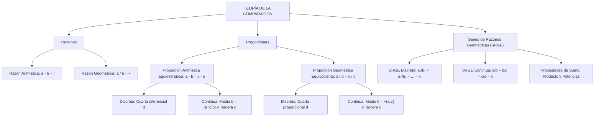

## 1. MARCO CONCEPTUAL Y ONTOLOGÍA
## 1. FICHA TÉCNICA Y MATRIZ DE COMPETENCIAS

| Parámetro | Especificación Oficial |
| :--- | :--- |
| **Eje Temático** | EJE II: Matemática |
| **Asignatura / Componente** | Aritmética |
| **Tema Oficial N.°** | Tema VI: Razones y proporciones: aritméticas, geométricas, proporciones y series de razones geométricas equivalentes |
| **Referencia Prospecto UNSA** | Resolución de Consejo Universitario N.° 0028-2026 (Págs. 9, 44-45) |
| **Ponderación por Pregunta** | **Ingenierías:** 1.658267400 pts (4 preg. = 6.633070 pts) **Biomédicas:** 1.265447400 pts (3 preg. = 3.796342 pts) **Sociales:** 0.824134300 pts (3 preg. = 2.472403 pts) |
| **Nivel de Complejidad Cognitiva** | Bloom: Análisis de Relaciones Cuantitativas, Modelación Proporcional y Deducción Algebraica |
| **Conexión Interuniversitaria** | **UNSA:** Serie de razones geométricas continuas equivalentes, cálculo de medias diferenciales y proporcionales, y proporciones discretas en edades. **UNMSM (DECO):** Aplicaciones a mezclas, escalas cartográficas, demografía y distribución de votos electorales. **UNI:** Propiedades invariantes de sumas y productos en SRGE de n razones, razones armónicas y matrices de razones continuas. |

### Matriz de Indicadores de Logro Evaluados
1. **Diferenciación Conceptual de Razones:** Discriminar con exactitud antecedentes, consecuentes y valores de razón aritmética (sustracción) y razón geométrica (división).
2. **Clasificación Estricta de Proporciones:** Resolver problemas distinguiendo entre proporciones discretas (4 términos distintos) y continuas (términos medios iguales), calculando cuartas, terceras y medias diferenciales/proporcionales.
3. **Serie de Razones Geométricas Equivalentes (SRGE):** Demostrar y aplicar las identidades fundamentales de sumas, productos y potencias de razones continuas y discretas para simplificar sistemas multivariables.

---

## 2. MAPA TAXONÓMICO Y ONTOLOGÍA

---

## 2. DESARROLLO TEÓRICO FORMAL - PARTE I
### 3. DESARROLLO TEÓRICO FORMAL

### 3.1 Concepto Formal de Razón
Una **razón** es la comparación cuantitativa y homogénea entre dos cantidades de una misma magnitud. Existen dos modalidades fundamentales:

1. **Razón Aritmética (r):** Comparación por medio de la sustracción. Determina en cuántas unidades excede una cantidad a la otra:
   a - b = r
   - a: **Antecedente**
   - b: **Consecuente**
   - r: **Valor de la razón aritmética**

2. **Razón Geométrica (k):** Comparación por medio de la división. Determina cuántas veces contiene una cantidad a la otra:
   \frac{a}{b} = k \quad (b \neq 0)
   - a: **Antecedente**
   - b: **Consecuente**
   - k: **Valor de la razón geométrica**

> **Convenio Preuniversitario Universal:** Si en un problema de admisión se menciona simplemente "la razón o relación entre dos números", se asume por defecto que se trata de una **razón geométrica**.

---

### 3.2 Teoría General de las Proporciones
Una **proporción** es la igualdad de dos razones de la misma naturaleza o clase.

#### 3.2.1 Proporción Aritmética (Equidiferencia)
Igualdad de dos razones aritméticas:
a - b = c - d
- Términos **extremos:** a y d.
- Términos **medios:** b y c.
- **Propiedad Fundamental:** En toda proporción aritmética, la suma de los extremos es igual a la suma de los medios:
  a + d = b + c

* **Clasificación:**
  1. **Discreta:** Los cuatro términos son distintos (b \neq c).
     - d recibe el nombre de **cuarta diferencial** de a, b y c.
  2. **Continua:** Los términos medios son idénticos (b = c):
     a - b = b - c \implies 2b = a + c \implies b = \frac{a + c}{2}
     - b se denomina **media diferencial** o **media aritmética** de a y c.
     - c se denomina **tercera diferencial** de a y b.

#### 3.2.2 Proporción Geométrica (Equicociente)
Igualdad de dos razones geométricas:
\frac{a}{b} = \frac{c}{d} \quad (b, d \neq 0)
- Términos **extremos:** a y d.
- Términos **medios:** b y c.
- **Propiedad Fundamental:** En toda proporción geométrica, el producto de los extremos es igual al producto de los medios:
  a \cdot d = b \cdot c

## 3. FORMULARIO FUNDAMENTAL Y LEYES BASE
### 4. FORMULARIO MAESTRO (LATEX ESTRICTO)

| Estructura / Propiedad | Expresión Matemática Rigurosa |
| :--- | :--- |
| **Razón Aritmética** | a - b = r \quad (a: \text{antecedente}, b: \text{consecuente}) |
| **Razón Geométrica** | \frac{a}{b} = k \iff a = b \cdot k |
| **Prop. Aritmética Discreta** | a - b = c - d \implies d = b + c - a \quad (d: \text{cuarta diferencial}) |
| **Prop. Aritmética Continua** | a - b = b - c \implies b = \frac{a+c}{2} \quad (b: \text{media diferencial}), \; c = 2b - a |
