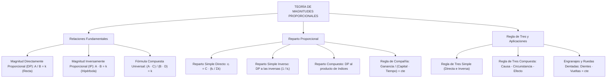

## 1. MARCO CONCEPTUAL Y ONTOLOGÍA
## 1. FICHA TÉCNICA Y MATRIZ DE COMPETENCIAS

| Parámetro | Especificación Oficial |
| :--- | :--- |
| **Eje Temático** | EJE II: Matemática |
| **Asignatura / Componente** | Aritmética |
| **Tema Oficial N.°** | Tema VII: Magnitudes y proporcionalidad: directa e inversa, reparto proporcional, regla de tres simple y compuesta |
| **Referencia Prospecto UNSA** | Resolución de Consejo Universitario N.° 0028-2026 (Págs. 9, 44-45) |
| **Ponderación por Pregunta** | **Ingenierías:** 1.658267400 pts (4 preg. = 6.633070 pts) **Biomédicas:** 1.265447400 pts (3 preg. = 3.796342 pts) **Sociales:** 0.824134300 pts (3 preg. = 2.472403 pts) |
| **Nivel de Complejidad Cognitiva** | Bloom: Análisis Funcional, Modelación Multivariable y Resolución Estratégica |
| **Conexión Interuniversitaria** | **UNSA:** Gráficas mixtas de magnitudes (recta e hipérbola equilátera), regla de tres compuesta con rendimiento y dificultad, y regla de compañía. **UNMSM (DECO):** Reparto de utilidades en sociedades mercantiles, rendimientos de maquinaria agroindustrial y logística de obras públicas. **UNI:** Propiedades funcionales de Cauchy (f(xy) = f(x)f(y)), engranajes y ruedas dentadas con ejes concéntricos y unidos por fajas. |

### Matriz de Indicadores de Logro Evaluados
1. **Modelado Funcional de Magnitudes:** Identificar y formular algebraicamente relaciones Directamente Proporcionales (DP) e Inversamente Proporcionales (IP), interpretando sus representaciones analíticas y geométricas.
2. **Reparto Proporcional Simple y Compuesto:** Repartir cantidades discretas o continuas en forma directa o inversa respecto a múltiples índices de reparto, aplicando propiedades de homogeneización.
3. **Regla de Compañía:** Distribuir beneficios y pérdidas en sociedades comerciales en función proporcional a los capitales aportados y los tiempos de permanencia.
4. **Regla de Tres Compuesta por Método Estructural:** Resolver situaciones complejas de rendimiento, dificultad, obreros, tiempo y obra utilizando el esquema universal Causa-Circunstancia-Efecto.

---

## 2. MAPA TAXONÓMICO Y ONTOLOGÍA

---

## 2. DESARROLLO TEÓRICO FORMAL - PARTE I
### 3. DESARROLLO TEÓRICO FORMAL

### 3.1 Magnitud y Cantidad
* **Magnitud:** Todo aquello susceptible de sufrir variación cualitativa o cuantitativa (aumento o disminución) y que puede ser medido objetivamente (longitud, masa, tiempo, costo, rendimiento, etc.).
* **Cantidad:** Valor o medida puntual que adopta una magnitud en un determinado instante o estado de observación (ejemplo: 15\text{ kg}, 8\text{ horas}, S/. 2500).

### 3.2 Relaciones Fundamentales entre Dos Magnitudes

#### 1. Magnitudes Directamente Proporcionales (A \text{ DP } B)
Dos magnitudes son directamente proporcionales si al multiplicar o dividir el valor de una de ellas por un número real positivo, el valor correspondiente de la otra queda multiplicado o dividido por el mismo número.
Matemáticamente, su **cociente es constante**:
A \text{ DP } B \iff \frac{A}{B} = k \quad (\text{constante}, \; k > 0)
* **Representación Gráfica en el Plano Cartesiano:**
  Es una **línea recta** que parte del origen de coordenadas (semirrecta):
  A = k \cdot B \implies f(x) = k \cdot x

#### 2. Magnitudes Inversamente Proporcionales (A \text{ IP } B)
Dos magnitudes son inversamente proporcionales si al multiplicar o dividir el valor de una de ellas por un número real positivo, el valor correspondiente de la otra queda dividido o multiplicado por el mismo número.
Matemáticamente, su **producto es constante**:
A \text{ IP } B \iff A \cdot B = k \quad (\text{constante}, \; k > 0)
* **Representación Gráfica en el Plano Cartesiano:**
  Es una rama de una **hipérbola equilátera**:
  A = \frac{k}{B} \implies f(x) = \frac{k}{x}

### 3.3 Propiedades Operativas de las Magnitudes Proporcionales
1. A \text{ DP } B \iff B \text{ DP } A \quad \text{y} \quad A \text{ IP } B \iff B \text{ IP } A
2. A \text{ IP } B \iff A \text{ DP } \frac{1}{B}
3. A \text{ DP } B \iff A^n \text{ DP } B^n \quad (\forall n \in \mathbb{R}^+)
4. A \text{ IP } B \iff A^n \text{ IP } B^n \quad (\forall n \in \mathbb{R}^+)
5. **Teorema de Proporcionalidad Compuesta:**
   Si una magnitud A depende simultáneamente de varias magnitudes independientes:
   \begin{cases} A \text{ DP } B & (C, D \text{ constantes}) \\ A \text{ IP } C & (B, D \text{ constantes}) \\ A \text{ DP } D & (B, C \text{ constantes}) \end{cases} \implies \frac{A \cdot C}{B \cdot D} = k \quad (\text{constante universal})

---

### 3.4 Aplicaciones Físicas y Mecánicas: Ruedas Dentadas y Engranajes
1. **Dos ruedas engranadas o unidas por una faja/cadena:**
   El número de dientes (D) y el número de vueltas (V) son **inversamente proporcionales**:
   D_A \cdot V_A = D_B \cdot V_B
2. **Dos ruedas unidas por el mismo eje (concéntricas):**

## 3. FORMULARIO FUNDAMENTAL Y LEYES BASE
### 4. FORMULARIO MAESTRO (LATEX ESTRICTO)

| Principio / Modelo | Ecuación Canónica |
| :--- | :--- |
| **Magnitud DP** | \frac{A}{B} = k \iff A = k \cdot B \quad (\text{Gráfica: Recta } y = mx) |
| **Magnitud IP** | A \cdot B = k \iff A = \frac{k}{B} \quad (\text{Gráfica: Hipérbola equilátera}) |
| **Identidad Compuesta** | \frac{A \cdot (\text{Magnitudes IP})}{(\text{Magnitudes DP})} = \text{constante} |
