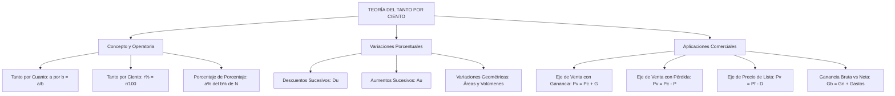

## 1. MARCO CONCEPTUAL Y ONTOLOGÍA
## 1. FICHA TÉCNICA Y MATRIZ DE COMPETENCIAS

| Parámetro | Especificación Oficial |
| :--- | :--- |
| **Eje Temático** | EJE II: Matemática |
| **Asignatura / Componente** | Aritmética |
| **Tema Oficial N.°** | Tema VIII: Porcentajes: concepto, aumentos y descuentos porcentuales, aplicaciones comerciales |
| **Referencia Prospecto UNSA** | Resolución de Consejo Universitario N.° 0028-2026 (Págs. 9, 44-45) |
| **Ponderación por Pregunta** | **Ingenierías:** 1.658267400 pts (4 preg. = 6.633070 pts) **Biomédicas:** 1.265447400 pts (3 preg. = 3.796342 pts) **Sociales:** 0.824134300 pts (3 preg. = 2.472403 pts) |
| **Nivel de Complejidad Cognitiva** | Bloom: Análisis Cuantitativo, Modelación Financiera y Resolución Operativa Dinámica |
| **Conexión Interuniversitaria** | **UNSA:** Variaciones porcentuales de áreas y volúmenes geométricos, descuentos sucesivos encadenados y ganancia neta con gastos de transporte. **UNMSM (DECO):** Aplicaciones en balances tributarios (IGV 18%), inflación acumulada, depreciación de activos fijos y márgenes de utilidad en retail. **UNI:** Optimización no lineal de precios fijados con doble descuento sucesivo condicionado a una tasa mínima de rentabilidad sobre el costo. |

### Matriz de Indicadores de Logro Evaluados
1. **Fundamentación Teórica del Tanto por Cuanto:** Operar el operador porcentual (\% = \frac{1}{100}) y calcular porcentajes encadenados y fracciones de porcentajes.
2. **Variaciones Porcentuales Dinámicas:** Modelar cambios sucesivos en variables dependientes aplicando las identidades de Aumento Único (A_u) y Descuento Único (D_u), así como variaciones en fórmulas geométricas.
3. **Ecuaciones de Comercio y Finanzas:** Resolver problemas comerciales interrelacionando Precio de Costo (P_c), Precio de Venta (P_v), Precio Fijado o de Lista (P_f), Ganancia Bruta (G_b), Ganancia Neta (G_n), Gastos operativos (g) y Descuento (D).

---

## 2. MAPA TAXONÓMICO Y ONTOLOGÍA

---

## 2. DESARROLLO TEÓRICO FORMAL - PARTE I
### 3. DESARROLLO TEÓRICO FORMAL

### 3.1 Concepto de Tanto por Cuanto y Tanto por Ciento
* **Tanto por Cuanto:** Es el número de partes que se toman de una cantidad que ha sido dividida en un número determinado de partes iguales:
  \text{El } a \text{ por } b \text{ de } N = \frac{a}{b} \cdot N
* **Tanto por Ciento:** Caso particular fundamental donde la cantidad de referencia se divide en exactamente 100 partes iguales. Cada parte representa una centésima (\frac{1}{100}) del total, denotada por el símbolo \%:
  1\% = \frac{1}{100} = 0.01
  r\% \text{ de } N = \frac{r}{100} \cdot N
* **Toda cantidad representa el 100\% de sí misma:**
  N = 100\% N

#### Reglas de Operación Porcentual
1. a\% N \pm b\% N = (a \pm b)\% N
2. a\%(b\% N) = \left(\frac{a}{100} \cdot \frac{b}{100}\right) \cdot N = \left(\frac{a \cdot b}{100}\right)\% N
3. Si una cantidad aumenta en su r\%, resulta en el (100 + r)\% del valor inicial.
4. Si una cantidad disminuye en su r\%, resulta en el (100 - r)\% del valor inicial.

---

### 3.2 Aumentos y Descuentos Porcentuales Sucesivos

#### 1. Descuentos Sucesivos y Descuento Único (D_u)
Si una cantidad sufre dos descuentos sucesivos del d_1\% y luego del d_2\%:
* Al aplicar el primer descuento queda: (100 - d_1)\%.
* Al aplicar el segundo descuento sobre lo que quedaba: (100 - d_2)\% \cdot (100 - d_1)\%.
* **Fórmula del Descuento Único Equivalente:**
  D_u = \left( d_1 + d_2 - \frac{d_1 \cdot d_2}{100} \right)\%
* Para n descuentos sucesivos d_1, d_2, \dots, d_n:
  \text{Queda final} = \left( \frac{100 - d_1}{100} \right) \cdot \left( \frac{100 - d_2}{100} \right) \dots \left( \frac{100 - d_n}{100} \right) \cdot 100\%
  D_u = 100\% - \text{Queda final}

#### 2. Aumentos Sucesivos y Aumento Único (A_u)
Si una cantidad sufre dos aumentos sucesivos del a_1\% y luego del a_2\%:
* **Fórmula del Aumento Único Equivalente:**
  A_u = \left( a_1 + a_2 + \frac{a_1 \cdot a_2}{100} \right)\%
* Para n aumentos sucesivos a_1, a_2, \dots, a_n:
  \text{Resulta final} = \left( \frac{100 + a_1}{100} \right) \cdot \left( \frac{100 + a_2}{100} \right) \dots \left( \frac{100 + a_n}{100} \right) \cdot 100\%
  A_u = \text{Resulta final} - 100\%

## 3. FORMULARIO FUNDAMENTAL Y LEYES BASE
### 4. FORMULARIO MAESTRO (LATEX ESTRICTO)

| Relación / Teorema | Expresión Matemática Rigurosa |
| :--- | :--- |
| **Tanto por Cuanto** | \text{El } a \text{ por } b \text{ de } N = \frac{a}{b} \cdot N |
| **Descuento Único (2 tasas)** | D_u = \left( d_1 + d_2 - \frac{d_1 d_2}{100} \right)\% |
| **Aumento Único (2 tasas)** | A_u = \left( a_1 + a_2 + \frac{a_1 a_2}{100} \right)\% |
