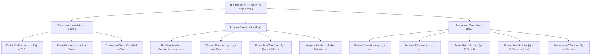

## 1. MARCO CONCEPTUAL Y ONTOLOGÍA
## 1. FICHA TÉCNICA Y MATRIZ DE COMPETENCIAS

| Parámetro | Especificación Oficial |
| :--- | :--- |
| **Eje Temático** | EJE II: Matemática |
| **Asignatura / Componente** | Aritmética |
| **Tema Oficial N.°** | Tema IX: Sucesiones y progresiones: numéricas, progresión aritmética y geométrica |
| **Referencia Prospecto UNSA** | Resolución de Consejo Universitario N.° 0028-2026 (Págs. 9, 44-45) |
| **Ponderación por Pregunta** | **Ingenierías:** 1.658267400 pts (4 preg. = 6.633070 pts) **Biomédicas:** 1.265447400 pts (3 preg. = 3.796342 pts) **Sociales:** 0.824134300 pts (3 preg. = 2.472403 pts) |
| **Nivel de Complejidad Cognitiva** | Bloom: Análisis de Patrones Discretos, Deducción Inductiva y Modelación Asintótica |
| **Conexión Interuniversitaria** | **UNSA:** Conteo de cifras de tipos de imprenta (paginación de libros), suma límite de series geométricas infinitas e interpolación de medios diferenciales/geométricos. **UNMSM (DECO):** Crecimiento bacteriano exponencial (P.G.), planes de ahorro programado con aportes crecientes (P.A.) y amortización financiera. **UNI:** Sucesiones recurrentes lineales de segundo orden (Fibonacci, Lucas), fórmulas cerradas de Binet y criterios de convergencia de series. |

### Matriz de Indicadores de Logro Evaluados
1. **Regla de Formación y Término General:** Deducir analíticamente el término enésimo (a_n) en sucesiones lineales, cuadráticas y geométricas.
2. **Conteo Combinatorio de Cifras (Tipos de Imprenta):** Calcular la cantidad total de cifras empleadas al escribir secuencias numéricas correlativas desde 1 hasta N.
3. **Progresiones Aritméticas (P.A.):** Interpolar medios aritméticos y calcular la suma de los n términos mediante la semisuma de extremos multiplicada por el número de términos.
4. **Progresiones Geométricas (P.G.) y Suma Límite:** Determinar el producto de términos finitos y evaluar la suma convergente infinita (S_\infty = \frac{t_1}{1 - q}) para |q| < 1.

---

## 2. MAPA TAXONÓMICO Y ONTOLOGÍA

---

## 2. DESARROLLO TEÓRICO FORMAL - PARTE I
### 3. DESARROLLO TEÓRICO FORMAL

### 3.1 Definición Formal de Sucesión Numérica
Una **sucesión numérica** es una función cuyo dominio es el conjunto de los enteros positivos \mathbb{Z}^+ = \{1, 2, 3, \dots\} y cuyo codominio es un subconjunto de los números reales \mathbb{R}:
f: \mathbb{Z}^+ \to \mathbb{R}
f(n) = a_n \quad (n\text{-ésimo término o término general})
La sucesión se denota ordenadamente como:
(a_n)_{n \ge 1} = a_1, a_2, a_3, \dots, a_n, \dots

---

### 3.2 Conteo de Cifras en la Numeración Correlativa (Tipos de Imprenta)
Para escribir una sucesión de números naturales consecutivos desde 1 hasta un número de k cifras N = \overline{d_1 d_2 \dots d_k}:
* De 1 al 9: 9 números de 1 cifra \implies 9 \times 1 = 9 cifras.
* Del 10 al 99: 90 números de 2 cifras \implies 90 \times 2 = 180 cifras.
* Del 100 al 999: 900 números de 3 cifras \implies 900 \times 3 = 2700 cifras.

#### Teorema del Conteo Rápido de Cifras (Fórmula de Gauss-Lumbreras):
La cantidad total de cifras empleadas al escribir la secuencia 1, 2, 3, \dots, N (donde N tiene k cifras) es:
\text{Cantidad de Cifras} = (N + 1) \cdot k - \underbrace{111\dots1}_{k \text{ unos}}

*Ejemplo:* Para numerar un libro de N = 345 páginas (k = 3 cifras):
\text{Cifras} = (345 + 1) \cdot 3 - 111 = 346 \cdot 3 - 111 = 1038 - 111 = 927 \text{ cifras}

---

### 3.3 Progresión Aritmética (P.A.) o Sucesión Lineal
Una P.A. es una sucesión en la cual cada término (a partir del segundo) se obtiene sumando al término anterior una cantidad constante r denominada **razón aritmética**:
a_n = a_{n-1} + r \iff a_n - a_{n-1} = r \quad (\forall n \ge 2)

#### Propiedades Fundamentales de la P.A.
1. **Término Enésimo (a_n):**
   a_n = a_1 + (n - 1)r = r \cdot n + a_0 \quad (\text{donde } a_0 = a_1 - r \text{ es el término cero})
2. **Número de Términos (n):**
   n = \frac{a_n - a_1}{r} + 1 = \frac{a_n - a_0}{r}
3. **Términos Equidistantes de los Extremos:**
   En una P.A. finita de n términos, la suma de dos términos equidistantes de los extremos es constante e igual a la suma de los términos extremos:
   a_k + a_{n-k+1} = a_1 + a_n

## 3. FORMULARIO FUNDAMENTAL Y LEYES BASE
### 4. FORMULARIO MAESTRO (LATEX ESTRICTO)

| Concepto / Teorema | Expresión Matemática Rigurosa |
| :--- | :--- |
| **Conteo de Cifras (1 a N, k cifras)** | \text{Cant. Cifras} = (N + 1)k - \underbrace{111\dots1}_{k \text{ veces}} |
| **P.A.: Término General** | a_n = a_1 + (n - 1)r = r \cdot n + a_0 |
| **P.A.: Número de Términos** | n = \frac{a_n - a_1}{r} + 1 |
| **P.A.: Suma de n Términos** | S_n = \left( \frac{a_1 + a_n}{2} \right) \cdot n |
