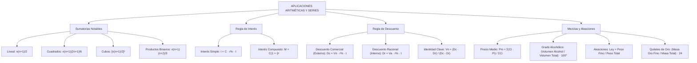

## 1. MARCO CONCEPTUAL Y ONTOLOGÍA
## 1. FICHA TÉCNICA Y MATRIZ DE COMPETENCIAS

| Parámetro | Especificación Oficial |
| :--- | :--- |
| **Eje Temático** | EJE II: Matemática |
| **Asignatura / Componente** | Aritmética |
| **Tema Oficial N.°** | Tema X: Sumatorias notables, interés (simple y compuesto), descuento comercial y racional, mezclas y aleaciones |
| **Referencia Prospecto UNSA** | Resolución de Consejo Universitario N.° 0028-2026 (Págs. 9, 44-45) |
| **Ponderación por Pregunta** | **Ingenierías:** 1.658267400 pts (4 preg. = 6.633070 pts) **Biomédicas:** 1.265447400 pts (3 preg. = 3.796342 pts) **Sociales:** 0.824134300 pts (3 preg. = 2.472403 pts) |
| **Nivel de Complejidad Cognitiva** | Bloom: Análisis Financiero, Modelación Ponderada y Cálculo Algorítmico Multidisciplinario |
| **Conexión Interuniversitaria** | **UNSA:** Relación entre Descuento Comercial y Racional (V_n = \frac{D_c \cdot D_r}{D_c - D_r}), grado de mezclas alcohólicas con destilados y ley de orfebrería en quilates. **UNMSM (DECO):** Préstamos bancarios con amortizaciones fijas e interés compuesto continuo, rendimiento de fondos mutuos y mezclas de granos agrícolas. **UNI:** Tasas instantáneas continuas, descuento bancario compuesto, demostración inductiva de sumatorias de potencias de grado p y balance metalúrgico de aleaciones complejas. |

### Matriz de Indicadores de Logro Evaluados
1. **Sumatorias Notables y Series Especiales:** Aplicar fórmulas cerradas de sumas de números naturales, cuadrados, cubos, productos binarios e inversas telescópicas.
2. **Matemática Financiera - Interés Simple y Compuesto:** Calcular capitales, montos e intereses utilizando tasas de interés homogéneas (anuales) y modelando periodos de capitalización (n).
3. **Regla de Descuento (Comercial y Racional):** Relacionar el Valor Nominal (V_n) con el Valor Actual (V_a), aplicando identidades cruzadas entre el descuento externo (D_c) e interno (D_r).
4. **Mezclas y Aleaciones Metalúrgicas:** Determinar el Precio Medio ponderado de mezclas, el Grado Alcohólico (^\circ) y la Ley de una aleación metálica (fina y liga en quilates de oro).

---

## 2. MAPA TAXONÓMICO Y ONTOLOGÍA

---

## 2. DESARROLLO TEÓRICO FORMAL - PARTE I
### 3. DESARROLLO TEÓRICO FORMAL

### 3.1 Sumatorias Notables Fundamentales
El operador sumatoria \sum_{i=1}^n a_i compacta la adición finita de términos estructurados:

1. **Suma de los n primeros números enteros positivos:**
   \sum_{k=1}^n k = 1 + 2 + 3 + \dots + n = \frac{n(n + 1)}{2}
2. **Suma de los n primeros números pares positivos:**
   \sum_{k=1}^n 2k = 2 + 4 + 6 + \dots + 2n = n(n + 1)
3. **Suma de los n primeros números impares positivos:**
   \sum_{k=1}^n (2k - 1) = 1 + 3 + 5 + \dots + (2n - 1) = n^2
4. **Suma de los n primeros cuadrados perfectos:**
   \sum_{k=1}^n k^2 = 1^2 + 2^2 + 3^2 + \dots + n^2 = \frac{n(n + 1)(2n + 1)}{6}
5. **Suma de los n primeros cubos perfectos:**
   \sum_{k=1}^n k^3 = 1^3 + 2^3 + 3^3 + \dots + n^3 = \left[ \frac{n(n + 1)}{2} \right]^2 = \left( \sum_{k=1}^n k \right)^2
6. **Suma de productos de dos términos consecutivos (Productos Binarios):**
   \sum_{k=1}^n k(k + 1) = 1 \cdot 2 + 2 \cdot 3 + 3 \cdot 4 + \dots + n(n + 1) = \frac{n(n + 1)(n + 2)}{3}
7. **Suma de inversas de productos consecutivos (Serie Telescópica):**
   \sum_{k=1}^n \frac{1}{k(k + 1)} = \frac{1}{1 \cdot 2} + \frac{1}{2 \cdot 3} + \dots + \frac{1}{n(n + 1)} = \frac{n}{n + 1}

---

### 3.2 Regla de Interés
* **Capital (C):** Suma dineraria o activo que se cede en préstamo para generar rentabilidad.
* **Tiempo (t):** Duración del préstamo o colocación financiera.
* **Tasa de Interés o Rédito (r\%):** Porcentaje de ganancia pactado por unidad de tiempo.
* **Monto (M):** Valor acumulado total al término del plazo: M = C + I.

> **Regla de Oro de la Tasa:** En todas las fórmulas de interés, la tasa r\% y el tiempo t deben estar expresados en las **mismas unidades temporales**. Si no se indica la unidad, se asume por ley **tasa anual**.
> - Tasa mensual \times 12 = Tasa anual.
> - Tasa trimestral \times 4 = Tasa anual.
> - Tasa semestral \times 2 = Tasa anual.

#### 1. Interés Simple
El capital original permanece constante a lo largo de todo el periodo (los intereses generados no se capitalizan ni devengan nuevos intereses):
I = C \cdot \left(\frac{r}{100}\right) \cdot t
* **Fórmulas prácticas con tasa anual r\%:**
  I = \frac{C \cdot r \cdot t}{100} \quad (t \text{ en años})
  I = \frac{C \cdot r \cdot t}{1200} \quad (t \text{ en meses})
  I = \frac{C \cdot r \cdot t}{36000} \quad (t \text{ en días, año comercial de } 360 \text{ días})

#### 2. Interés Compuesto
Los intereses devengados en cada periodo pactado se suman al capital inicial para generar nuevos intereses en los periodos sucesivos (**capitalización**):
M = C \cdot (1 + i)^n
- M: Monto compuesto final
- C: Capital inicial
- i: Tasa de interés efectiva por periodo de capitalización
- n: Número total de periodos de capitalización transcurridos (n = t \times \text{frecuencia})
- Interés compuesto total: I_c = M - C = C \cdot [(1 + i)^n - 1]

---

### 3.3 Regla de Descuento

## 3. FORMULARIO FUNDAMENTAL Y LEYES BASE
### 4. FORMULARIO MAESTRO (LATEX ESTRICTO)

| Principio / Ley | Expresión Matemática Rigurosa |
| :--- | :--- |
| **Suma de Naturales** | \sum_{k=1}^n k = \frac{n(n+1)}{2} |
| **Suma de Cuadrados** | \sum_{k=1}^n k^2 = \frac{n(n+1)(2n+1)}{6} |
| **Suma de Cubos** | \sum_{k=1}^n k^3 = \left[\frac{n(n+1)}{2}\right]^2 |
| **Interés Simple** | I = \frac{C \cdot r \cdot t}{100} \quad (M = C + I) |
| **Interés Compuesto** | M = C(1 + i)^n \quad (I_c = M - C) |
