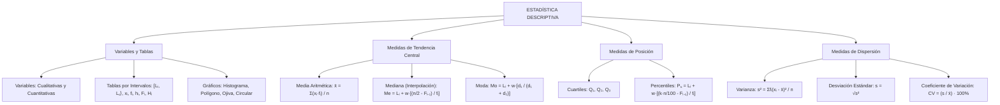

## 1. MARCO CONCEPTUAL Y ONTOLOGÍA
## 1. FICHA TÉCNICA Y MATRIZ DE COMPETENCIAS

| Parámetro | Especificación Oficial |
| :--- | :--- |
| **Eje Temático** | EJE II: Matemática |
| **Asignatura / Componente** | Aritmética |
| **Tema Oficial N.°** | Tema XI: Estadística descriptiva: recolección y tablas, gráficos, medidas de tendencia central, de posición y de dispersión |
| **Referencia Prospecto UNSA** | Resolución de Consejo Universitario N.° 0028-2026 (Págs. 9, 44-45) |
| **Ponderación por Pregunta** | **Ingenierías:** 1.658267400 pts (4 preg. = 6.633070 pts) **Biomédicas:** 1.265447400 pts (3 preg. = 3.796342 pts) **Sociales:** 0.824134300 pts (3 preg. = 2.472403 pts) |
| **Nivel de Complejidad Cognitiva** | Bloom: Análisis Paramétrico, Interpretación Gráfica y Síntesis Estadística Avanzada |
| **Conexión Interuniversitaria** | **UNSA:** Reconstrucción de tablas de frecuencias con datos faltantes a partir de ojivas o histogramas, cálculo analítico de mediana y moda para datos continuos. **UNMSM (DECO):** Análisis de variabilidad en ensayos clínicos, homogeneidad de lotes farmacéuticos mediante coeficiente de variación y diagramas de Pareto. **UNI:** Varianza de datos transformados linealmente (y = ax + b), momentos estadísticos, asimetría de Pearson y percentiles continuos. |

### Matriz de Indicadores de Logro Evaluados
1. **Organización Tabular y Representación Gráfica:** Construir e interpretar tablas de frecuencias unidimensionales (marca de clase x_i, f_i, h_i, F_i, H_i) e histogramas, polígonos y ojivas.
2. **Medidas de Tendencia Central y Posición:** Calcular con rigor analítico la media (\bar{x}), mediana (Me), moda (Mo) y percentiles (P_k) para datos agrupados en intervalos de clase.
3. **Medidas de Variabilidad y Dispersión:** Determinar la varianza (\sigma^2), desviación estándar (s) y evaluar el grado de homogeneidad de una muestra mediante el Coeficiente de Variación (CV).

---

## 2. MAPA TAXONÓMICO Y ONTOLOGÍA

---

## 2. DESARROLLO TEÓRICO FORMAL - PARTE I
### 3. DESARROLLO TEÓRICO FORMAL

### 3.1 Población, Muestra y Clasificación de Variables
* **Población:** Conjunto universal finito o infinito de elementos o unidades de análisis que poseen características observables comunes.
* **Muestra:** Subconjunto representativo y aleatorio seleccionado de la población (n < N).
* **Variable Estadística:** Característica o cualidad observable en los elementos de estudio.
  1. **Cualitativa (Categórica):** Expresa atributos no numéricos.
     - *Nominal:* No admite orden jerárquico natural (ej.: grupo sanguíneo, profesión, estado civil).
     - *Ordinal:* Admite ordenación jerárquica intrínseca (ej.: grado militar, nivel socioeconómico, escala de dolor).
  2. **Cuantitativa (Numérica):** Expresa cantidades numéricas medibles.
     - *Discreta:* Toma valores puntuales aislados en \mathbb{Z} (ej.: número de hijos, cantidad de piezas defectuosas).
     - *Continua:* Puede tomar cualquier valor dentro de un intervalo continuo en \mathbb{R} (ej.: estatura, peso, tiempo, voltaje).

---

### 3.2 Tabla de Distribución de Frecuencias para Datos Agrupados
Cuando el tamaño de la muestra es grande y la variable es continua, los datos se agrupan en k intervalos de clase cerrados a la izquierda y abiertos a la derecha:
I_i = [L_i, L_s\rangle = [L_i, L_{i+1}\rangle \quad (i = 1, 2, \dots, k)
* **Rango o Recorrido (R):** R = x_{\max} - x_{\min}.
* **Número de Intervalos (k):** Determinado usualmente por la **Regla de Sturges**:
  k = 1 + 3.322 \log_{10}(n) \quad (k \in \mathbb{Z}^+)
* **Ancho de Clase o Amplitud (w o C):** Asumiendo intervalos de ancho constante:
  w = \frac{R}{k}
* **Marca de Clase (x_i):** Punto medio del intervalo que actúa como representante representativo:
  x_i = \frac{L_i + L_s}{2}

#### Tipos de Frecuencias:
1. **Frecuencia Absoluta Simple (f_i):** Número de observaciones pertenecientes al intervalo I_i.
   \sum_{i=1}^k f_i = n \quad (\text{tamaño total de la muestra})
2. **Frecuencia Relativa Simple (h_i):** Proporción del total que corresponde al intervalo:
   h_i = \frac{f_i}{n}, \quad 0 \le h_i \le 1, \quad \sum_{i=1}^k h_i = 1 \quad (\text{o } 100\%)
3. **Frecuencia Absoluta Acumulada (F_i):**
   F_i = \sum_{j=1}^i f_j = f_1 + f_2 + \dots + f_i \quad (F_k = n)
4. **Frecuencia Relativa Acumulada (H_i):**
   H_i = \sum_{j=1}^i h_j = \frac{F_i}{n} \quad (H_k = 1)

---

### 3.3 Medidas de Tendencia Central para Datos Agrupados

#### 1. Media Aritmética (\bar{x})
Es el promedio ponderado de las marcas de clase respecto a sus respectivas frecuencias absolutas:
\bar{x} = \frac{\sum_{i=1}^k x_i \cdot f_i}{n} = \sum_{i=1}^k x_i \cdot h_i

#### 2. Mediana (Me)
Es el valor que divide a la distribución ordenada exactamente en dos partes porcentuales iguales (50\% inferior y 50\% superior):
* **Paso 1:** Ubicar la clase mediana identificando el primer intervalo cuya frecuencia acumulada satisfaga:

## 3. FORMULARIO FUNDAMENTAL Y LEYES BASE
### 4. FORMULARIO MAESTRO (LATEX ESTRICTO)

| Medida / Parámetro | Ecuación Canónica |
| :--- | :--- |
| **Marca de Clase** | x_i = \frac{L_i + L_s}{2} |
| **Media Agrupada** | \bar{x} = \frac{1}{n} \sum_{i=1}^k x_i f_i = \sum_{i=1}^k x_i h_i |
| **Mediana Agrupada** | Me = L_i + w \left( \frac{\frac{n}{2} - F_{i-1}}{f_i} \right) |
| **Moda Agrupada** | Mo = L_i + w \left( \frac{f_i - f_{i-1}}{(f_i - f_{i-1}) + (f_i - f_{i+1})} \right) |
