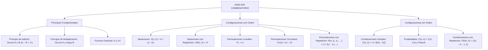

## 1. MARCO CONCEPTUAL Y ONTOLOGÍA
## 1. FICHA TÉCNICA Y MATRIZ DE COMPETENCIAS

| Parámetro | Especificación Oficial |
| :--- | :--- |
| **Eje Temático** | EJE II: Matemática |
| **Asignatura / Componente** | Aritmética |
| **Tema Oficial N.°** | Tema XII: Análisis combinatorio: factorial, variaciones, combinaciones, permutaciones |
| **Referencia Prospecto UNSA** | Resolución de Consejo Universitario N.° 0028-2026 (Págs. 9, 44-45) |
| **Ponderación por Pregunta** | **Ingenierías:** 1.658267400 pts (4 preg. = 6.633070 pts) **Biomédicas:** 1.265447400 pts (3 preg. = 3.796342 pts) **Sociales:** 0.824134300 pts (3 preg. = 2.472403 pts) |
| **Nivel de Complejidad Cognitiva** | Bloom: Razonamiento Inductivo-Deductivo, Modelación Discreta y Estrategia Combinatoria |
| **Conexión Interuniversitaria** | **UNSA:** Permutaciones con elementos juntos/separados, rondas circulares con restricciones y combinaciones con repetición. **UNMSM (DECO):** Rutas y caminos en cuadrículas urbanas, conformación de comités paritarios y distribución de turnos médicos hospitalarios. **UNI:** Identidades combinatorias de Vandermonde, principio de inclusión-exclusión de Sylvester y particiones de enteros en teoría de grafos. |

### Matriz de Indicadores de Logro Evaluados
1. **Principios Fundamentales de Conteo:** Discriminar con rigor entre situaciones aditivas (sucesos excluyentes) y multiplicativas (etapas sucesivas o simultáneas).
2. **Modelado Factorial y Variaciones:** Operar expresiones algebraicas factoriales y calcular variaciones lineales con y sin repetición donde el orden de los elementos es determinante.
3. **Sistemas Permutacionales:** Resolver configuraciones lineales, circulares y con elementos repetidos bajo condiciones de ligadura (elementos juntos, adyacentes o separados).
4. **Teoría Combinatoria y Binomial:** Aplicar números combinatorios, propiedades de complementariedad, identidad de Pascal y combinaciones con repetición en problemas de partición.

---

## 2. MAPA TAXONÓMICO Y ONTOLOGÍA

---

## 2. DESARROLLO TEÓRICO FORMAL - PARTE I
### 3. DESARROLLO TEÓRICO FORMAL

### 3.1 Principios Fundamentales del Conteo

#### 1. Principio de Adición
Si un evento o actividad A puede ocurrir de m maneras diferentes y otro evento B puede ocurrir de n maneras diferentes, y **ambos eventos son mutuamente excluyentes** (no pueden ocurrir simultáneamente ni en secuencia: A \cap B = \emptyset), entonces el evento "A o B" puede ocurrir de:
N = m + n \text{ maneras}

#### 2. Principio de Multiplicación (Principio Fundamental)
Si un experimento o procedimiento se compone de dos etapas sucesivas o independientes, donde la primera etapa puede realizarse de m formas distintas y, para cada una de ellas, la segunda etapa puede realizarse de n formas distintas, entonces el procedimiento completo "A y luego B" puede realizarse de:
N = m \times n \text{ maneras}

---

### 3.2 La Función Factorial (n!) y Semifactorial (n!!)
Para todo número entero no negativo n \in \mathbb{N} \cup \{0\}, el factorial se define axiomáticamente:
0! = 1
n! = 1 \cdot 2 \cdot 3 \dots (n - 1) \cdot n = n \cdot (n - 1)! \quad (\forall n \ge 1)

* **Semifactorial o Factorial Doble (n!!):**
  n!! = \begin{cases} 2 \cdot 4 \cdot 6 \dots n, & \text{si } n \text{ es par} \\ 1 \cdot 3 \cdot 5 \dots n, & \text{si } n \text{ es impar} \end{cases}

---

### 3.3 El Cuadro de Decisión Combinatoria
Frente a cualquier problema de conteo, la elección del modelo se rige por dos preguntas axiomáticas:

| Modelo Combinatorio | ¿Importa el Orden? | ¿Intervienen Todos los Elementos? | ¿Se Pueden Repetir? | Fórmula Canónica |
| :--- | :---: | :---: | :---: | :--- |
| **Variación Simple (V_k^n)** | **SÍ** | NO (k < n) | NO | V_k^n = \frac{n!}{(n - k)!} |
| **Variación con Repetición (VR_k^n)** | **SÍ** | NO o SÍ | **SÍ** | VR_k^n = n^k |
| **Permutación Lineal (P_n)** | **SÍ** | **SÍ** (k = n) | NO | P_n = n! |
| **Permutación Circular (P_c(n))** | **SÍ** | **SÍ** (en anillo) | NO | P_c(n) = (n - 1)! |
| **Permutación con Repetición (P_n^{k_1, \dots, k_r})** | **SÍ** | **SÍ** | **SÍ** | P_n^{k_1, \dots, k_r} = \frac{n!}{k_1! \cdot k_2! \dots k_r!} |
| **Combinación Simple (C_k^n)** | **NO** | NO (k \le n) | NO | C_k^n = \frac{n!}{k!(n - k)!} |

## 3. FORMULARIO FUNDAMENTAL Y LEYES BASE
### 4. FORMULARIO MAESTRO (LATEX ESTRICTO)

| Estructura Combinatoria | Expresión Matemática Rigurosa |
| :--- | :--- |
| **Variación Simple** | V_k^n = \frac{n!}{(n - k)!} = n(n - 1)(n - 2)\dots(n - k + 1) |
| **Variación con Repetición** | VR_k^n = n^k |
| **Permutación Lineal** | P_n = n! |
| **Permutación Circular** | P_c(n) = (n - 1)! |
