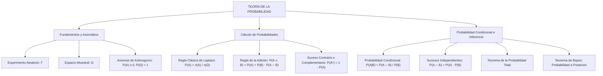

## 1. MARCO CONCEPTUAL Y ONTOLOGÍA
## 1. FICHA TÉCNICA Y MATRIZ DE COMPETENCIAS

| Parámetro | Especificación Oficial |
| :--- | :--- |
| **Eje Temático** | EJE II: Matemática |
| **Asignatura / Componente** | Aritmética |
| **Tema Oficial N.°** | Tema XIII: Probabilidad: fenómeno aleatorio, espacio muestral, equiprobabilidad, sucesos independientes y probabilidad condicional |
| **Referencia Prospecto UNSA** | Resolución de Consejo Universitario N.° 0028-2026 (Págs. 9, 44-45) |
| **Ponderación por Pregunta** | **Ingenierías:** 1.658267400 pts (4 preg. = 6.633070 pts) **Biomédicas:** 1.265447400 pts (3 preg. = 3.796342 pts) **Sociales:** 0.824134300 pts (3 preg. = 2.472403 pts) |
| **Nivel de Complejidad Cognitiva** | Bloom: Análisis Probabilístico, Inferencia Bayesiana y Modelación Estocástica |
| **Conexión Interuniversitaria** | **UNSA:** Probabilidad clásica laplaciana con combinatoria avanzada, independencia estocástica y teorema de Bayes en pruebas médicas. **UNMSM (DECO):** Sensibilidad y especificidad de pruebas diagnósticas (ELISA, PCR), control de calidad de lotes y árboles de decisión financiera. **UNI:** Variables aleatorias discretas, esperanza matemática, distribución binomial hipergeométrica y axiomas de medida de Kolmogorov. |

### Matriz de Indicadores de Logro Evaluados
1. **Espacio Muestral y Eventos:** Construir el espacio muestral (\Omega) de experimentos aleatorios y operar sucesos (unión, intersección, complemento, eventos mutuamente excluyentes).
2. **Definición Clásica de Laplace y Axiomas de Kolmogorov:** Calcular probabilidades en espacios muestrales equiprobables finitos aplicando técnicas combinatorias rigurosas.
3. **Probabilidad Condicional e Independencia Estocástica:** Discriminar sucesos dependientes e independientes aplicando la regla de multiplicación y la definición formal de probabilidad condicional.
4. **Teorema de la Probabilidad Total y Teorema de Bayes:** Modelar particiones del espacio muestral para calcular probabilidades a priori y actualizar probabilidades a posteriori.

---

## 2. MAPA TAXONÓMICO Y ONTOLOGÍA

---

## 2. DESARROLLO TEÓRICO FORMAL - PARTE I
### 3. DESARROLLO TEÓRICO FORMAL

### 3.1 Experimentos, Espacios Muestrales y Eventos
* **Experimento Determinista:** Aquel cuyo resultado exacto puede predecirse con certeza antes de su ejecución si se mantienen idénticas las condiciones iniciales (ej.: soltar una piedra al vacío y calcular su tiempo de caída con la ley de gravedad).
* **Experimento Aleatorio (\mathcal{E}):** Aquel cuyo resultado no puede anticiparse con certeza antes de su realización, aun conociendo todas las posibilidades teóricas (ej.: lanzar dos dados, extraer una carta de una baraja).
* **Espacio Muestral (\Omega):** Conjunto universal no vacío constituido por la totalidad de los resultados elementales posibles del experimento aleatorio \mathcal{E}.
* **Evento o Suceso (A):** Cualquier subconjunto del espacio muestral (A \subseteq \Omega).
  - **Suceso Elemental:** Subconjunto unitario (\{w_i\} \subset \Omega).
  - **Suceso Seguro:** El propio espacio muestral \Omega (P(\Omega) = 1).
  - **Suceso Imposible:** El conjunto vacío \emptyset (P(\emptyset) = 0).
  - **Sucesos Mutuamente Excluyentes:** A \cap B = \emptyset (no pueden coexistir simultáneamente).
  - **Sucesos Colectivamente Exhaustivos:** A \cup B = \Omega.

---

### 3.2 Definición Clásica de Laplace (Espacios Equiprobables)
Si un experimento aleatorio posee un espacio muestral finito \Omega constituido por n resultados posibles **mutuamente excluyentes y con la misma probabilidad de ocurrencia (equiprobables)**, la probabilidad del evento A es:
P(A) = \frac{\text{Número de casos favorables a } A}{\text{Número total de casos posibles en } \Omega} = \frac{n(A)}{n(\Omega)}
donde 0 \le P(A) \le 1.

---

### 3.3 Axiomática de Kolmogorov y Teoremas Derivados
Sea \Omega un espacio muestral y \mathcal{F} un álgebra de eventos sobre \Omega. Una función de probabilidad P: \mathcal{F} \to \mathbb{R} satisface formalmente los **tres axiomas de Kolmogorov**:
1. **Axioma de No Negatividad:**
   P(A) \ge 0, \quad \forall A \in \mathcal{F}
2. **Axioma de Certidumbre:**
   P(\Omega) = 1
3. **Axioma de Aditividad:**
   Para cualquier secuencia de eventos mutuamente disjuntos dos a dos (A_i \cap A_j = \emptyset, \; \forall i \neq j):
   P\left( \bigcup_{i=1}^\infty A_i \right) = \sum_{i=1}^\infty P(A_i)

#### Teoremas Derivados Fundamentales:
1. P(\emptyset) = 0.
2. **Regla del Complemento:**
   P(A^c) = 1 - P(A)
3. **Acotamiento Universal:**
   0 \le P(A) \le 1, \quad \forall A
4. **Regla General de la Adición (Sucesos Compatibles):**
   P(A \cup B) = P(A) + P(B) - P(A \cap B)
5. **Para tres eventos cualesquiera:**
   P(A \cup B \cup C) = P(A) + P(B) + P(C) - P(A \cap B) - P(A \cap C) - P(B \cap C) + P(A \cap B \cap C)

## 3. FORMULARIO FUNDAMENTAL Y LEYES BASE
### 4. FORMULARIO MAESTRO (LATEX ESTRICTO)

| Ley / Teorema | Expresión Matemática Rigurosa |
| :--- | :--- |
| **Definición de Laplace** | P(A) = \frac{n(A)}{n(\Omega)} \quad (0 \le P(A) \le 1) |
| **Suceso Complementario** | P(A^c) = 1 - P(A) |
| **Regla de la Adición** | P(A \cup B) = P(A) + P(B) - P(A \cap B) |
| **Sucesos Excluyentes** | P(A \cup B) = P(A) + P(B) \quad (A \cap B = \emptyset) |
