# TEMA 02: CIUDADANÍA: DERECHOS Y DEBERES

---

## 2. MAPA CONCEPTUAL Y ÁRBOL DE LA CIUDADANÍA PERUANA

```mermaid
graph TD
 ROOT["Ciudadanía y participación"]
 B1["Conceptos diferentes"]
 B1N1["Distinguir persona, nacionalidad, ciudadanía y ejercicio de derechos políticos."]
 B1N2["El artículo 30 vincula la ciudadanía con la condición de peruano y la mayoría de edad de dieciocho años."]
 B1N3["La inscripción electoral se exige para el ejercicio de la ciudadanía; no confundir ese requisito con la definición de persona."]
 B2["Participación y sufragio"]
 B2N1["Elegir y ser elegido se ejerce según condiciones y procedimientos establecidos."]
 B2N2["La participación pública incluye mecanismos distintos del voto en una elección de representantes."]
 B2N3["El artículo 31 distingue voto obligatorio y facultativo; las condiciones de un proceso concreto requieren consultar su información oficial."]
 B3["Ejercicio y suspensión"]
 B3N1["El artículo 33 regula suspensión del ejercicio de la ciudadanía; no equivale a borrar identidad ni dignidad."]
 B3N2["No deducir automáticamente la habilitación electoral de poseer un DNI: distinguir identificación e inscripción electoral."]
 B3N3["No confundir una propuesta de reforma con una disposición ya aprobada y vigente."]
 B4["Identidad y vida común"]
 B4N1["Los símbolos nacionales y la diversidad cultural son dimensiones de identidad colectiva."]
 B4N2["La identidad no exige uniformidad de lengua, costumbres o convicciones."]
 B4N3["Distinguir obligaciones establecidas por normas de actitudes cívicas que requieren justificación y participación."]
 ROOT --> B1
 B1 --> B1N1
 B1 --> B1N2
 B1 --> B1N3
 ROOT --> B2
 B2 --> B2N1
 B2 --> B2N2
 B2 --> B2N3
 ROOT --> B3
 B3 --> B3N1
 B3 --> B3N2
 B3 --> B3N3
 ROOT --> B4
 B4 --> B4N1
 B4 --> B4N2
 B4 --> B4N3
```

---

## 3. DESARROLLO TEÓRICO RIGUROSO

### A. Concepto y Adquisición de la Ciudadanía en el Perú
1. **Definición**: Vínculo jurídico-político que une a una persona con el Estado, confiriéndole la plenitud de derechos civiles y políticos para intervenir activamente en los asuntos públicos de la nación.
2. **Requisitos Constitucionales (Artículo 30° de la Constitución)**:
   - *"Son ciudadanos los peruanos mayores de dieciocho años. Para el ejercicio de la ciudadanía se requiere la inscripción electoral"*.
   - Por ende, son tres condiciones concurrentes:
     1. Ser peruano de nacimiento o por naturalización.
     2. Haber cumplido los 18 años de edad.
     3. Estar debidamente inscrito en el Registro Nacional de Identificación y Estado Civil (RENIEC) y contar con el Documento Nacional de Identidad (DNI) electrónico o convencional.

### C. Deberes Cívicos Fundamentales del Ciudadano
Conforme al Artículo 38° de la Constitución: *"Todos los peruanos tienen el deber de honrar al Perú y de proteger los intereses nacionales, así como de respetar, cumplir y defender la Constitución y el ordenamiento jurídico de la Nación"*.
- **Votar con responsabilidad cívica** e informada.
- **Pagar tributos legítimos** para el sostenimiento de los servicios públicos esenciales del Estado.
- **Defender la soberanía y la integridad territorial** de la patria en caso de agresión o calamidad.
- **Respetar los derechos humanos y libertades** de los demás conciudadanos.
- **Participar cívicamente** en los comités de defensa civil, juntas vecinales y jurados electorales (rol de miembro de mesa).

### D. Suspensión del Ejercicio de la Ciudadanía
El **Artículo 33° de la Constitución Política del Perú** establece de manera taxativa y cerrada las tres únicas causales por las cuales se suspende el ejercicio de la ciudadanía y de los derechos políticos:
1. **Por resolución judicial de interdicción**:
   - Declaración judicial dictada respecto a personas que adolecen de incapacidad absoluta de discernimiento o deterioro mental grave que les impide manifestar su voluntad (regulada con el nuevo régimen de apoyos y salvaguardias del Código Civil).
2. **Por sentencia con pena privativa de la libertad**:
   - Condena penal consentida y ejecutoriada que impone reclusión carcelaria efectiva en un establecimiento penitenciario.
3. **Por sentencia con inhabilitación de los derechos políticos**:
   - Sanción penal o condena impuesta por el Poder Judicial o juicio político del Congreso (Art. 100° Const.) que suspende expresamente la facultad de votar, postular o ejercer función pública por un tiempo determinado.
- *Nota Crucial*: La ciudadanía **se suspende temporalmente**, no se pierde definitivamente la nacionalidad de origen. Al extinguirse la pena o revocarse la medida judicial, los derechos ciudadanos se rehabilitan automáticamente.

## 4. CUADRO COMPARATIVO: LAS TRES CAUSALES DE SUSPENSIÓN DE LA CIUDADANÍA (ART. 33°)

| Causal Constitucional | Órgano que la Emite | Efecto Jurídico Directo | Momento de Rehabilitación |
| :--- | :--- | :--- | :--- |
| **1. Interdicción Judicial** | Juez Civil competente. | El ciudadano no puede sufragar ni realizar actos jurídicos por sí mismo. | Cuando cesa la causa judicial y se dicta resolución de rehabilitación. |
| **2. Pena Privativa de la Libertad** | Juez Penal (Sentencia consentida). | Suspensión del derecho a sufragio y reclusión carcelaria efectiva. | Al cumplir la condena impuesta o recibir indulto/conmutación de pena. |
| **3. Inhabilitación de Derechos Políticos** | Poder Judicial o Congreso (Juicio político).| Impedimento de ejercer cargos públicos, elegir y ser elegido. | Al vencer el plazo fijado en la sentencia judicial o resolución legislativa. |

---

## 5. MNEMOTECNIAS PREUNIVERSITARIAS

### Nemotecnia de las Causas de Suspensión (Art. 33°):
> **"IN - PE - IN"**
- **IN**: **In**terdicción judicial
- **PE**: **Pe**na privativa de la libertad
- **IN**: **In**habilitación de derechos políticos

## 7. PROBLEMAS RESUELTOS CON RIGOR GRADUAL

### Nivel 1: Básico / Definición Directa
**Enunciado**: De conformidad con el Artículo 30° de la Constitución Política del Perú, para ser legalmente considerado ciudadano peruano se requiere haber cumplido la edad mínima de:
A) 16 años  
B) 21 años  
C) 18 años  
D) 25 años  
E) 17 años con libreta militar  

- **Resolución**: El artículo 30° de la Constitución señala taxativamente que son ciudadanos los peruanos mayores de **dieciocho (18) años**.
- **Clave Correcta**: **C**

---

### Nivel 2: Intermedio / Comprensión de Causales
**Enunciado**: ¿En cuál de las siguientes circunstancias se produce la suspensión legítima del ejercicio de la ciudadanía según el Artículo 33° de la Constitución peruana?
A) Por no haber sufragado en dos elecciones generales consecutivas.  
B) Por residir en el extranjero por más de cinco años sin registrarse en el consulado.  
C) Por sentencia judicial firme con pena privativa de la libertad efectiva.  
D) Por encontrarse en situación de desempleo o quiebra económica comercial.  
E) Por afiliarse a un sindicato laboral de trabajadores del sector público.  

- **Resolución**: El artículo 33° inciso 2 de la Constitución establece expresamente que el ejercicio de la ciudadanía se suspende *"por sentencia con pena privativa de la libertad"*.
- **Clave Correcta**: **C**

---

### Nivel 3: Aplicación / Casuística
**Enunciado**: Don Juan Carlos, un docente arequipeño jubilado de 72 años de edad, decide no asistir a votar en las elecciones regionales y municipales del presente año debido a problemas de movilidad física. De acuerdo con el ordenamiento constitucional peruano, don Juan Carlos:
A) Debe ser recluido por tres días en un penal por delito contra el sufragio.  
B) Está exonerado de la obligatoriedad del voto, por lo que no se le aplicará ninguna multa electoral.  
C) Pierde automáticamente la nacionalidad peruana y sus derechos sucesorios.  
D) Debe pagar una multa triplicada por haber ejercido la docencia pública.  
E) Sufrirá la suspensión de su ciudadanía mediante resolución de interdicción.  

- **Resolución**: El artículo 31° de la Constitución establece que el voto es obligatorio hasta los setenta (70) años de edad. A partir de esa edad, el voto es facultativo y no genera multas electorales por inasistencia.
- **Clave Correcta**: **B**

---

### Nivel 5: Reto Extremo (Boss Challenge / UNI - UNSA Medicina)
**Enunciado**: Un ciudadano que se desempeñaba como Ministro de Estado es sometido a un juicio político por la Comisión Permanente y el Pleno del Congreso de la República conforme a los Artículos 99° y 100° de la Constitución, imputándosele una infracción constitucional grave. Tras la votación calificada reglamentaria, el Congreso aprueba una resolución legislativa sancionándolo con la *inhabilitación para el ejercicio de la función pública por diez años*. Respecto a los derechos ciudadanos del exministro, dicha sanción constitucional implica que:
A) Pierde irrevocablemente el derecho a la vida y a la libertad de pensamiento.  
B) El sancionado no podrá ser nombrado en cargos públicos ni postular a elecciones populares durante el decenio fijado, quedando suspendidos sus derechos políticos específicos.  
C) Se extingue su partida de nacimiento y es despojado de su patrimonio privado de inmediato.  
D) Queda privado de transitar libremente por el territorio nacional en calidad de ciudadano civil.  
E) El sancionado puede apelar ante el Consejo de Seguridad de las Naciones Unidas como última instancia.  

- **Resolución**: Conforme al Artículo 100° y al Artículo 33° inciso 3 de la Constitución, la inhabilitación política aprobada por el Congreso suspende temporalmente los derechos políticos del funcionario, inhabilitándolo para postular a cargos de elección popular, desempeñar empleos públicos o ejercer funciones representativas durante el período de la sanción, sin anular sus demás derechos fundamentales civiles.
- **Clave Correcta**: **B**

---

## 8. GLOSARIO TÉCNICO DE 10 TÉRMINOS CÍVICOS
1. **Ciudadanía**: Condición jurídico-política que adquiere un peruano al cumplir 18 años para intervenir en la gestión del Estado.
2. **Sufragio**: Derecho y deber constitucional mediante el cual los ciudadanos expresan su voluntad política en comicios electorales.
3. **Interdicción Civil**: Declaración judicial que priva a una persona del ejercicio directo de sus derechos civiles por incapacidad absoluta de discernimiento.
4. **Inhabilitación Política**: Sanción que priva temporalmente a una persona del derecho de ejercer funciones públicas y participar activamente en elecciones.
5. **Voto Facultativo**: Derecho a sufragar de manera voluntaria sin que su omisión acarree multas ni sanciones administrativas (mayores de 70 años).
6. **Padrón Electoral**: Relación oficial de ciudadanos hábiles elaborada por el RENIEC y fiscalizada por el JNE para sufragar en un proceso comicial.
7. **Identidad Nacional**: Sentimiento de pertenencia colectiva a una comunidad histórica, cultural y política soberana articulada en torno a valores compartidos.
8. **Interculturalidad**: Diálogo horizontal, enriquecedor y respetuoso entre diversas identidades culturales que conviven dentro de una misma nación.
9. **Símbolos Patrios**: Expresiones visuales y sonoras oficiales (Bandera, Escudo, Himno Nacional) consagradas por la Constitución para representar a la República.
10. **Juicio Político**: Procedimiento parlamentario (Arts. 99° y 100° Const.) para investigar y sancionar a altos dignatarios del Estado por infracciones a la Constitución.

---

## 9. FLASHCARDS DE REPASO RÁPIDO (ANVERSO / REVERSO)

- **Flashcard 1**:
  - *Anverso*: ¿A partir de qué edad el voto deja de ser obligatorio en el Perú y no genera multa?
  - *Reverso*: A partir de los 70 años cumplidos (es voto facultativo).

- **Flashcard 2**:
  - *Anverso*: ¿Cuáles son los tres símbolos de la patria consagrados en el Artículo 49° de la Constitución?
  - *Reverso*: 1) La Bandera; 2) El Escudo; 3) El Himno Nacional (la Escarapela NO es símbolo constitucional).

- **Flashcard 3**:
  - *Anverso*: ¿Cuáles son las tres causales constitucionales de suspensión de la ciudadanía (Art. 33°)?
  - *Reverso*: 1) Interdicción judicial; 2) Pena privativa de la libertad efectiva; 3) Inhabilitación de los derechos políticos.

- **Flashcard 4**:
  - *Anverso*: ¿Pueden votar los miembros de las FF. AA. y la Policía Nacional en el Perú?
  - *Reverso*: Sí, tienen derecho al voto desde la reforma del año 2005, pero no pueden postular ni hacer proselitismo partidario en servicio activo.

---

### B. Derechos Políticos del Ciudadano (Artículo 31° de la Constitución)
1. **Derecho al Sufragio (Voto)**:
   - Características constitucionales del voto en el Perú:
     - **Personal**: Nadie puede votar a través de apoderado o intermediario.
     - **Igual**: Cada voto tiene el mismo valor aritmético (*"Un ciudadano, un voto"*).
     - **Libre**: Emisión sin coacción física, económica o religiosa.
     - **Secreto**: Se garantiza la privacidad e inviolabilidad de la cabina de votación.
     - **Obligatorio**: Es obligatorio desde los 18 hasta los **70 años**. A partir de los 70 años cumplidos, el sufragio deviene en **facultativo o voluntario** (los mayores de 70 años no pagan multa por no votar).
     - *Fuerzas Armadas y Policía Nacional*: Desde la reforma constitucional del año 2005 (Ley N.° 28480), los miembros de las FF. AA. y la PNP en actividad tienen derecho al voto y a la participación ciudadana, pero **no pueden postular a cargos de elección popular ni participar en actividades proselitistas partidarias**.
2. **Derecho a Elegir y ser Elegido**:
   - Facultad de postular a cargos públicos de representación popular (Presidente, Congresistas, Gobernadores Regionales, Alcaldes, Regidores) cumpliendo los requisitos constitucionales de ley.
3. **Mecanismos de Participación y Control Ciudadano**:
   - Participación: Referéndum, iniciativa legislativa e iniciativa de reforma constitucional.
   - Control: Revocatoria, remoción de autoridades y demanda de rendición de cuentas (desarrollados en la Ley N.° 26300).

### E. Identidad Nacional, Interculturalidad y Símbolos de la Patria
1. **Símbolos de la Patria (Artículo 49° de la Constitución)**:
   - *"Son símbolos de la patria la bandera de tres franjas verticales con los colores rojo y blanco, y el escudo y el himno nacional establecidos por ley"*.
   - *Aclaración de Examen*: La **Escarapela** es un distintivo cívico tradicional o emblema nacional de uso popular en Fiestas Patrias, pero **NO es un símbolo patrio oficial según el artículo 49° de la Constitución**.
2. **Capitales Constitucionales**:
   - Capital de la República del Perú: La ciudad de **Lima**.
   - Capital Histórica del Perú: La ciudad del **Cusco** (Art. 49° Const.).
3. **Pluriculturalidad y Lenguas Oficiales (Artículo 48° de la Constitución)**:
   - *"Son idiomas oficiales el castellano y, en las zonas donde predominen, también lo son el quechua, el aimara y las demás lenguas aborígenes, según la ley"*.
   - El Perú es un Estado pluricultural y multiétnico que protege la diversidad de costumbres, tradiciones y patrimonio inmaterial de sus pueblos andinos y amazónicos.

---

## 6. CASUÍSTICA Y "HACKING" DE EXÁMENES (TRAMPAS FRECUENTES)
1. **La trampa de la Escarapela**: Pregunta clásica de admisión: *"¿Cuál de los siguientes NO es un símbolo patrio reconocido por el Artículo 49° de la Constitución?"*
   - La respuesta es **La Escarapela**. Los únicos tres símbolos constitucionales son: la Bandera, el Escudo y el Himno Nacional.
2. **La edad del voto facultativo**:
   - El voto es obligatorio hasta los **70 años**. A los 70 años y un día, no hay sanción por no votar. Si el examen dice "hasta los 65 años" (edad de jubilación), es una trampa deliberada.
3. **Militares y Policías**:
   - Tienen derecho al voto desde el 2005. Lo que **no pueden** es postular a elecciones mientras estén en servicio activo ni deliberar o militar en partidos políticos.

---

### Nemotecnia de las Características del Voto:
> **"PE - I - LI - SE - O"**
- **PE**: Personal (no transferible)
- **I**: Igual (vale uno)
- **LI**: Libre (sin coacción)
- **SE**: Secreto (cabina privada)
- **O**: Obligatorio hasta los 70 años (luego es optativo)

---

### No confundir las categorías

| Categoría | Pregunta orientativa | Precisión |
|---|---|---|
| Persona | ¿A quién se reconoce dignidad y derechos? | No se limita al grupo que puede votar |
| Nacionalidad | ¿Cuál es el vínculo jurídico con un Estado? | No equivale a residencia o afinidad cultural |
| Ciudadanía | ¿Qué condición política regula el artículo 30? | Distinguir condición de peruano y mayoría de edad |
| Ejercicio | ¿Qué requisitos se exigen para ejercer derechos políticos? | La inscripción electoral pertenece a este plano |

**Importante:** el mapa no determina la situación electoral individual de alguien. Identificación, inscripción y habilitación son cuestiones que no deben confundirse al estudiar las normas.
