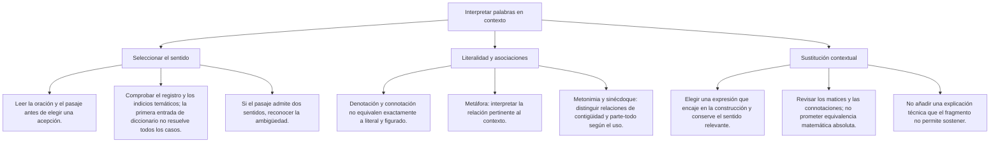

# TEMA VI: Vocabulario en Contexto

---

## 2. MAPA TAXONÓMICO Y ONTOLOGÍA

### Hack 1: Descarte de Sinónimos Descontextualizados
En preguntas del tipo: *"En el texto, el vocablo VAPULEAR se entiende como..."*:
- El distractor número uno será: *"Golpear físicamente con un palo"*.
- Si el texto hablaba de un debate electoral donde un candidato humilló con argumentos al otro:
  - **HACK:** Tacha de inmediato el significado físico bruto.
  - La clave correcta será: *"Refutar contundentemente"* o *"Superar dialécticamente"*.

## 7. ZONA DE TRAMPAS Y DISTRACTORES ("¡PELIGRO EXAMEN!")

> [!WARNING]
> **Trampa 1: La Primera Acepción del Diccionario**
> **Importante:** el contexto orienta la acepción pertinente. No debe suponerse una intención universal de las comisiones de admisión ni que la primera acepción sea siempre incorrecta.

> [!CAUTION]
> **Trampa 2: La Alternativa de Mayor Nivel Académico Aparente**
> No te dejes deslumbrar por palabras rimbombantes o arcaicas en las opciones. A veces la sustitución contextual más exacta es una palabra sencilla pero de precisión quirúrgica.

---

### Texto Base para los Ejercicios 3 y 4
*"En el marco de la teoría económica institucional de Daron Acemoglu y James Robinson, la prosperidad de las naciones no depende de factores geográficos, climáticos ni raciales, sino de la calidad de sus instituciones políticas y económicas. Aquellas sociedades dominadas por 'instituciones extractivas' concentran el poder y la riqueza en manos de una élite reducida que **exprime** los recursos de la mayoría de la población sin otorgar garantías de propiedad privada ni incentivos para la innovación tecnológica. Por el contrario, las naciones que logran forjar 'instituciones inclusivas' distribuyen el poder ampliamente en la sociedad, garantizan la seguridad jurídica para las inversiones y fomentan un terreno de juego parejo donde el talento individual y la 'destrucción creativa' schumpeteriana pueden florecer, permitiendo un crecimiento económico sostenido y una movilidad social ascendente."*

---

### Ejercicio 3 (Nivel Intermedio-Avanzado: Metáfora Económica Contextual)
**Enunciado:** En el texto, el verbo **EXPRIMIR** connota directamente la acción de:
A) Extraer el jugo de frutos cítricos mediante presión manual o mecánica.  
B) Despojar y explotar sistemáticamente los excedentes económicos de la población.  
C) Destilar licores artesanales en haciendas coloniales costeras.  
D) Reducir el tamaño físico de las monedas de curso legal.  
E) Donar fondos caritativos a comunidades campesinas vulnerables.  

**Resolución Paso a Paso:**
1. Rastreando el contexto oracional: *"una élite reducida que **exprime** los recursos de la mayoría de la población sin otorgar garantías..."*.
2. El verbo común *exprimir* (sacar zumo por presión) está siendo utilizado en sentido metafórico sociopolítico.
3. La élite política extractiva despoja a los ciudadanos del fruto de su trabajo mediante impuestos confiscatorios, monopolios y abusos sin redistribución equitativa.
4. El significado trasladado al ámbito económico institucional es **explotar, despojar o esquilmar sistemáticamente los recursos y riquezas ajenas**.
5. La opción B traduce esta metáfora económica con precisión rigurosa.
**Respuesta:** B

---

### Ejercicio 5 (Nivel 5: Boss Challenge - Resignificación Ontológica en Física Cuántica)
**Enunciado (Nivel UNI / Máxima Exigencia):** Lea el siguiente pasaje sobre mecánica cuántica:
*"En el formalismo ortodoxo de la Escuela de Copenhague, una partícula subatómica antes de ser sometida a un acto experimental de medición no posee una posición espacial definida, sino que existe como una onda de probabilidad matemática descrita por la ecuación de Schrödinger. Es la interacción irreversible con el aparato macroscópico de observación lo que provoca el denominado 'colapso' de la función de onda, obligando a la naturaleza a **elegir** un valor propio determinado entre el espectro de posibilidades infinitas del espacio de Hilbert."*
En el contexto del formalismo cuántico citado, el empleo del verbo **ELEGIR** constituye:
A) La prueba científica irrefutable de que las partículas subatómicas poseen libre albedrío y voluntad moral consciente.  
B) Una personificación metafórica que designa la transición probabilística hacia la concreción de un estado cuántico particular observable.  
C) Un error gramatical involuntario de traducción del idioma alemán que carece de todo sentido físico.  
D) La confirmación de que los científicos deciden arbitrariamente las coordenadas atómicas con sus pensamientos.  
E) La demostración de que el espacio de Hilbert es un lugar geográfico tangible del cosmos.  

**Resolución Paso a Paso:**
1. Desglosamos la tensión conceptual del verbo *elegir*:
   - Literalmente, "elegir" es un acto de voluntad deliberada propio de seres con conciencia psicológica humana (antropomorfismo).
   - En la física cuántica, las partículas y las ondas no tienen cerebro ni alma volitiva; son entidades inanimadas regidas por leyes matemáticas.
2. Analizamos el contexto físico:
   - Antes de medir: Infinitas probabilidades superpuestas.
   - Tras medir: Se observa un solo valor medible en el laboratorio (colapso de la función de onda).
   - El físico recurre a la **personificación o metáfora pedagógica** (*"obligando a la naturaleza a elegir"*) para expresar de forma gráfica cómo una nube de probabilidades se concreta en una realidad física medible individual.
3. La opción B desentraña con maestría epistemológica el uso figurado del tecnicismo.
**Respuesta:** B

---

## 10. GLOSARIO DE TÉRMINOS CLAVE

1. **Vocabulario en Contexto:** Interpretación semántica de un término condicionada por las redes proposicionales del texto.
2. **Denotación:** Significado literal, objetivo y universalmente acordado de una palabra en la comunidad lingüística.
3. **Connotación:** Valores semánticos secundarios, afectivos o metafóricos añadidos por el contexto o la cultura.
4. **Metáfora:** Tropo que consiste en trasladar el sentido recto de las voces a otro figurado en virtud de una analogía.
5. **Tecnicismo:** Vocablo propio del lenguaje especializado de un arte, ciencia, oficio o disciplina académica.
6. **Desambiguación:** Proceso cognitivo de seleccionar la única acepción pertinente de un término polisémico en un enunciado.
7. **Sustitución Salva-Verdad:** Reemplazo de un vocablo por otro sin alterar la verdad proposicional ni la gramática oracional.
8. **Personificación:** Figura retórica que atribuye propiedades o acciones humanas a objetos inanimados o conceptos abstractos.
9. **Anacronismo Semántico:** Error de atribuir a un texto histórico el significado contemporáneo moderno de una palabra.
10. **Acepción:** Cada uno de los significados diferenciados que una palabra ostenta formalmente en el diccionario.

---

## 11. BANCO DE FLASHCARDS (Q/A)

- **Q: ¿Por qué en un examen de admisión nunca se debe buscar el significado de una palabra de forma aislada?**  
  **A:** Porque el contexto activa unos semas e inhibe otros; una palabra puede significar cosas opuestas según la disciplina del texto.
- **Q: ¿Qué condición obligatoria debe cumplir un sinónimo contextual para ser la clave correcta?**  
  **A:** Debe preservar exactamente la categoría gramatical original y encajar en el hueco sin distorsionar el sentido del autor.
- **Q: Si en un texto de medicina se lee "El cuadro clínico del paciente", ¿qué significa "cuadro"?**  
  **A:** Significa conjunto o espectro de signos, síntomas y manifestaciones patológicas; no es una pintura artística.
- **Q: ¿Qué es una metáfora conceptual?**  
  **A:** La estructuración de un concepto abstracto en términos de una experiencia física tangible (ejemplo: "el tiempo es dinero").
- **Q: ¿Cómo ayuda un conector adversativo a deducir el significado de una palabra desconocida?**  
  **A:** Porque presenta una idea contraria; si comprendes el término conocido después del conector, el término desconocido será su antónimo.

---

### Ontología de la Semántica Contextual
- **Contexto Lingüístico:** Conjunto de palabras, sintagmas y oraciones que rodean a un término condicionando y actualizando uno solo de sus semas potenciales.
- **Resignificación:** Proceso dinámico por el cual una palabra común adquiere un sentido especializado o metafórico inédito dentro de una teoría científica o corriente literaria.
- **Sema Actualizado:** Rasgo semántico específico que se activa por la presencia de vocablos afines en la misma proposición.
- **Sema Inhibido:** Rasgo semántico habitual del diccionario que queda temporalmente suspendido o anulado por la fuerza del contexto textual.

---

### 3.2 Clasificación de los Usos Contextuales en Exámenes de Admisión

#### A. El Vocablo Común con Sentido Técnico-Filosófico
Palabras del habla común que en un texto académico asumen un rigor conceptual elevado:
- *Mundo:* En física cuántica no es el planeta Tierra, sino un *marco de referencia o universo de posibilidades*.
- *Fuerza:* En física newtoniana no es vigor muscular, sino *magnitud vectorial capaz de alterar la cantidad de movimiento*.
- *Crítica:* En Kant no es hablar mal de alguien, sino *examen riguroso de los límites de la razón pura*.

#### B. La Metáfora Conceptual y el Lenguaje Connotativo
Cuando el autor traslada las propiedades de un dominio físico a un dominio abstracto:
- *"El ministro actuó como un dique de contención ante las presiones populares"*.
  - *Dique de contención* en el contexto social significa **freno, barrera u obstáculo moderador** que impidió el desborde de las protestas.

---

## 8. APLICACIÓN AL MUNDO REAL Y CONTEXTO DECO

En la diplomacia jurídica y la traducción de tratados de extradición en derecho penal internacional, la determinación del vocabulario en contexto es un asunto de soberanía nacional. Traducir el vocablo inglés *malice* en un tribunal estadounidense como simple "malicia" coloquial en español es un error judicial grave: en el derecho anglosajón (*Common Law*), *malice aforethought* es el tecnicismo penal estricto para designar el **dolo premeditado de matar con alevosía**, lo que determina la diferencia jurídica entre cadena perpetua o libertad bajo fianza.

---

### Ejercicio 2 (Nivel Intermedio: Sinonimia Contextual de Vocablo Culto)
**Enunciado (Modelo Admisión UNSA):** En el fragmento, la palabra **PERNICIOSA** adquiere el significado de:
A) Inofensiva  
B) Nociva  
C) Ficticia  
D) Efímera  
E) Anticuada  

**Resolución Paso a Paso:**
1. Ubicamos el contexto: *"Toda especulación [...] era inmediatamente tachada de herejía **perniciosa** y sofocada en la hoguera..."*.
2. Analizamos el semema de *perniciosa* en el discurso escolástico:
   - La herejía era considerada por la Inquisición como un mal gravísimo que corrompía las almas y amenazaba la salvación eterna, por lo que debía ser quemada.
3. Definición y sinónimo contextual:
   - *Pernicioso:* Que causa grave daño o perjuicio; perjudicial, sumamente **nocivo**, dañino o destructor.
4. Cotejamos con las opciones: La palabra **nociva** encaja con exactitud matemática salvando la verdad del enunciado.
**Respuesta:** B

---

### Ejercicio 4 (Nivel Avanzado DECO: Desambiguación de Tecnicismo Compuesto)
**Enunciado (Tipo San Marcos DECO / UNSA):** En el segundo párrafo, la expresión **DESTRUCCIÓN CREATIVA** alude semánticamente a:
A) La demolición con dinamita de monumentos arquitectónicos antiguos para construir rascacielos.  
B) El proceso socioeconómico en el cual las nuevas innovaciones tecnológicas reemplazan y vuelven obsoletas a las viejas industrias y empresas ineficientes.  
C) La destrucción vandálica de fábricas textiles promovida por el movimiento ludista del siglo XIX.  
D) El colapso irreparable del sistema financiero provocado por terremotos o catástrofes naturales.  
E) La creatividad de los artistas plásticos para esculpir figuras a partir de chatarra reciclada.  

**Resolución Paso a Paso:**
1. Analizamos la procedencia del concepto citado por el autor: *"la 'destrucción creativa' schumpeteriana"*.
2. En la teoría económica de Joseph Schumpeter, la "destrucción creativa" es el motor del capitalismo dinámico:
   - Lo "destructivo": Las viejas tecnologías y modelos de negocio obsoletos quiebran y desaparecen (ejemplo: las carretas de caballos frente al automóvil, o los rollos fotográficos Kodak frente a las cámaras digitales).
   - Lo "creativo": Nacen nuevas industrias, empleos de mayor productividad y tecnologías revolucionarias que elevan el bienestar general.
3. La opción B define con exactitud enciclopédica y contextual el tecnicismo económico.
**Respuesta:** B

---

### 3.1 La Falacia del Diccionario Aislado en Comprensión Lectora
El error más grave de un postulante en las preguntas de vocabulario en contexto es evocar la primera definición memorizada del diccionario de la RAE:
- Enunciado del texto: *"El científico examinó la **red** neuronal con sumo cuidado"*.
- Si el alumno piensa en una *malla de pescar peces en el mar*, comete un anacronismo semántico fatal.
- En ese contexto biomédico, *red* significa **circuito o entramado interconectado de axones y dendritas**.

#### La Regla de Oro de la Sustitución Salva-Verdad (*Salva Veritate*)
El sinónimo contextual legítimo es aquel que puede insertarse físicamente en el lugar de la palabra original de modo que:
1. La oración conserve exactamente la misma categoría gramatical (sustantivo por sustantivo, verbo por verbo).
2. La sustitución conserve la información y la intención interpretables en ese contexto; revisar los matices antes de aceptar la equivalencia.
3. No se genere ninguna cacofonía ni discordancia con las palabras adyacentes.

### Ejercicio 1 (Nivel Básico: Sentido Figurado de Verbo Común)
**Enunciado:** En el texto, el verbo **ROMPER** se entiende contextualmente como:
A) Quebrar físicamente un objeto de cerámica en pedazos.  
B) Emanciparse de una subordinación ideológica o limitación dogmática.  
C) Suspender una reunión de cardenales en la Santa Sede.  
D) Rasgar los manuscritos antiguos de la biblioteca de Alejandría.  
E) Fracturar un hueso durante una persecución inquisitorial.  

**Resolución Paso a Paso:**
1. Ubicamos la palabra en el texto: *"para que la razón humana **rompiera** aquellas pesadas cadenas conceptuales..."*.
2. Analizamos el objeto directo de la acción: "cadenas conceptuales".
   - Las cadenas no son de hierro físico; son metáforas de la dominación ideológica y dogmática impuesta por la escolástica eclesiástica medieval.
3. Desarmamos el sentido del verbo *romper* aplicado a cadenas de pensamiento:
   - Implica liberarse, independizarse, desvincularse, emanciparse del yugo intelectual que ataba la investigación libre.
4. Las opciones A, D y E toman la palabra en un sentido físico material burdo que choca con la naturaleza abstracta del texto.
5. La opción B expresa con exactitud el sentido de **emancipación o liberación ideológica**.
**Respuesta:** B

---

---

## 4. FORMULARIO MAESTRO DE IDENTIFICACIÓN TIPOLÓGICA

| Rasgo Observable en el Examen | Conclusión Tipológica Inmediata | Estrategia de Lectura Eficaz |
| :--- | :--- | :--- |
| **Presencia de Tesis + Conectores Opositivos** | **Texto Argumentativo** | Rastrear la tesis central y los argumentos principales. |
| **Definiciones Científicas + Función Referencial** | **Texto Explicativo / Expositivo** | Identificar el fenómeno y sus causas determinantes. |
| **Presencia de Gráficos de Barras o Tablas** | **Texto Mixto / Discontinuo** | Cruzar la cifra estadística del gráfico con la afirmación del texto. |
| **Verbos Imperativos en Cascada Numérica** | **Texto Instructivo** | Leer la secuencia lineal de acciones obligatorias sin saltar pasos. |

---

---

## 5. MNEMOTECNIAS DE COMBATE PREUNIVERSITARIO

### Mnemotecnia 1: "La Brújula de las Cuatro Puntas" (\text{I-A-E-I})
- **I**nformativo = La Noticia (Te cuenta el hecho sin meter su cuchara).
- **A**rgumentativo = El Juicio (El fiscal defiende su teoría con uñas y dientes).
- **E**xplicativo = La Clase del Catedrático (Te explica cómo funciona la célula).
- **I**nstructivo = El Manual de Armado (Te ordena paso por paso qué tornillo ajustar).

### Mnemotecnia 2: "El Semáforo de la Postura"
- ⚪ **Blanco (Informativo / Explicativo):** Cero opinión personal, solo ciencia y datos.
- 🔴 **Rojo de Fuego (Argumentativo):** El autor toma partido y pelea por su idea.
- 🟡 **Amarillo de Alerta (Instructivo):** Órdenes directas que debes obedecer.

---

---

## 6. TÉCNICAS Y ARTIFICIOS DE CÁLCULO (HACKING PREUNIVERSITARIO)

### Hack 1: Decodificación de Textos Mixtos DECO en 20 Segundos
En preguntas con gráfico o infografía anexa:
1. Lee primero el **título del gráfico** y las **unidades de los ejes** (X e Y: años, porcentajes, toneladas).
2. Busca en las alternativas la que mezcle o invierta las variables (ejemplo: leer miles en vez de millones).
3. Contrasta si el gráfico **confirma o contradice** lo dicho en el texto continuo: en el 70% de los exámenes de admisión, la pregunta clave radica en identificar el punto exacto donde la gráfica desmiente una afirmación del texto.

### Hack 2: La Prueba del Verbo Principal para Textos Instructivos
Si las oraciones empiezan con: *"1. Vierta...", "2. Añada...", "3. Encienda..."*:
- Tacha automáticamente opciones como "ensayo literario" o "artículo de opinión".
- La presencia de la estructura algorítmica imperativa define de forma inapelable a un **texto instructivo o prescriptivo**.

---
