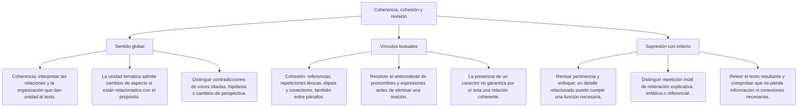
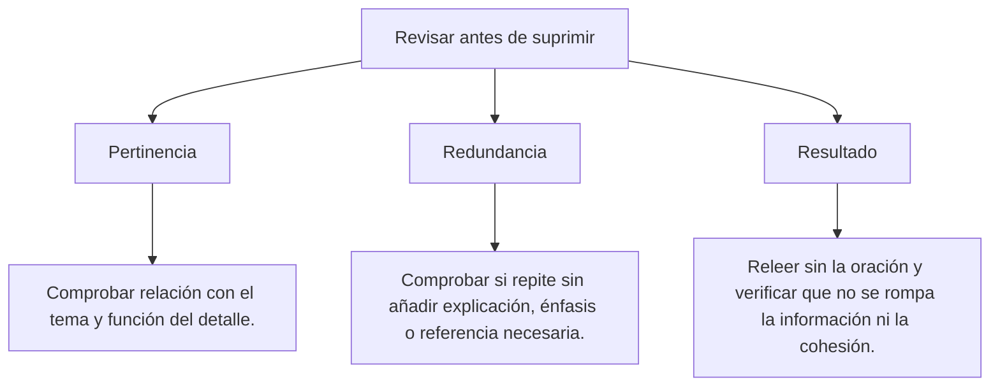

### Matriz de Indicadores de Logro Evaluados
1. **Identificación de relaciones interparrafales:** Mapear cómo se enlazan las proposiciones de un texto mediante conectores lógico-textuales y signos de puntuación.
2. **Eliminación de oraciones por impertinencia (Inatingencia):** Detectar y suprimir la oración que se aparta del eje temático central o que aborda un aspecto ajeno y distractor.
3. **Eliminación de oraciones por redundancia:** Localizar y purgar el enunciado cuya información ya fue aportada con mayor riqueza o concisión por otra proposición del texto.
4. **Detección de desajustes de coherencia:** Identificar saltos lógicos injustificados, fisuras temporales o contradicciones que atentan contra la unidad de sentido global.

---

## 2. MAPA TAXONÓMICO Y ONTOLOGÍA

### Ontología de la Textualidad
- **Texto:** Tejido verbal unitario, autónomo e intencional dotado de sentido completo (del latín *textus*, tejido).
- **Coherencia:** Condición semántica por la cual todas las partes del texto convergen armónicamente en el desarrollo de un único tema macroestructural.
- **Cohesión:** Red sintáctica y léxica superficial que encadena visiblemente las oraciones entre sí mediante pronombres, nexos y sinónimos.
- **Impertinencia Directa:** La oración aborda un tema radicalmente distinto al del resto del texto.
- **Impertinencia Indirecta (Por Énfasis):** La oración menciona el mismo tema general, pero enfoca un aspecto secundario o una perspectiva divergente que desentona con el cuerpo del párrafo.

---

## 3. DESARROLLO TEÓRICO FORMAL

### 3.1 Mecanismos de Cohesión Textual en el Examen de Admisión

#### A. Mecanismos Referenciales Gramaticales
1. **Anáfora:** Un pronombre o adverbio asume el significado de una palabra mencionada antes:
   - *"El volcán Misti domina el valle de Arequipa. **Este** macizo tutelar se eleva a 5822 m s. n. m."* (*Este* = El volcán Misti).
2. **Catáfora:** Anticipación de una información que será nombrada expresamente después:
   - *"**Ellos** fueron los grandes próceres de la independencia: San Martín, Bolívar y Sucre"*.
3. **Elipsis:** Supresión de un elemento que se sobreentiende con claridad, aligerando el peso sintáctico:
   - *"Mario Vargas Llosa escribió La ciudad y los perros en 1963; cuatro años después, [ \emptyset ] publicó Los cachorros"*.

#### B. Mecanismos de Cohesión Léxica
1. **Sustitución Sinonímica:** Empleo de vocablos sinónimos para no fatigar al lector con la misma palabra (*sismo \to terremoto \to movimiento telúrico*).
2. **Hiperonimia e Hiponimia:** Reemplazo de una especie por su género abarcador (*abeja \to insecto \to himenóptero*).
3. **Nominalización:** Transformar un verbo en sustantivo para conectar párrafos (*"Las placas tectónicas colisionaron. **Esta colisión** liberó energía..."*).

### 3.2 Los Dos Grandes Criterios de Supresión de Oraciones

#### Criterio 1: Por Impertinencia (Inatingencia)
- Se elimina aquella proposición que rompe la unidad temática.
- **Caso sutil (Impertinencia por desfase de época o enfoque):** Si un texto habla exclusivamente de la arquitectura del Monasterio de Santa Catalina en la época virreinal, una oración que comente las tarifas actuales de los turistas en el año 2026 debe ser eliminada por **impertinencia de enfoque**.

#### Criterio 2: Por Redundancia (Pleonasmo Textual)
- Se elimina la proposición que reitera una información ya consignada en otra oración del texto:
  - **Regla de oro de eliminación:** Si la Oración II dice X de forma breve, y la Oración V dice X con lujo de detalles técnicos y explicaciones ricas, **¡se elimina la Oración II por deficiencia informativa!**
  - Se suprime siempre la que aporte menos riqueza o la que sea una repetición vacía.

---

## 4. FORMULARIO MAESTRO DE EVALUACIÓN DE COHERENCIA

| Paso de Resolución | Algoritmo de Descarte | Regla de Oro en Admisión |
| :--- | :--- | :--- |
| **1. Lectura Panorámica** | Determinar el **Tema Central** y el **Enfoque Dominante** del conjunto. | Sintetizar mentalmente el texto en una frase de 5 palabras. |
| **2. Búsqueda de la Impertinencia** | Cotejar cada oración contra el tema: *¿Esta oración rema hacia el mismo puerto?* | Comprobar si ese aspecto cumple una función dentro del conjunto antes de eliminarlo. |
| **3. Búsqueda de la Redundancia** | Si todas son pertinentes, buscar el par repetitivo (O_i \approx O_j). | Aplicar la ley: Se elimina la que aporte menor precisión léxica. |
| **4. Comprobación Final** | Leer el texto omitiendo la oración elegida para verificar que la lectura fluya con perfecta armonía. | Comprobar también referencias, información necesaria y alternativas; una impresión de fluidez no garantiza por sí sola la respuesta. |

---

## 5. MNEMOTECNIAS DE COMBATE PREUNIVERSITARIO

### Mnemotecnia 1: "La Fiesta Exclusiva" (Impertinencia)
- Imagina que el texto es una fiesta temática donde todos deben ir vestidos de gala blanca (arquitectura colonial).
- De pronto llega una oración vestida con traje de baño fosforescente (turismo contemporáneo).
- **¡Sácala de la fiesta inmediatamente!** Por más bonita que sea la oración, no cumple el código de vestimenta del tema.

### Mnemotecnia 2: "El Clon Inútil" (Redundancia)
- Si en un equipo de fútbol ya tienes al delantero titular jugando en la cancha, ¿para qué vas a meter a su clon idéntico que no corre ni aporta nada nuevo?
- Expulsa al clon perezoso y quédate con el jugador que mejor rinda.

---

## 6. TÉCNICAS Y ARTIFICIOS DE CÁLCULO (HACKING PREUNIVERSITARIO)

### Hack 1: Detección de la Impertinencia por Cambio de Sujeto Gramatical
En el 80% de los ejercicios de eliminación de oraciones:
1. Revisa los sujetos gramaticales de las 5 oraciones:
   - Oración I: *La vicuña...*
   - Oración II: *Este camélido silvestre...*
   - Oración III: *La fibra de la vicuña...*
   - Oración IV: *La alpaca doméstica, en cambio, se cría para...*
   - Oración V: *La conservación de la vicuña en Pampa Galeras...*
2. **HACK:** La oración IV cambió de sujeto (habla de la alpaca mientras todas hablan de la vicuña). Se elimina de inmediato por impertinencia.

### Hack 2: La Redundancia Encubierta por Paráfrasis
Dos oraciones utilizan palabras completamente distintas pero dicen exactamente la misma verdad proposicional:
- Oración I: *"El tabaco contiene sustancias cancerígenas que elevan el riesgo de neoplasias pulmonares"*.
- Oración IV: *"Fumar cigarrillos es nocivo porque los componentes del humo inducen la formación de tumores malignos en el aparato respiratorio"*.
- **HACK:** Ambas dicen P \implies Q. Revisa cuál de las dos está mejor empalmada con sus oraciones vecinas y elimina la que esté aislada o suelta.

---

## 7. ZONA DE TRAMPAS Y DISTRACTORES ("¡PELIGRO EXAMEN!")

> [!WARNING]
> **Trampa 1: Creer que la Oración más Corta es Siempre la que se Elimina**
> No siempre se suprime la oración breve. A veces una oración de dos líneas es el encabezado matriz definitorio y la oración larga es un agregado palabrero redundante que no aporta nada nuevo. Evalúa el **contenido semántico**, no el número de caracteres impresos.

> [!CAUTION]
> **Trampa 2: La Impertinencia por Desfase de Énfasis**
> La trampa maestra de la UNSA: Todas las oraciones hablan del cerebro humano.
> - Oraciones I, II, III y V hablan de los neurotransmisores químicos en las sinapsis.
> - La oración IV habla del peso y tamaño del cerebro de los hombres prehistóricos.
> Aunque la oración IV menciona al cerebro, su enfoque es anatómico-evolutivo, mientras que el resto es bioquímico-funcional. Se elimina por **impertinencia de enfoque**.

---

## 8. APLICACIÓN AL MUNDO REAL Y CONTEXTO DECO

En la redacción de patentes tecnológicas ante INDECOPI, la formulación de normas jurídicas en el Congreso de la República y la programación de código limpio en ingeniería de software (*Clean Code / Refactoring*), la coherencia y cohesión sin redundancias es el estándar supremo de calidad. Un texto de ley con oraciones redundantes o impertinentes genera vacíos legales, interpretaciones judiciales contradictorias y litigios constitucionales interminables. La economía lingüística es precisión y seguridad jurídica.

---

## 9. BANCO DE EJERCICIOS RESUELTOS GRADUADOS

### Ejercicio 1 (Nivel Básico: Eliminación por Impertinencia Directa)
**Enunciado:** Identifique la oración que debe ser eliminada por romper la coherencia temática del texto:
(I) La vicuña es el camélido sudamericano silvestre que posee la fibra animal más fina y cotizada del planeta.  
(II) Habita en las altiplanicies andinas de la puna, a altitudes que superan los 3800 metros sobre el nivel del mar.  
(III) Su pelaje de color canela en el dorso y blanco en el pecho le confiere un camuflaje natural extraordinario frente a depredadores.  
(IV) El cóndor andino es un ave rapaz de hábitos carroñeros que anida en riscos elevados de la cordillera.  
(V) La caza furtiva de la vicuña durante el siglo XX puso a la especie al borde de la extinción biológica.  
A) I  
B) II  
C) III  
D) IV  
E) V  

**Resolución Paso a Paso:**
1. Determinamos el eje temático del texto:
   - Las oraciones I, II, III y V describen integralmente a la **vicuña** (taxonomía, hábitat andino, características de su pelaje y peligro de extinción).
2. Analizamos la oración IV:
   - Introduce de forma abrupta un tema biológico totalmente ajeno: las costumbres zoológicas del **cóndor andino** (*Vultur gryphus*).
3. La oración IV quiebra de manera frontal la unidad temática (impertinencia directa radical).
4. Por lo tanto, debe ser excluida del párrafo.
**Respuesta:** D

---

### Ejercicio 2 (Nivel Intermedio: Eliminación por Redundancia Simple)
**Enunciado (Modelo Admisión UNSA):** Elija la oración que debe ser suprimida por constituir una reiteración innecesaria:
(I) El sillar es una roca ígnea piroclástica de tonalidad blanquecina originada por flujos volcánicos consolidados.  
(II) Durante la época virreinal, los arquitectos arequipeños emplearon masivamente el sillar para levantar templos, portadas y claustros.  
(III) La catedral de Arequipa, símbolo indiscutible de la ciudad, fue edificada predominantemente con bloques labrados de sillar.  
(IV) En tiempos de la Colonia, las iglesias, fachadas y conventos de Arequipa se construyeron en gran escala utilizando sillar blanco.  
(V) Su consistencia porosa y ligereza mecánica permitieron esculpir relieves decorativos de extraordinario barroquismo mestizo.  
A) I  
B) II  
C) III  
D) IV  
E) V  

**Resolución Paso a Paso:**
1. Analizamos la proposición II:
   - *"Durante la época virreinal, los arquitectos arequipeños emplearon masivamente el sillar para levantar templos, portadas y claustros."*
2. Analizamos la proposición IV:
   - *"En tiempos de la Colonia, las iglesias, fachadas y conventos de Arequipa se construyeron en gran escala utilizando sillar blanco."*
3. Cotejo proposicional riguroso:
   - "Época virreinal" = "Tiempos de la Colonia".
   - "Templos, portadas y claustros" = "Iglesias, fachadas y conventos".
   - "Emplearon masivamente el sillar" = "Se construyeron en gran escala utilizando sillar blanco".
4. Las oraciones II y IV afirman exactamente la misma realidad fáctica con una mera sustitución de sinónimos.
5. Como la oración II enlaza mejor cronológicamente con la III y aporta el término técnico arquitectónico, la oración IV resulta un duplicado innecesario.
6. Por ende, la oración IV se elimina por **redundancia simple**.
**Respuesta:** D

---

### Ejercicio 3 (Nivel Intermedio-Avanzado: Impertinencia por Desfase de Enfoque)
**Enunciado:** Determine qué oración debe ser eliminada del siguiente texto científico:
(I) La fotosíntesis oxigénica es el proceso bioquímico mediante el cual las plantas, algas y cianobacterias convierten la energía solar en energía química.  
(II) En la fase luminosa, los fotones excitan a los electrones en los fotosistemas I y II ubicados en las membranas tilacoidales del cloroplasto.  
(III) La fotólisis del agua rompe las moléculas de H_2O, liberando oxígeno gaseoso como subproducto y generando ATP y NADPH.  
(IV) Los precios internacionales de los fertilizantes nitrogenados han aumentado considerablemente debido a los conflictos geopolíticos mundiales.  
(V) En la fase oscura o ciclo de Calvin, el ATP y NADPH producidos fijan el dióxido de carbono (CO_2) para sintetizar glucosa.  
A) I  
B) II  
C) III  
D) IV  
E) V  

**Resolución Paso a Paso:**
1. Mapeamos el eje temático:
   - Oraciones I, II, III y V describen con rigor de biología celular y bioquímica las **fases moleculares de la fotosíntesis oxigénica** (fase luminosa, fotólisis del agua y ciclo de Calvin).
2. Analizamos la oración IV:
   - Trata sobre la economía internacional, el costo comercial de los fertilizantes inorgánicos y los conflictos geopolíticos.
3. Aunque los fertilizantes tienen que ver indirectamente con la agricultura, la oración IV rompe la naturaleza bioquímica microscópica del discurso.
4. Se elimina categóricamente por **impertinencia temática y de enfoque**.
**Respuesta:** D

---

### Ejercicio 4 (Nivel Avanzado DECO: Eliminación por Redundancia Compuesta)
**Enunciado (Tipo San Marcos DECO / UNSA):** Identifique la oración prescindible en el siguiente fragmento:
(I) La enfermedad de Alzheimer es un trastorno neurodegenerativo progresivo caracterizado por el deterioro cognitivo y la pérdida irreversible de la memoria.  
(II) A nivel histopatológico, se distingue por la acumulación anormal de placas seniles de proteína beta-amiloide en el espacio extracelular del cerebro.  
(III) Asimismo, se observa la formación intracelular de ovillos neurofibrilares compuestos por proteína tau hiperfosforilada.  
(IV) Estas lesiones provocan la pérdida sináptica masiva y la muerte neuronal en regiones críticas como el hipocampo y la corteza cerebral.  
(V) El Alzheimer se manifiesta histológicamente tanto por las placas beta-amiloides como por los ovillos de proteína tau que destruyen las neuronas.  
A) I  
B) II  
C) III  
D) IV  
E) V  

**Resolución Paso a Paso:**
1. Evaluamos el contenido informativo de cada enunciado:
   - Oración I: Define la patología clínica y sus síntomas macroscópicos.
   - Oración II: Explica con rigor la primera lesión histopatológica (placas beta-amiloides).
   - Oración III: Explica con rigor la segunda lesión histopatológica (ovillos de proteína tau).
   - Oración IV: Describe la consecuencia lesiva en las regiones cerebrales (hipocampo y corteza).
2. Analizamos la oración V:
   - Afirma que el Alzheimer presenta placas beta-amiloides (dicho en II) y ovillos de tau (dicho en III) que dañan neuronas (dicho en IV).
3. La oración V no aporta un solo dato nuevo; es una síntesis empobrecedora que reitera lo ya explicado con mayor profundidad analítica en las oraciones II, III y IV.
4. Por el criterio de **redundancia compuesta**, la oración V es prescindible y debe ser suprimida.
**Respuesta:** E

---

### Ejercicio 5 (Nivel 5: Boss Challenge - Eliminación por Contradicción Lógica Interna)
**Enunciado (Nivel UNI / Máxima Exigencia):** ¿Qué oración debe ser eliminada del siguiente ensayo sobre termodinámica y cosmología?
(I) El segundo principio de la termodinámica postula que en todo sistema físico aislado la entropía global tiende inexorablemente a aumentar con el tiempo.  
(II) Esta degradación continua de la energía disponible hacia formas térmicas no aprovechables establece una 'flecha del tiempo' unidireccional e irreversible en el universo.  
(III) En concordancia con esta ley, todos los sistemas cerrados del cosmos pueden espontáneamente disminuir su desorden y retornar por sí mismos a su estado inicial de mínima entropía sin gasto energético externo.  
(IV) A escala cosmológica, este proceso sostenido conducirá en el futuro remoto al escenario asintótico conocido como la 'muerte térmica' del universo.  
(V) En dicho estado final, cesarán todos los procesos físicos dinámicos al alcanzarse el equilibrio térmico absoluto a temperaturas cercanas al cero kelvin.  
A) I  
B) II  
C) III  
D) IV  
E) V  

**Resolución Paso a Paso:**
1. Analizamos la doctrina física expuesta en el texto:
   - Oración I: La entropía en sistemas aislados siempre aumenta (\Delta S \ge 0).
   - Oración II: Establece la flecha unidireccional del tiempo e irreversibilidad.
   - Oraciones IV y V: Describen la consecuencia cósmica inevitable (muerte térmica y equilibrio a cero kelvin).
2. Analizamos minuciosamente la proposición III:
   - *"todos los sistemas cerrados del cosmos pueden espontáneamente disminuir su desorden y retornar por sí mismos a su estado inicial de mínima entropía sin gasto energético..."*.
   - Esta afirmación afirma que los sistemas cerrados disminuyen su entropía espontáneamente (\Delta S < 0), lo cual **viola de manera frontal y categórica la segunda ley de la termodinámica** enunciada en la oración I y la irreversibilidad de la oración II.
3. La oración III incurre en una flagrante **contradicción interna con la tesis central** del texto.
4. En los exámenes de admisión de alta exigencia, la contradicción directa es causal indiscutible de supresión por destrucción de la coherencia textual.
**Respuesta:** C

---

## 10. GLOSARIO DE TÉRMINOS CLAVE

1. **Coherencia Textual:** Cualidad semántica que dota al texto de sentido unificado y convergente.
2. **Cohesión Textual:** Conjunto de enlaces gramaticales y léxicos que articulan formalmente las oraciones.
3. **Impertinencia:** Criterio de eliminación aplicado a oraciones que se desvían del tema central del párrafo.
4. **Redundancia:** Repetición viciosa de información ya expresada que no añade ningún valor cognitivo.
5. **Anáfora:** Mecanismo referencial donde un término asume el valor semántico de un antecedente textual.
6. **Catáfora:** Mecanismo de anticipación donde un pronombre señala a un término que aparecerá después.
7. **Elipsis:** Supresión voluntaria de un elemento sintáctico que el lector restituye mentalmente.
8. **Inatingencia por Enfoque:** Error de coherencia donde el tema es afín pero la perspectiva o disciplina choca con el texto.
9. **Redundancia Compuesta:** Reiteración en una sola proposición de datos dispersos en dos o más oraciones del texto.
10. **Contradicción Lógica:** Afirmación que niega de forma directa los postulados sostenidos en las premisas matrices del escrito.

---

## 11. BANCO DE FLASHCARDS (Q/A)

- **Q: ¿Cuál es la diferencia entre impertinencia directa e impertinencia indirecta?**  
  **A:** La directa trata de un tema totalmente ajeno; la indirecta trata del mismo tema general pero con un enfoque o aspecto secundario divergente.
- **Q: Si dos oraciones dicen lo mismo, ¿cuál de las dos debe ser eliminada?**  
  **A:** Se elimina la que aporte menor precisión, menor riqueza explicativa o la que quede desconectada del hilo argumentativo.
- **Q: ¿Qué es una anáfora en la cohesión de un párrafo?**  
  **A:** El uso de un pronombre o demostrativo para referirse a una palabra o idea que ya fue nombrada líneas arriba.
- **Q: ¿Por qué una contradicción interna es motivo de supresión de oración?**  
  **A:** Porque destruye el principio de no contradicción, que es el pilar innegociable de la coherencia semántica textual.
- **Q: ¿Cómo ayuda el subrayado del sujeto gramatical a detectar la oración impertinente?**  
  **A:** Permite identificar al instante la oración discordante que cambió de protagonista sin justificación discursiva.

---

---

## 4. FORMULARIO MAESTRO DE IDENTIFICACIÓN TIPOLÓGICA

| Rasgo Observable en el Examen | Conclusión Tipológica Inmediata | Estrategia de Lectura Eficaz |
| :--- | :--- | :--- |
| **Presencia de Tesis + Conectores Opositivos** | **Texto Argumentativo** | Rastrear la tesis central y los argumentos principales. |
| **Definiciones Científicas + Función Referencial** | **Texto Explicativo / Expositivo** | Identificar el fenómeno y sus causas determinantes. |
| **Presencia de Gráficos de Barras o Tablas** | **Texto Mixto / Discontinuo** | Cruzar la cifra estadística del gráfico con la afirmación del texto. |
| **Verbos Imperativos en Cascada Numérica** | **Texto Instructivo** | Leer la secuencia lineal de acciones obligatorias sin saltar pasos. |

---

---

## 5. MNEMOTECNIAS DE COMBATE PREUNIVERSITARIO

### Mnemotecnia 1: "La Brújula de las Cuatro Puntas" (\text{I-A-E-I})
- **I**nformativo = La Noticia (Te cuenta el hecho sin meter su cuchara).
- **A**rgumentativo = El Juicio (El fiscal defiende su teoría con uñas y dientes).
- **E**xplicativo = La Clase del Catedrático (Te explica cómo funciona la célula).
- **I**nstructivo = El Manual de Armado (Te ordena paso por paso qué tornillo ajustar).

### Mnemotecnia 2: "El Semáforo de la Postura"
- ⚪ **Blanco (Informativo / Explicativo):** Cero opinión personal, solo ciencia y datos.
- 🔴 **Rojo de Fuego (Argumentativo):** El autor toma partido y pelea por su idea.
- 🟡 **Amarillo de Alerta (Instructivo):** Órdenes directas que debes obedecer.

---

---

### 3.3 El Punto de Discrepancia en Textos Dialécticos
Cuando el examen presenta un texto con dos interlocutores en debate (Diálogo A vs. Diálogo B):
- **Discrepancia Central:** Aquello en lo que A y B se oponen diametralmente.
- **Puntos de Coincidencia (Trampa frecuente):** Datos o hechos de la realidad que ambos aceptan pero interpretan de forma divergente.
- *Ejemplo:* Si A dice: *"Debemos prohibir las corridas de toros por ser un acto cruel"*, y B responde: *"No debemos prohibirlas porque son una tradición cultural milenaria"*:
  - Punto de coincidencia: Ambos aceptan que las corridas de toros existen y forman parte de una tradición viva.
  - Punto de discrepancia: **Si la crueldad animal debe ser motivo suficiente para prohibir legalmente las corridas de toros**.

---

## 4. FORMULARIO MAESTRO DE EVALUACIÓN ARGUMENTATIVA

| Desafío en Admisión | Pregunta Clave de Interrogación | Criterio de Resolución |
| :--- | :--- | :--- |
| **Hallar la Tesis** | *¿Qué afirmación defiende con vehemencia el autor contra viento y marea?* | La tesis es siempre una oración enunciativa afirmativa o negativa, nunca una pregunta ni un sintagma nominal suelto. |
| **Hallar el Argumento Central** | *¿Cuál es el "PORQUE" nuclear que sostiene su tesis?* | El argumento debe ser la causa directa de la postura, no un mero ejemplo secundario. |
| **Debilitar Argumento** | *¿Qué información nueva vuelve insostenible o absurdo el puente causal del autor?* | El mejor debilitador ataca la conexión directa entre la premisa y la conclusión. |
| **Reforzar Argumento** | *¿Qué dato adicional descarta las dudas razonables del opositor?* | El mejor reforzador confirma la exclusividad de la relación causa-efecto planteada. |
| **Supuesto Subyacente** | *¿Qué premisa no dicha necesita el autor para que su argumento tenga sentido?* | Si el supuesto es falso, todo el argumento se derrumba de inmediato. |

---

## 5. MNEMOTECNIAS DE COMBATE PREUNIVERSITARIO

### Mnemotecnia 1: "La Mesa de Tres Patas"
- El **tablero** superior es la **TESIS** (lo que se quiere mantener en pie).
- Las **patas** son los **ARGUMENTOS** (lo que sostiene al tablero).
- Si en una pregunta de examen te piden debilitar el argumento: **¡NO cortes el tablero, serrucha una de las patas!** Quien ataca los fundamentos empíricos derriba el texto completo.

### Mnemotecnia 2: "El Duelo de Vaqueros" (Discrepancia)
- Identifica el arma de Vaquero 1 (Tesis 1).
- Identifica el arma de Vaquero 2 (Tesis 2).
- El punto de choque donde se cruzan las balas es la **Discrepancia**. Si hablan de temas paralelos que no se tocan, todavía no has encontrado el núcleo del conflicto.

---

## 6. TÉCNICAS Y ARTIFICIOS DE CÁLCULO (HACKING PREUNIVERSITARIO)

### Hack 1: La Pregunta de Oro: "¿Y QUÉ?" (Prueba de Inatingencia)
Cuando te presenten una alternativa en una pregunta de debilitar/reforzar:
- Aplica la prueba del "¿Y qué?":
  - Si la alternativa dice algo verdadero pero que no afecta directamente a la tesis del autor, pregúntate: *¿Y qué tiene que ver eso con su argumento central?*
  - Si la respuesta es "nada relevante", es un **distractor fuera de foco**. Táchala de inmediato.

### Hack 2: La Prueba de la Negación para Encontrar el Supuesto
Para hallar el **supuesto de un argumento**:
1. Toma la alternativa que crees que es el supuesto.
2. Niégala categóricamente en tu mente (ponle un "NO").
3. Si al negarla el argumento del autor se vuelve completamente absurdo e inviable, **¡esa alternativa es el supuesto obligatorio!**

---

---

### 3.2 El Tono del Autor: Glosario de Actitudes Discursivas
El tono es la "música" interior del texto. Saber calificar el tono permite al postulante resolver la pregunta más sutil de la prueba:

**Revisión del conjunto:** comprueba pertinencia, referencias y contenido antes de suprimir una oración.

### 3.3 El Deslinde entre Hecho, Opinión y Punto de Vista
1. **Hecho:** Suceso fáctico comprobable empíricamente por cualquier observador neutral (*"Arequipa se ubica a 2325 m s. n. m."*).
2. **Opinión:** Juicio subjetivo o estimación personal del autor que admite discrepancia (*"Arequipa posee el clima más agradable de la cordillera andina"*).
3. **Punto de Vista:** La postura articulada donde el autor selecciona determinados hechos para fundamentar su opinión de manera sistemática.

---

## 4. FORMULARIO MAESTRO DE ANÁLISIS DE LA INTENCIÓN

| Pregunta de Examen | Método de Rastreo Textual | Fórmula de Elección de Clave |
| :--- | :--- | :--- |
| *¿Cuál es el propósito central del autor?* | Localizar la Idea Principal y transformarla en infinitivo activo. | \text{Propósito} = \text{Verbo Infinitivo Rector} + \text{Idea Principal}. |
| *¿Qué tono predomina en el texto?* | Subrayar los 5 adjetivos y adverbios más cargados de valor del autor. | Si los adjetivos son burlescos \to *Irónico*. Si son de duda \to *Escéptico*. |
| *El autor asume una postura...* | Evaluar si defiende, ataca o se mantiene al margen del tema. | Opciones de polaridad: *Favorable, Contraria, Imparcial o Crítica*. |

---
