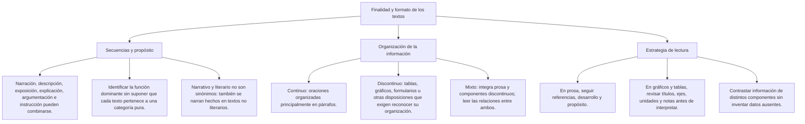

# TEMA VIII: Tipos de Texto

---

### Matriz de Indicadores de Logro Evaluados
1. **Identificación de la tipología textual por finalidad:** Discriminar si un fragmento busca transmitir conocimientos (informativo/expositivo), convencer mediante razones (argumentativo), orientar una conducta (instructivo) o recrear estéticamente un mundo (literario/narrativo).
2. **Reconocimiento de la silueta y estructura formal:** Analizar las partes constitutivas de cada formato textual (introducción-desarrollo-conclusión; tesis-argumentos; pasos secuenciales).
3. **Decodificación de textos discontinuos y mixtos:** Integrar la lectura analítica de párrafos continuos con el análisis de gráficos de barras, diagramas de flujo e infografías.
4. **Adecuación del método de lectura según el tipo de texto:** Aplicar técnicas de lectura crítica para textos argumentativos, lectura selectiva para textos instructivos y lectura de retención fáctica para textos informativos.

---

### Ontología de la Tipología Textual (Adam / Werlich)
- **Secuencia Textual:** Unidad estructural prototípica (narrativa, descriptiva, argumentativa, explicativa, dialógica o instruccional) que conforma el tejido de un texto.
- **Texto Continuo:** Discurso estructurado en oraciones que se agrupan en párrafos sucesivos dentro de una linealidad de lectura convencional.
- **Texto Discontinuo:** Información organizada de forma no secuencial que requiere una lectura transversal y tabulada (tablas, diagramas, mapas, cuadros estadísticos, recibos).
- **Texto Mixto (Formato DECO):** Texto continuo tradicional que incluye adosada una infografía, gráfico o tabla que complementa, ilustra o refuta la prosa.

---

## Mapa del tema

## 3. DESARROLLO TEÓRICO FORMAL

### 3.1 Las Cuatro Familias Textuales Fundamentales del Prospecto UNSA

#### A. Texto Informativo
- **Finalidad Primordial:** Transmitir información fáctica, acontecimientos reales o estados de cosas con la mayor objetividad posible.
- **Rasgos Lingüísticos:** Predominio de la función referencial del lenguaje, verbos en modo indicativo, ausencia de adjetivos emotivos o juicios de valor moral del emisor, tercera persona gramatical.
- **Formatos Típicos:** Noticias periodísticas, reportes meteorológicos, memorandos administrativos, crónicas neutras.

#### B. Texto Argumentativo
- **Finalidad Primordial:** Defender una postura (tesis) y convencer o persuadir al receptor mediante razones estructuradas (argumentos), o refutar una doctrina rival.
- **Rasgos Lingüísticos:** Predominio de la función apelativa y expresiva, uso de conectores causales, consecutivos y concesivos (*porque, por lo tanto, aunque*), verbos de opinión (*sostengo, considero, es evidente*).
- **Formatos Típicos:** Ensayos filosóficos, artículos de opinión, editoriales de periódicos, alegatos jurídicos, columnas críticas.

#### C. Texto Explicativo / Expositivo
- **Finalidad Primordial:** Facilitar la comprensión de un fenómeno complejo, desglosando sus causas, leyes, mecanismos biológicos o teorías científicas.
- **Rasgos Lingüísticos:** Empleo de definiciones formales, aposiciones aclaratorias, analogías pedagógicas, conectores explicativos (*es decir, en otras palabras, esto significa que*), tecnicismos unívocos.
- **Formatos Típicos:** Libros de texto universitarios, enciclopedias científicas, artículos de divulgación (*papers* de revistas indexadas).

#### D. Texto Instructivo / Normativo
- **Finalidad Primordial:** Guiar o pautar paso a paso la conducta del receptor para la ejecución de una tarea, el manejo de un artefacto o el acatamiento de una regla.
- **Rasgos Lingüísticos:** Verbos en modo imperativo (*mezcle, conecte, presione*) o en infinitivo (*armar, calentar*), oraciones breves, enumeraciones ordenadas cronológicamente, viñetas.
- **Formatos Típicos:** Manuales de usuario, recetas de cocina, protocolos de bioseguridad en hospitales, leyes y reglamentos de tránsito.

### 3.2 Cuadro Comparativo de Tipologías Textuales

| Tipo de Texto | Intención Principal | Pregunta Clave | Elemento Estructural Rector | Registro Dominante |
| :--- | :--- | :--- | :--- | :--- |
| **Informativo** | Dar a conocer hechos | *¿Qué ocurrió?* | Datos, fechas y protagonistas | Aséptico / Descriptivo |
| **Argumentativo**| Convencer / Persuadir | *¿Qué postura defiende?* | Tesis central y argumentos | Polémico / Reflexivo |
| **Explicativo** | Hacer comprender | *¿Por qué y cómo es así?* | Leyes, conceptos y causas | Pedagógico / Científico |
| **Instructivo** | Ordenar / Pautar acciones | *¿Cómo se realiza la tarea?* | Secuencia lógica de pasos | Imperativo / Prescriptivo |

---

## 4. FORMULARIO MAESTRO DE IDENTIFICACIÓN TIPOLÓGICA

| Rasgo Observable en el Examen | Conclusión Tipológica Inmediata | Estrategia de Lectura Eficaz |
| :--- | :--- | :--- |
| **Presencia de Tesis + Conectores Opositivos** | **Texto Argumentativo** | Rastrear la tesis central y los argumentos principales. |
| **Definiciones Científicas + Función Referencial** | **Texto Explicativo / Expositivo** | Identificar el fenómeno y sus causas determinantes. |
| **Presencia de Gráficos de Barras o Tablas** | **Texto Mixto / Discontinuo** | Cruzar la cifra estadística del gráfico con la afirmación del texto. |
| **Verbos Imperativos en Cascada Numérica** | **Texto Instructivo** | Leer la secuencia lineal de acciones obligatorias sin saltar pasos. |

---

## 5. MNEMOTECNIAS DE COMBATE PREUNIVERSITARIO

## 6. TÉCNICAS Y ARTIFICIOS DE CÁLCULO (HACKING PREUNIVERSITARIO)

### Hack 1: Decodificación de Textos Mixtos DECO en 20 Segundos
En preguntas con gráfico o infografía anexa:
1. Lee primero el **título del gráfico** y las **unidades de los ejes** (X e Y: años, porcentajes, toneladas).
2. Busca en las alternativas la que mezcle o invierta las variables (ejemplo: leer miles en vez de millones).
3. Contrasta si el gráfico **confirma o contradice** lo dicho en el texto continuo: en el 70% de los exámenes de admisión, la pregunta clave radica en identificar el punto exacto donde la gráfica desmiente una afirmación del texto.

### Hack 2: La Prueba del Verbo Principal para Textos Instructivos
Si las oraciones empiezan con: *"1. Vierta...", "2. Añada...", "3. Encienda..."*:
- Tacha automáticamente opciones como "ensayo literario" o "artículo de opinión".
- La presencia de la estructura algorítmica imperativa define de forma inapelable a un **texto instructivo o prescriptivo**.

---

## 8. APLICACIÓN AL MUNDO REAL Y CONTEXTO DECO

En la era de la transformación digital y la medicina basada en evidencias, saber procesar los distintos tipos de texto determina la eficacia profesional. Un ingeniero de minas lee textos instructivos en los manuales de seguridad de detonación de explosivos, textos expositivos en los informes geológicos del macizo rocoso y redacta textos argumentativos cuando sustenta ante el directorio la viabilidad económica de una planta concentradora. Cada tipología exige un canal cognitivo diferenciado.

---

### Texto Base para los Ejercicios 1 y 2
*"El telescopio espacial James Webb (JWST) es un observatorio astronómico espacial desarrollado mediante la colaboración internacional de veinticuatro países, liderados por la NASA, la Agencia Espacial Europea (ESA) y la Agencia Espacial Canadiense (CSA). Lanzado el 25 de diciembre de 2021 a bordo de un cohete Ariane 5 desde la Guayana Francesa, el telescopio fue diseñado para suceder al Hubble como la misión principal de astrofísica de la humanidad. Su espejo primario está compuesto por dieciocho segmentos hexagonales de berilio recubiertos de una capa microscópica de oro de apenas 100 nanómetros de espesor, formando un reflector de 6.5 metros de diámetro. A diferencia del Hubble, que observaba principalmente en los espectros óptico y ultravioleta, el James Webb opera primordialmente en el rango infrarrojo medio y cercano, lo que le permite atravesar las densas nubes de polvo estelar y detectar la débil luz desplazada al rojo procedente de las primeras galaxias formadas tras el Big Bang hace más de 13 500 millones de años."*

---

### Ejercicio 1 (Nivel Básico: Identificación de Tipología Textual por Finalidad)
**Enunciado:** Por su finalidad comunicativa y la estructura de su contenido, el texto anterior clasifica como:
A) Un texto argumentativo de crítica epistemológica a la NASA.  
B) Un texto informativo-explicativo de divulgación científica y astronómica.  
C) Un texto instructivo para fabricar espejos hexagonales de berilio.  
D) Un manifiesto poético sobre la soledad del cosmos.  
E) Un diálogo dramático entre científicos europeos y canadienses.  

**Resolución Paso a Paso:**
1. Analizamos la función del lenguaje y la intención del autor:
   - Aporta datos objetivos puros: fecha de lanzamiento, diámetro del espejo (6.5 m), composición metálica (berilio y oro), consorcio internacional de agencias.
   - Explica el mecanismo físico: longitud de onda infrarroja y detección de luz con corrimiento al rojo del universo temprano.
   - Carece de juicios de valor subjetivos, opiniones polémicas o tesis axiológicas que deban ser defendidas frente a un detractor.
2. Esta estructura responde exactamente al canon del **texto informativo-explicativo de divulgación científica**.
3. La opción B define con precisión la naturaleza del fragmento.
**Respuesta:** B

---

### Ejercicio 2 (Nivel Intermedio: Discriminación de Función Estructural)
**Enunciado (Modelo Admisión UNSA):** La mención comparativa del telescopio Hubble en la última oración del fragmento tiene como función textual:
A) Descalificar la labor histórica del Hubble como un fracaso tecnológico irreparable.  
B) Ejemplificar un texto instructivo de calibración óptica.  
C) Resaltar mediante el contraste las ventajas técnicas del espectro infrarrojo del James Webb para la astrofísica profunda.  
D) Formular la tesis central de un debate ideológico entre la ESA y la NASA.  
E) Explicar la fórmula química de las nubes de polvo interestelar.  

**Resolución Paso a Paso:**
1. Leemos la oración analizada: *"A diferencia del Hubble, que observaba en espectro óptico y ultravioleta, el James Webb opera en infrarrojo, lo que le permite atravesar densas nubes de polvo..."*.
2. Evaluamos la función comunicativa de la comparación:
   - No ataca al Hubble (opción A descartada).
   - Sirve como mecanismo pedagógico de **contraste técnico** para que el lector comprenda por qué el nuevo instrumento puede ver objetos astronómicos que antes eran invisibles para la humanidad.
3. La opción C expresa de forma rigurosa esta función explicativa.
**Respuesta:** C

---

### Ejercicio 3 (Nivel Intermedio-Avanzado: Identificación de Texto Instructivo-Normativo)
**Enunciado:** Por su formato discursivo, modalidad oracional y finalidad pragmática, el fragmento corresponde a:
A) Un ensayo lírico sobre la fragilidad del cerebro humano.  
B) Un texto instructivo-normativo que pauta una secuencia de procedimientos clínicos protocolizados.  
C) Una crónica periodística de sucesos policiales en una sala de emergencias.  
D) Un texto argumentativo que debate la legalidad de la tomografía axial computarizada.  
E) Un cuento de suspenso ambientado en un hospital militar.  

**Resolución Paso a Paso:**
1. Analizamos la fisonomía del texto:
   - Presenta una estructura numerada secuencial (1, 2, 3, 4).
   - Utiliza verbos imperativos directos dirigidos a la acción práctica del receptor (*verifique, canalice, no administre, traslade, inicie*).
   - Fija prescripciones técnicas, dosificaciones exactas (0.9 \text{ mg/kg}) y límites temporales estrictos (< 20 \text{ min}, < 4.5 \text{ h}).
2. Su meta comunicativa no es debatir ni entretener, sino **ordenar y guiar la conducta técnica del personal médico para salvar la vida del paciente**.
3. Clasifica formalmente como un **texto instructivo-normativo (protocolo clínico)**.
**Respuesta:** B

---

### Ejercicio 4 (Nivel Avanzado DECO: Inferencia de Condición Restrictiva en Texto Instructivo)
**Enunciado (Tipo San Marcos DECO / UNSA):** A partir del protocolo clínico expuesto, se deduce que la administración del fármaco trombolítico rt-PA está terminantemente contraindicada si:
A) El paciente presenta alteración en la fluidez del habla.  
B) La tomografía axial computarizada confirma la presencia de una hemorragia cerebral activa.  
C) Se canalizaron vías venosas con catéteres de calibre 18G.  
D) El tiempo puerta-imagen fue de quince minutos exactos.  
E) Se utilizó solución salina fisiológica al 0.9% para hidratar al paciente.  

**Resolución Paso a Paso:**
1. Rastreando las condiciones explícitas del paso 4:
   - *"inicie de inmediato la administración [...] Si el tiempo [...] es menor a 4.5 horas y **no existen contraindicaciones hemorrágicas absolutas**"*.
2. Conexión con el paso 3:
   - El paso 3 ordena la tomografía craneal *"para descartar hemorragia intracraneal activa"*.
3. Deducción lógica:
   - El fármaco rt-PA disuelve coágulos para permitir el flujo sanguíneo en la isquemia. Si el paciente tiene una hemorragia cerebral activa, administrarle un anticoagulante/trombolítico provocaría un sangrado cerebral masivo mortal.
   - Por tanto, confirmar hemorragia cerebral activa en la tomografía constituye la contraindicación absoluta que prohíbe de inmediato el fármaco.
4. La opción B formula esta deducción clínica vital.
**Respuesta:** B

---

### Ejercicio 5 (Nivel 5: Boss Challenge - Análisis Crítico de Texto Dialéctico Complejo)
**Enunciado (Nivel UNI / Máxima Exigencia):** Lea el siguiente texto dialéctico:
- **AUTOR A (J. S. Mill):** *"La única finalidad por la cual el poder soberano puede ejercerse legítimamente sobre cualquier miembro de una comunidad civilizada, contra su propia voluntad, es prevenir el daño a terceros. Su propio bien material o moral no es justificación suficiente. Nadie puede ser obligado justificadamente a realizar o tolerar algo porque sea mejor para él, porque le haga más feliz, o porque, en opinión de los demás, hacerlo sea sabio o virtuoso."*
- **AUTOR B (Paternalismo Jurídico contemporáneo):** *"El principio del daño milliano parte de una concepción atomizada e ilusoria del individuo. Las decisiones autodestructivas de una persona (como la adicción a estupefacientes duros o no usar casco al conducir) jamás son puramente privadas: sobrecargan el sistema público de salud financiado por los contribuyentes, destruyen el tejido emocional de sus familias y privan a la comunidad de ciudadanos productivos. El Estado tiene la obligación moral y económica de intervenir paternalistamente para proteger al individuo de sus propios sesgos cognitivos e impulsos irracionales."*
Respecto a la estructura y naturaleza discursiva del fragmento anterior, es correcto afirmar que:
A) Es un texto informativo neutro que describe las estadísticas de accidentes de tránsito en Gran Bretaña.  
B) Es un texto instructivo que enseña a fabricar cascos de motociclista según normas ISO.  
C) Es un texto dialéctico de confrontación argumentativa, donde el Autor A defiende el liberalismo anti-paternalista del principio del daño, mientras el Autor B esgrime una postura de paternalismo estatal justificada en las externalidades sociales.  
D) Ambos autores coinciden plenamente en que el Estado jamás debe intervenir en las adicciones de los ciudadanos.  
E) El Autor B utiliza una crónica poética para conmover al parlamento europeo.  

**Resolución Paso a Paso:**
1. Desarmamos la arquitectura del texto:
   - Formato: Texto dialéctico (dos autores con posturas filosófico-jurídicas antagónicas sobre el mismo problema).
   - Autor A: Sostiene la tesis liberal clásica de John Stuart Mill (Principio del Daño): el Estado solo interviene si dañas a otros; no puede imponer el bien individual por la fuerza.
   - Autor B: Sostiene la tesis del paternalismo jurídico contemporáneo: el individuo no está aislado; sus conductas dañinas generan externalidades negativas a toda la sociedad (costos médicos públicos, familias rotas), legitimando la intervención protectora del Estado.
2. Evaluación tipológica:
   - No es un texto expositivo ni informativo; es un **texto argumentativo dialéctico de alta densidad filosófica y axiológica**.
3. La opción C resume con precisión de cirujano la naturaleza discursiva y los marcos teóricos de ambos contendientes.
**Respuesta:** C

---

## 10. GLOSARIO DE TÉRMINOS CLAVE

1. **Tipología Textual:** Clasificación analítica de los textos según su propósito, formato y estructura interna.
2. **Texto Continuo:** Discurso en prosa estructurado mediante oraciones integradas en párrafos lineales.
3. **Texto Discontinuo:** Discurso organizado en matrices no secuenciales como infografías, gráficos y esquemas.
4. **Texto Mixto:** Discurso compuesto que articula párrafos continuos junto a elementos gráficos discontinuos.
5. **Texto Informativo:** Escrito enfocado en transmitir hechos reales con neutralidad referencial y objetividad.
6. **Texto Argumentativo:** Escrito estructurado para persuadir o convencer a través de una tesis y argumentos.
7. **Texto Explicativo:** Discurso didáctico orientado a hacer comprender las leyes y causas de un fenómeno complejo.
8. **Texto Instructivo:** Discurso prescriptivo estructurado en secuencias imperativas para guiar acciones prácticas.
9. **Texto Dialéctico:** Confrontación discursiva articulada en torno a dos o más posturas antagónicas sobre un dilema.
10. **Externalidad Social:** En economía y derecho, impacto indirecto positivo o negativo que una acción individual produce sobre terceros.

---

## 11. BANCO DE FLASHCARDS (Q/A)

- **Q: ¿Cuál es el rasgo lingüístico dominante en un texto informativo puro?**  
  **A:** La función referencial del lenguaje, los verbos en modo indicativo y la ausencia total de adjetivos emotivos o juicios de valor.
- **Q: ¿Qué diferencia a un texto explicativo de un texto argumentativo?**  
  **A:** El explicativo busca que el lector *comprenda* un mecanismo científico o ley; el argumentativo busca que el lector *adopte una postura* o tesis debatible.
- **Q: ¿Cómo se reconocen de inmediato los textos instructivos?**  
  **A:** Por el uso sistemático de verbos en modo imperativo o infinitivo organizados en pasos o viñetas secuenciales ordenadas.
- **Q: ¿Qué es un texto mixto según el modelo de evaluación DECO?**  
  **A:** Un texto en prosa continua que incluye una infografía o gráfico estadístico cuyos datos deben cruzarse con la lectura para responder.
- **Q: En un texto dialéctico con dos posturas enfrentadas, ¿cuál es la primera tarea del lector?**  
  **A:** Identificar el punto exacto de controversia o discrepancia central que enfrenta a los dos expositores.

---

## 7. ZONA DE TRAMPAS Y DISTRACTORES ("¡PELIGRO EXAMEN!")

> [!WARNING]
> **Trampa 1: Confundir Explicativo con Argumentativo**
> - Si un texto explica cómo se produce la fisión nuclear del uranio-235 desglosando los neutrones y la masa crítica: es **explicativo/expositivo**.
> - Si el texto afirma que construir centrales nucleares en el Perú es un error catastrófico por el peligro sísmico: es **argumentativo**.
> No confundas explicar un mecanismo científico con defender una postura política sobre su uso.

> [!CAUTION]
> **Trampa 2: La Infografía tomada como Adorno Decorativo**
> En textos mixtos de la UNSA y UNMSM, la infografía **NUNCA es un dibujo de relleno**. Contiene datos estadísticos específicos indispensables para resolver al menos una o dos preguntas de la prueba. Ignorar el gráfico es regalar puntos valiosos.

---

### Mnemotecnia 2: "El Semáforo de la Postura"
- ⚪ **Blanco (Informativo / Explicativo):** Cero opinión personal, solo ciencia y datos.
- 🔴 **Rojo de Fuego (Argumentativo):** El autor toma partido y pelea por su idea.
- 🟡 **Amarillo de Alerta (Instructivo):** Órdenes directas que debes obedecer.

---

### Texto Base para los Ejercicios 3 y 4
*"Protocolo de Actuación Médica Inicial ante Sospecha de Accidente Cerebrovascular Isquémico Agudo (ACV):
1. **Reconocimiento Temprano (Escala FAST):** Verifique de inmediato la presencia de asimetría facial (desviación de comisura labial), paresia o debilidad motora en extremidades superiores y alteración en la fluidez del habla (disartria o afasia).
2. **Acceso Vascular y Monitoreo:** Canalice inmediatamente dos vías venosas periféricas con catéter de calibre 18G en miembros superiores. No administre soluciones glucosadas hipotónicas que puedan inducir edema cerebral; utilice exclusivamente solución salina isotónica al 0.9%.
3. **Neuroimagen Urgente:** Traslade al paciente al servicio de tomografía axial computarizada (TAC) craneal sin contraste en un tiempo puerta-imagen inferior a veinte minutos para descartar hemorragia intracraneal activa.
4. **Terapia de Reperfusión:** Si el tiempo de inicio de los síntomas es menor a 4.5 horas y no existen contraindicaciones hemorrágicas absolutas, inicie de inmediato la administración intravenosa del activador tisular del plasminógeno recombinante (rt-PA) a dosis de 0.9 mg/kg."*

---

---

## 3. DESARROLLO TEÓRICO RIGUROSO

### A. El Conocimiento Científico: Concepto y Niveles
El conocimiento es una forma de aprehensión de la realidad. Se distingue en tres niveles fundamentales:
1. **Conocimiento Vulgar o Empírico-Espontáneo**:
   - Adquirido en la vida cotidiana mediante el sentido común, la tradición y la experiencia directa no controlada.
   - Es superficial, asistemático, acrítico, dogmático y subjetivo.
2. **Conocimiento Científico**:
   - Saber selectivo, riguroso y metódico que describe, explica y predice fenómenos de la realidad mediante modelos conceptuales contrastables.
3. **Conocimiento Filosófico**:
   - Saber universal, radical, totalizador y problematizador de los fundamentos últimos del ser y del conocer.

#### Características Esenciales del Conocimiento Científico:
- **Objetivo**: Se ajusta a los hechos y propiedades del objeto de estudio, independientemente de los deseos, emociones o sesgos del investigador.
- **Metódico**: No se obtiene por azar, sino siguiendo procedimientos, técnicas y protocolos lógicamente planificados (método científico).
- **Sistemático**: Constituye un cuerpo coherente, organizado e interconectado de proposiciones, leyes y teorías, no un cúmulo caótico de datos aislados.
- **Verificable / Contrastable**: Sus enunciados deben someterse a prueba mediante la observación rigurosa o el experimento controlado.
- **Falible**: Reconoce su propia imperfección; no postula dogmas inmutables, sino que está permanentemente abierto a la rectificación o superación histórica.
- **Comunicable y Preciso**: Utiliza un lenguaje unívoco, claro y técnico, susceptible de ser comprendido, replicado y criticado por la comunidad científica universal.

### B. El Método Científico: Estructura Operativa
Secuencia lógica y procedimental para resolver enigmas sobre la naturaleza y la sociedad:
1. **Observación y Detección de Anomalías**: Identificación de un hecho fáctico que no encaja con el conocimiento científico previo.
2. **Planteamiento del Problema**: Formulación rigurosa y precisa de una interrogante que delimita variables observables (¿\text{De qué manera influye } X \text{ en } Y?).
3. **Formulación de la Hipótesis**: Enunciado conjetural, provisional y fundado teóricamente que propone una respuesta tentativa a la pregunta de investigación. Debe ser lógicamente coherente y empíricamente contrastable.
4. **Diseño y Ejecución de la Contrastación**: Prueba experimental o empírica sistemática con control de variables (variable independiente, dependiente e interviniente).
5. **Análisis de Datos y Conclusión**: Determinación de si la evidencia empírica corrobora o refuta la hipótesis.
6. **Incorporación al Cuerpo del Saber**: Si la hipótesis es corroborada sistemáticamente, puede dar origen a nuevas leyes o integrarse en teorías existentes.

### C. Hecho, Hipótesis, Ley y Teoría Científica
- **Hecho**: Acontecimiento o estado de cosas observable y verificable en la realidad objetiva (ej. el agua hierve a 100 °C a 1 atm).
- **Hipótesis Científica**: Explicación tentativa que vincula dos o más variables para dar cuenta de un problema no resuelto.
- **Ley Científica**: Hipótesis científica confirmada que expresa una **relación constante, universal y necesaria** entre fenómenos o propiedades de la realidad (ej. Ley de Gravitación Universal: F = G \frac{m_1 m_2}{r^2}).
- **Teoría Científica**: El estrato superior del saber científico. Es un sistema conceptual unificado, estructurado deductivamente, que integra un conjunto coherente de leyes, hipótesis y principios para explicar y predecir de modo comprehensivo un ámbito de la realidad (ej. Teoría de la Relatividad, Teoría de la Selección Natural).

### D. Relación Ciencia, Tecnología y Sociedad (CTS)
- **Ciencia**: Búsqueda desinteresada del saber y la verdad objetiva para explicar el cosmos (dimensión cognoscitiva).
- **Tecnología**: Aplicación práctica, instrumental y sistemática del conocimiento científico para diseñar herramientas, procesos y artefactos que modifican la realidad y satisfacen necesidades humanas.
- **Sociedad**: Contexto ético, político, económico y ecológico donde se desarrollan la ciencia y la tecnología. El enfoque CTS estudia el impacto social y los dilemas bioéticos (inteligencia artificial, manipulación genética, armamento atómico, calentamiento global).

### E. Modelos Epistemológicos y Criterios de Demarcación

#### 1. El Positivismo Lógico / Neopositivismo (Círculo de Viena: Carnap, Schlick, Neurath)
- **Criterio de Demarcación**: **El Verificacionismo empírico**.
- Un enunciado tiene significado cognitivo si y solo si es analítico (lógica/matemática) o empíricamente verificable por la observación sensible.
- Califican a la Metafísica, la Ética pura y la Teología como **pseudoproposiciones carentes de sentido**.

#### 2. El Racionalismo Crítico de Karl Popper (Falsacionismo)
- **Crítica a la Inducción**: Popper demuestra que ninguna cantidad finita de observaciones positivas de cisnes blancos puede probar inductivamente la ley universal *"Todos los cisnes son blancos"*, pues basta un solo cisne negro para refutarla.
- **La Asimetría Lógica entre Verificación y Falsación**: Las leyes universales son formalmente inverificables de modo definitivo, pero son **falsables mediante un contraejemplo empírico**.
- **Criterio de Demarcación**: Una teoría es científica si formula predicciones arriesgadas que puedan ser empíricamente contrastadas y potencialmente refutadas (**falsabilidad**). Si una teoría es inmune a la refutación (como el psicoanálisis dogmático o la astrología, según Popper), no es ciencia, sino pseudociencia o mito.
- La ciencia progresa por **conjeturas y refutaciones**; las teorías no son verdades eternas, sino hipótesis provisionalmente corroboradas.

#### 3. La Estructura de las Revoluciones Científicas de Thomas Kuhn
- Introduce el enfoque socio-histórico en la epistemología frente al logicismo abstracto:
  - **Paradigma**: Matriz disciplinar compartida por una comunidad científica (teorías, valores, métodos, experimentos ejemplares).
  - **Ciencia Normal**: Etapa en que los científicos resuelven "rompecabezas" (*puzzles*) bajo las reglas del paradigma vigente sin cuestionar sus cimientos.
  - **Anomalías**: Hechos que el paradigma dominante no puede explicar.
  - **Crisis**: La acumulación de anomalías graves quiebra la confianza en el paradigma.
  - **Revolución Científica**: Aparición de un nuevo paradigma rival que sustituye al anterior (ej. paso del geocentrismo tolemaico al heliocentrismo copernicano; de la mecánica newtoniana a la relatividad einsteiniana).
  - **Inconmensurabilidad**: Dos paradigmas sucesivos utilizan lenguajes y visiones de mundo tan disímiles que no pueden compararse de forma neutra ni acumulativa lineal.

#### 4. Mario Bunge y las Pseudociencias
- Mario Bunge clasifica las ciencias en **Formales** (lógica y matemática; trabajan con entes ideales y su criterio es la coherencia formal) y **Fácticas** (naturales y sociales; trabajan con hechos materiales y su criterio es la contrastación empírica).
- Define la **pseudociencia** como todo campo de creencias o prácticas que pretende presentarse como científico pero carece de método experimental riguroso, no interactúa con otras ciencias, postula fuerzas inmateriales inescrutables y se niega a la autocrítica y evolución teórica.

---

---

## 5. MNEMOTECNIAS PREUNIVERSITARIAS

### Nemotecnia de las Fases de Kuhn:
> **"PRE - NOR - ANO - CRI - REVO"**
- **PRE**: Preciencia (múltiples escuelas dispersas)
- **NOR**: Ciencia **Normal** (dominio de un paradigma unificado)
- **ANO**: **Anomalías** (fallas inexplicables)
- **CRI**: **Crisis** del paradigma
- **REVO**: **Revolución** científica (reemplazo por un nuevo paradigma)

### Nemotecnia de Características de la Ciencia (Mario Bunge):
> **"FA - ME - O - SI - CO - VER"**
- **FA**: Falible
- **ME**: Metódica
- **O**: Objetiva
- **SI**: Sistemática
- **CO**: Comunicable
- **VER**: Verificable

---
