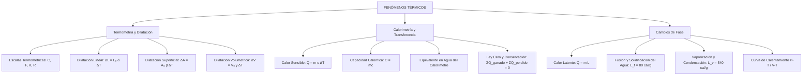

## 1. MARCO CONCEPTUAL Y ONTOLOGÍA
## 1. PORTADA Y FICHA TÉCNICA

```
========================================================================================
CURSO: FÍSICA PREUNIVERSITARIA
EJE: 04 - CIENCIA Y TECNOLOGÍA
TEMA: 07 - FENÓMENOS TÉRMICOS (CALORIMETRÍA, TERMOMETRÍA Y DILATACIÓN)
NIVEL: PREUNIVERSITARIO AVANZADO (UNSA - UNMSM - UNI)
DURACIÓN ESTIMADA: 4 HORAS ACADÉMICAS
SISTEMA DE EVALUACIÓN: DESTREZAS COGNITIVAS (DECO), DEMOSTRACIONES Y CÁLCULO
========================================================================================
```

---


## 2. MAPA CONCEPTUAL SINTÉTICO (MERMAID)



---


## 2. DESARROLLO TEÓRICO FORMAL - PARTE I
### 3. MARCO TEÓRICO EXHAUSTIVO

### 3.1. Naturaleza Microscópica de la Temperatura y el Calor
- **Temperatura (T):** Magnitud física escalar fundamental del SI (medida en Kelvin, \text{K}) que cuantifica la energía cinética media de traslación por molécula de un sistema en equilibrio térmico:
  \langle E_k \rangle = \frac{3}{2} k_B T
  donde k_B = 1.380649 \times 10^{-23} \text{ J/K} es la constante de Boltzmann. La temperatura no representa la energía total del cuerpo, sino el nivel de agitación molecular promedio.
- **Calor (Q):** Energía térmica transitoria en tránsito a través del límite de un sistema termodinámico como consecuencia exclusiva de una diferencia de temperatura. No se "posee" calor; los cuerpos poseen *energía interna* (U).

### 3.2. Escalas Termométricas
Para relacionar dos escalas lineales arbitrarias X e Y con puntos de referencia fijos (fusión y ebullición del agua a 1 \text{ atm}):
\frac{T_X - T_{\text{fusión}, X}}{T_{\text{ebullición}, X} - T_{\text{fusión}, X}} = \frac{T_Y - T_{\text{fusión}, Y}}{T_{\text{ebullición}, Y} - T_{\text{fusión}, Y}}

Para las escalas convencionales:
- **Celsius (^\circ\text{C}):** 0^\circ\text{C} a 100^\circ\text{C} (100 divisiones).
- **Fahrenheit (^\circ\text{F}):** 32^\circ\text{F} a 212^\circ\text{F} (180 divisiones).
- **Kelvin (\text{K}):** 273.15 \text{ K} a 373.15 \text{ K} (escala absoluta, cero absoluto 0 \text{ K}).
- **Rankine (\text{R}):** 491.67 \text{ R} a 671.67 \text{ R} (escala absoluta inglesa).

Relación matemática fundamental:
\frac{C}{5} = \frac{F - 32}{9} = \frac{K - 273}{5} = \frac{R - 492}{9}

Variaciones térmicas relativas (\Delta T):

## 3. FORMULARIO FUNDAMENTAL Y LEYES BASE
### 4. LEYES, ECUACIONES Y MODELOS MATEMÁTICOS

### 4.1. Calorimetría
1. **Calor Sensible (Q_s):** Transferencia de calor que produce exclusivamente variación de temperatura sin cambio de estado:
   Q_s = m c_e \Delta T = C \Delta T
   - m: masa del cuerpo [\text{g} \text{ o } \text{kg}].
   - c_e: calor específico \left[\frac{\text{cal}}{\text{g}^\circ\text{C}} \text{ o } \frac{\text{J}}{\text{kg}\cdot\text{K}}\right]. Para agua líquida: c_{\text{agua}} = 1.00 \frac{\text{cal}}{\text{g}^\circ\text{C}} = 4186 \frac{\text{J}}{\text{kg}\cdot\text{K}}.
   - Para hielo: c_{\text{hielo}} \approx 0.50 \frac{\text{cal}}{\text{g}^\circ\text{C}}. Para vapor: c_{\text{vapor}} \approx 0.50 \frac{\text{cal}}{\text{g}^\circ\text{C}}.
   - C = m c_e: capacidad calorífica del sistema [\text{cal}/^\circ\text{C} \text{ o } \text{J/K}].

2. **Equivalente Mecánico del Calor (Experimento de Joule):**
   1 \text{ cal} = 4.186 \text{ J}

3. **Equivalente en Agua de un Calorímetro (M_{\text{eq}}):**
   Masa ficticia de agua pura que absorbería o cedería la misma cantidad de calor que el recipiente y sus accesorios ante una misma variación de temperatura:
