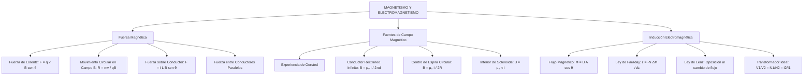

## 1. MARCO CONCEPTUAL Y ONTOLOGÍA
## 1. PORTADA Y FICHA TÉCNICA

```
========================================================================================
CURSO: FÍSICA PREUNIVERSITARIA
EJE: 04 - CIENCIA Y TECNOLOGÍA
TEMA: 10 - MAGNETISMO Y ELECTROMAGNETISMO
NIVEL: PREUNIVERSITARIO AVANZADO (UNSA - UNMSM - UNI)
DURACIÓN ESTIMADA: 5 HORAS ACADÉMICAS
SISTEMA DE EVALUACIÓN: DESTREZAS COGNITIVAS (DECO), REGLA DE LA MANO DERECHA E INDUCCIÓN
========================================================================================
```

---


## 2. MAPA CONCEPTUAL SINTÉTICO (MERMAID)



---


## 2. DESARROLLO TEÓRICO FORMAL - PARTE I
### 3. MARCO TEÓRICO EXHAUSTIVO

### 3.1. Naturaleza del Magnetismo e Interacción Magnética
- **Polos Magnéticos:** Los imanes presentan dos polos inseparables (Norte y Sur). No existen monopolos magnéticos aislados en la naturaleza clásica (\nabla \cdot \vec{B} = 0). Polos del mismo nombre se repelen; de nombres opuestos se atraen.
- **Campo Magnético (\vec{B}):** Campo vectorial generado por cargas eléctricas en movimiento o corrientes. Unidad SI: Tesla (\text{T} = \frac{\text{N}}{\text{A}\cdot\text{m}}). En el sistema CGS: Gauss (1\text{ T} = 10^4\text{ G}). Las líneas de inducción magnética son continuas y cerradas sobre sí mismas (salen del polo norte y entran por el sur en el exterior del imán).

### 3.2. Fuerza Magnética sobre Cargas en Movimiento (Fuerza de Lorentz)
Una partícula cargada con velocidad \vec{v} inmersa en un campo magnético \vec{B} experimenta una fuerza magnética dada por:
\vec{F}_B = q (\vec{v} \times \vec{B})
- **Módulo:**
  F_B = |q| v B \sin\theta
  (\theta es el ángulo entre \vec{v} y \vec{B}).
- **Dirección y Sentido:** Determinada por la *Regla de la Mano Derecha* (o regla de la palma). Si la carga es negativa (q < 0), el sentido resultante se invierte 180^\circ.
- **Trabajo Nulo de la Fuerza Magnética:**
  Como \vec{F}_B \perp \vec{v} en todo instante:
  P_B = \vec{F}_B \cdot \vec{v} = 0 \implies W_B = \int \vec{F}_B \cdot d\vec{r} = 0
  La fuerza magnética pura **no realiza trabajo**, no modifica la rapidez ni la energía cinética de la partícula, solo altera la dirección de su velocidad.
- **Trayectoria en Campo Magnético Uniforme (\vec{v} \perp \vec{B}):**

## 3. FORMULARIO FUNDAMENTAL Y LEYES BASE
### 4. LEYES, ECUACIONES Y MODELOS MATEMÁTICOS

### 4.1. Generación de Campo Magnético (Ley de Biot-Savart y Ampère)
Constante de permeabilidad magnética del vacío:
\mu_0 = 4\pi \times 10^{-7}\ \frac{\text{T}\cdot\text{m}}{\text{A}} \approx 1.2566 \times 10^{-6}\ \frac{\text{T}\cdot\text{m}}{\text{A}}

1. **Conductor Rectilíneo Muy Largo (Infinito):**
   A una distancia perpendicular d del conductor:
   B = \frac{\mu_0 I}{2\pi d}
   (Las líneas de campo son circunferencias concéntricas orientadas según la regla del pulgar derecho).
2. **Espira Circular Plana de Radio R:**
   En el centro geométrico de la espira:
   B = \frac{\mu_0 I}{2 R}
   Para una bobina plana corta de N espiras: B = \frac{\mu_0 N I}{2R}.
3. **Solenoide Ideal (Bobina Larga de Longitud L con N vueltas):**
   En el interior del solenoide (L \gg R):
   B = \mu_0 \left(\frac{N}{L}\right) I = \mu_0 n I
   (n = N/L es la densidad de espiras por metro).
4. **Toroide:**
   B = \frac{\mu_0 N I}{2\pi r}
