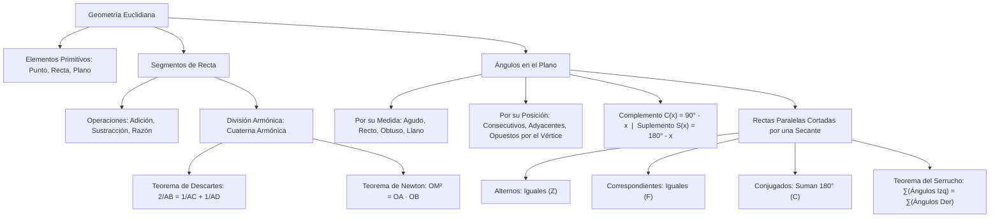

## 1. MARCO CONCEPTUAL Y ONTOLOGÍA
## 1. FICHA TÉCNICA Y MATRIZ DE COMPETENCIAS

| Parámetro | Detalle Institucional |
| :--- | :--- |
| **Resolución Oficial** | Resolución de Consejo Universitario N° 0028-2026 (Admisión UNSA 2027) |
| **Eje Curricular** | Eje 02: Matemática / Geometría Euclidiana Plana |
| **Peso Ponderado UNSA** | **Ingenierías:** 1.658337400 pts/preg (4 preg. = 6.63 pts) \| **Biomédicas:** 1.265447400 pts \| **Sociales:** 0.824574000 pts |
| **Frecuencia en Exámenes** | **Alta (88%):** Es la puerta de entrada a la geometría métrica, evaluando cuaternas armónicas en segmentos y propiedades angulares entre rectas paralelas. |
| **Modelos de Examen** | UNSA (Ordinario, CEPREUNSA), UNMSM (DECO de diseño urbano y refracción óptica), UNI (Relaciones armónicas de Newton y Descartes). |
| **Competencia Cardinal** | Aplicar los axiomas euclidianos y teoremas fundamentales sobre segmentos y ángulos, operando relaciones armónicas y deduciendo medidas angulares entre rectas paralelas cortadas por secantes con rigor deductivo. |

---

## 2. MAPA TAXONÓMICO Y ONTOLOGÍA DE CONCEPTOS

---

## 2. DESARROLLO TEÓRICO FORMAL - PARTE I
### EJE 02: MATEMÁTICA — GEOMETRÍA
### TEMA I: ELEMENTOS FUNDAMENTALES, SEGMENTOS Y ÁNGULOS

---

### 3. DESARROLLO TEÓRICO FORMAL (ESTÁNDAR LUMBRERAS / CUZCANO / UNI)

### 3.1. Conceptos Primitivos y Axiomática Euclidiana
La geometría formal se estructura sobre tres términos primitivos no definidos:
1. **Punto (P):** Ente adimensional sin longitud, anchura ni espesor.
2. **Recta (\overleftrightarrow{L}):** Conjunto infinito y continuo de puntos ordenados unidimensionalmente que se extiende indefinidamente en dos sentidos opuestos.
3. **Plano (\mathcal{P}):** Ente bidimensional ilimitado determinado por tres puntos no colineales.

#### Axiomas y Postulados Fundamentales:
- **Axioma de la Recta:** Por dos puntos distintos pasa una y solo una recta.
- **Axioma de la Distancia:** A cada par de puntos del espacio le corresponde un único número real no negativo denominado distancia euclidiana: d(A, B) \geq 0, verificando d(A, B) = 0 \iff A = B.

---

### 3.2. Segmentos de Recta y División Armónica
Un **segmento de recta** es la porción de recta comprendida entre dos puntos llamados extremos, incluidos estos:
\overline{AB} = \{P \in \overleftrightarrow{AB} \mid P = A \ \lor \ P = B \ \lor \ P \text{ está entre } A \text{ y } B\}
Su longitud se denota por AB.

#### Punto Medio (M):
M \in \overline{AB} \quad \text{tal que} \quad AM = MB = \frac{AB}{2}

#### División Armónica y Cuaterna Armónica:
Sean cuatro puntos colineales y consecutivos A, B, C, D. Se dice que los puntos C y D dividen armónicamente al segmento \overline{AB} (o que forman una **cuaterna armónica**) si la razón de las distancias desde C a los extremos coincide con la razón desde D a los mismos extremos:

\mathbf{\frac{AC}{CB} = \frac{AD}{DB}}

#### Teoremas Clásicos de la Cuaterna Armónica:

#### 1. Teorema de René Descartes:
Relaciona las longitudes desde el origen común A:
\mathbf{\frac{2}{AB} = \frac{1}{AC} + \frac{1}{AD}}
*(La longitud AB es la media armónica entre las longitudes AC y AD).*

#### 2. Teorema de Isaac Newton:
Si O es el punto medio del segmento \overline{AB}:
\mathbf{OC \cdot OD = OA^2 = OB^2}

---

### 3.3. Ángulos en el Plano y Clasificación
Un **ángulo** es la figura geométrica formada por la unión de dos rayos que comparten el mismo origen, denominado vértice:
\angle AOB = \overrightarrow{OA} \cup \overrightarrow{OB}, \quad \text{con origen común } O
- **Bisectriz:** Rayo interior que divide al ángulo en dos medidas congruentes (\alpha = \beta).

## 3. FORMULARIO FUNDAMENTAL Y LEYES BASE
### 4. FORMULARIO MAESTRO (LATEX ESTRICTO)

| Teorema / Definición | Fórmula Matemática | Condición Operativa |
| :--- | :--- | :--- |
| **Cuaterna Armónica** | \frac{AC}{CB} = \frac{AD}{DB} | Puntos colineales consecutivos A, C, B, D |
| **Teorema de Descartes** | \frac{2}{AB} = \frac{1}{AC} + \frac{1}{AD} | Origen en el extremo inicial A |
| **Teorema de Newton** | OC \cdot OD = OA^2 | O es punto medio de \overline{AB} |
| **Complemento** | C(x) = 90^\circ - x | 0^\circ \leq x \leq 90^\circ |

## Postulados, teoremas y demostración

Un postulado es una afirmación aceptada como punto de partida de un sistema; un teorema se demuestra usando definiciones, postulados y resultados previos. En geometría euclidiana, dos puntos distintos determinan una recta. El dibujo orienta, pero no demuestra una propiedad: una figura que parece tener lados iguales necesita un dato o una deducción que lo establezca.

Para demostrar, separa hipótesis y conclusión. Si se conoce que dos ángulos forman un par lineal, su suma es 180°; conocer solamente que son vecinos en un dibujo no basta. La precisión del lenguaje evita aplicar resultados sin sus condiciones.
