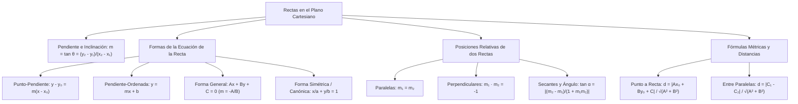

## 1. MARCO CONCEPTUAL Y ONTOLOGÍA
## 1. FICHA TÉCNICA Y MATRIZ DE COMPETENCIAS

| Parámetro | Detalle Institucional |
| :--- | :--- |
| **Resolución Oficial** | Resolución de Consejo Universitario N° 0028-2026 (Admisión UNSA 2027) |
| **Eje Curricular** | Eje 02: Matemática / Geometría Analítica Plana |
| **Peso Ponderado UNSA** | **Ingenierías:** 1.658337400 pts/preg (4 preg. = 6.63 pts) \| **Biomédicas:** 1.265447400 pts \| **Sociales:** 0.824574000 pts |
| **Frecuencia en Exámenes** | **Crítica / Alta (94%):** Preguntas fijas sobre ecuaciones de rectas tangentes, paralelismo, perpendicularidad y distancia de un punto a una recta. |
| **Modelos de Examen** | UNSA (Ordinario, CEPREUNSA), UNMSM (DECO de rutas óptimas y distancias mínimas a oleoductos), UNI (Familias de rectas y mediatrices analíticas). |
| **Competencia Cardinal** | Determinar las ecuaciones de la recta en sus formas punto-pendiente, general y simétrica, analizar el paralelismo y perpendicularidad a partir de pendientes, y calcular distancias mínimas y áreas mediante determinantes cartesianos. |

---

## 2. MAPA TAXONÓMICO Y ONTOLOGÍA DE CONCEPTOS

---

## 2. DESARROLLO TEÓRICO FORMAL - PARTE I
### EJE 02: MATEMÁTICA — GEOMETRÍA
### TEMA II: RECTAS EN EL PLANO, POSICIONES RELATIVAS Y DISTANCIAS

---

### 3. DESARROLLO TEÓRICO FORMAL (ESTÁNDAR LUMBRERAS / CUZCANO / UNI)

### 3.1. Sistema de Coordenadas Cartesianas y la Pendiente
El plano cartesiano \mathbb{R}^2 está definido por dos rectas numéricas perpendiculares que se cortan en el origen (0, 0).

#### 1. Distancia Euclidiana entre dos Puntos:
Sean P_1(x_1, y_1) y P_2(x_2, y_2):
d(P_1, P_2) = \sqrt{(x_2 - x_1)^2 + (y_2 - y_1)^2}

#### 2. Punto Medio (M) de un Segmento:
M\left(\frac{x_1 + x_2}{2}, \ \frac{y_1 + y_2}{2}\right)

#### 3. División de un Segmento en una Razón Dada r = \frac{P_1 P}{P P_2}:
x = \frac{x_1 + r x_2}{1 + r}, \qquad y = \frac{y_1 + r y_2}{1 + r}, \quad (r \neq -1)

#### 4. Pendiente de una Recta (m):
Es la tangente trigonométrica de su ángulo de inclinación \theta \in [0^\circ, 180^\circ\rangle medido en sentido antihorario desde el semieje positivo de las abscisas:
\mathbf{m = \tan \theta = \frac{y_2 - y_1}{x_2 - x_1}}, \quad (x_1 \neq x_2)
- Si \theta es agudo (0^\circ < \theta < 90^\circ) \implies m > 0 (Recta ascendente).
- Si \theta es obtuso (90^\circ < \theta < 180^\circ) \implies m < 0 (Recta descendente).
- Si \theta = 0^\circ \implies m = 0 (Recta horizontal).
- Si \theta = 90^\circ \implies m no existe o es infinita (Recta vertical: x = k).

---

### 3.2. Formas Canónicas de la Ecuación de la Recta

1. **Ecuación Punto-Pendiente:**
   Conocidos el punto de paso P_0(x_0, y_0) y la pendiente m:
   y - y_0 = m(x - x_0)
2. **Ecuación Pendiente-Ordenada al Origen:**
   Conocida la ordenada al origen (0, b) y la pendiente m:
   y = mx + b
3. **Ecuación Simétrica (Canónica):**
   Conocidos los puntos de corte con los ejes coordenados (a, 0) y (0, b) con a, b \neq 0:
   \frac{x}{a} + \frac{y}{b} = 1

## 3. FORMULARIO FUNDAMENTAL Y LEYES BASE
### 4. FORMULARIO MAESTRO (LATEX ESTRICTO)

| Concepto / Teorema | Fórmula Matemática | Propiedad / Condición |
| :--- | :--- | :--- |
| **Pendiente** | m = \frac{y_2 - y_1}{x_2 - x_1} = -\frac{A}{B} | x_1 \neq x_2, \ B \neq 0 |
| **Punto-Pendiente** | y - y_0 = m(x - x_0) | Pasa por (x_0, y_0) |
| **Simétrica** | \frac{x}{a} + \frac{y}{b} = 1 | Cortes en (a, 0) y (0, b) |
