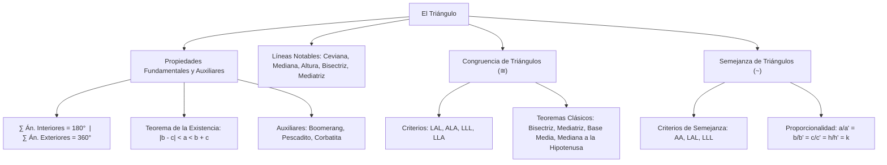

## 1. MARCO CONCEPTUAL Y ONTOLOGÍA
## 1. FICHA TÉCNICA Y MATRIZ DE COMPETENCIAS

| Parámetro | Detalle Institucional |
| :--- | :--- |
| **Resolución Oficial** | Resolución de Consejo Universitario N° 0028-2026 (Admisión UNSA 2027) |
| **Eje Curricular** | Eje 02: Matemática / Geometría Plana Fundamental y Razonamiento Deductivo |
| **Peso Ponderado UNSA** | **Ingenierías:** 1.658337400 pts/preg (4 preg. = 6.63 pts) \| **Biomédicas:** 1.265447400 pts \| **Sociales:** 0.824574000 pts |
| **Frecuencia en Exámenes** | **Máxima / Imprescindible (99%):** Es el tema más evaluado de toda la geometría preuniversitaria. Casi todo problema geométrico complejo se reduce a congruencia o semejanza de triángulos. |
| **Modelos de Examen** | UNSA (Ordinario, CEPREUNSA), UNMSM (DECO de cálculo de sombras, puentes y armaduras reticulares), UNI (Construcciones auxiliares y criterios de semejanza). |
| **Competencia Cardinal** | Demostrar propiedades de figuras triangulares aplicando teoremas de ángulos interiores/exteriores y desigualdad triangular, trazar líneas notables, e identificar criterios de congruencia y razones de proporcionalidad en triángulos semejantes. |

---

## 2. MAPA TAXONÓMICO Y ONTOLOGÍA DE CONCEPTOS

---

## 2. DESARROLLO TEÓRICO FORMAL - PARTE I
### EJE 02: MATEMÁTICA — GEOMETRÍA
### TEMA III: TRIÁNGULOS, LÍNEAS NOTABLES, CONGRUENCIA Y SEMEJANZA

---

### 3. DESARROLLO TEÓRICO FORMAL (ESTÁNDAR LUMBRERAS / CUZCANO / UNI)

### 3.1. Definición y Propiedades Fundamentales del Triángulo
El **triángulo** es la figura geométrica formada por la unión de tres segmentos de recta determinados por tres puntos no colineales:
\triangle ABC = \overline{AB} \cup \overline{BC} \cup \overline{CA}

#### Teoremas Angulares Fundamentales:
1. **Suma de Ángulos Interiores:**
   \alpha + \beta + \theta = 180^\circ
2. **Suma de Ángulos Exteriores (uno por vértice):**
   x + y + z = 360^\circ
3. **Medida del Ángulo Exterior:**
   Todo ángulo exterior es igual a la suma de las medidas de los dos ángulos interiores no adyacentes a él:
   x = \beta + \theta, \qquad y = \alpha + \theta, \qquad z = \alpha + \beta
4. **Teorema de la Existencia Triangular (Desigualdad Triangular):**
   En todo triángulo, la longitud de un lado es mayor que la diferencia de los otros dos y menor que su suma:
   \mathbf{|b - c| < a < b + c}
5. **Teorema de la Correspondencia:**
   A mayor ángulo interior se opone mayor lado, y viceversa:
   \alpha > \beta \iff a > b

#### Propiedades Auxiliares Frecuentes:
- **Teorema del Boomerang:** x = \alpha + \beta + \theta
- **Teorema del Pescadito:** \alpha + \beta = x + y
- **Teorema de la Mariposa (Corbatita):** \alpha + \beta = \theta + \phi

---

### 3.2. Clasificación de Triángulos

#### A. Por las Longitudes de sus Lados:
1. **Triángulo Escaleno:** Sus tres lados tienen longitudes diferentes (a \neq b \neq c).
2. **Triángulo Isósceles:** Posee dos lados congruentes (a = b \neq c). Los ángulos opuestos a dichos lados son congruentes (**ángulos de la base**).
3. **Triángulo Equilátero:** Sus tres lados son congruentes (a = b = c). Cada ángulo interior mide estrictamente **60^\circ**.

#### B. Por las Medidas de sus Ángulos (Triángulos Oblicuángulos y Rectángulos):
1. **Triángulo Acutángulo:** Sus tres ángulos interiores son agudos (< 90^\circ).
2. **Triángulo Rectángulo:** Posee un ángulo recto (90^\circ). Los lados que forman el ángulo recto son los **catetos** y el lado opuesto es la **hipotenusa**. Sus ángulos agudos son complementarios (\alpha + \beta = 90^\circ).
3. **Triángulo Obtusángulo:** Posee un ángulo interior obtuso (> 90^\circ).

---

### 3.3. Líneas Notables Asociadas al Triángulo
1. **Ceviana:** Segmento que une un vértice con cualquier punto del lado opuesto o de su prolongación.
2. **Mediana:** Ceviana que une un vértice con el **punto medio** del lado opuesto.
3. **Altura:** Ceviana perpendicular trazada desde un vértice a la recta que contiene al lado opuesto.
4. **Bisectriz (Interior y Exterior):** Rayo que biseca un ángulo del triángulo.
   - Ángulo formado por dos bisectrices interiores:

## 3. FORMULARIO FUNDAMENTAL Y LEYES BASE
### 4. FORMULARIO MAESTRO (LATEX ESTRICTO)

| Teorema / Propiedad | Formulación Matemática | Contexto Geométrico |
| :--- | :--- | :--- |
| **Existencia Triangular** | \|b - c\| < a < b + c | En todo triángulo real |
| **Ángulo Exterior** | x = \alpha + \beta | Ángulo exterior no adyacente |
| **Bisectrices Interiores** | x = 90^\circ + \frac{\theta}{2} | Ángulo en el incentro |
| **Bisectrices Exteriores** | x = 90^\circ - \frac{\theta}{2} | Ángulo en el excentro |
