## 1. MARCO CONCEPTUAL Y ONTOLOGÍA
## 1. FICHA TÉCNICA Y MATRIZ DE COMPETENCIAS

| Parámetro | Detalle Institucional |
| :--- | :--- |
| **Resolución Oficial** | Resolución de Consejo Universitario N° 0028-2026 (Admisión UNSA 2027) |
| **Eje Curricular** | Eje 02: Matemática / Proporcionalidad Geométrica y Métricas Euclidianas |
| **Peso Ponderado UNSA** | **Ingenierías:** 1.658337400 pts/preg (4 preg. = 6.63 pts) \| **Biomédicas:** 1.265447400 pts \| **Sociales:** 0.824574000 pts |
| **Frecuencia en Exámenes** | **Máxima / Crítica (98%):** Es el núcleo de cálculo numérico de la geometría plana. Aparece en todo examen para calcular longitudes de alturas, cuerdas y catetos. |
| **Modelos de Examen** | UNSA (Ordinario, CEPREUNSA), UNMSM (DECO de cálculo de distancias inaccesibles e ingeniería vial), UNI (Teoremas de Stewart, Apolonio y relaciones métricas en la circunferencia). |
| **Competencia Cardinal** | Aplicar con exactitud analítica el Teorema de Tales, los teoremas de la bisectriz y el incentro, las relaciones métricas en el triángulo rectángulo y oblicuángulo (Apolonio, Herón), y los teoremas de cuerdas, secantes y tangentes en la circunferencia. |

---

## 2. MAPA TAXONÓMICO Y ONTOLOGÍA DE CONCEPTOS

```mermaid
graph TD
    TF["Teoremas Fundamentales y Métricas"] --> PROP["Proporcionalidad Geométrica"]
    TF --> RMR["Relaciones Métricas en Triángulo Rectángulo"]
    TF --> RMO["Relaciones Métricas en Triángulos Oblicuángulos"]
    TF --> RMC["Relaciones Métricas en la Circunferencia"]
    
    PROP --> TALES["Teorema de Tales: a/b = c/d"]
    PROP --> BIS["Teoremas de la Bisectriz (Interior y Exterior)"]
    PROP --> CEVAMEN["Teoremas de Ceva y Menelao"]
    
    RMR --> PIT["Pitágoras: a² + b² = c²"]
    RMR --> CATALT["Cateto: a² = c·m  |  Altura: h² = m·n  |  a·b = c·h"]
    RMR --> INVCAT["Inversas: 1/h² = 1/a² + 1/b²"]
    
    RMO --> EUC["Teoremas de Euclides I y II (Ley de Cosenos Geométrica)"]
    RMO --> APOL["Teorema de la Mediana (Apolonio): b² + c² = 2mₐ² + a²/2"]
    RMO --> HERON["Fórmula de Herón para la Altura"]
    RMO --> STEW["Teorema de Stewart (Ceviana cualquiera)"]
    
    RMC --> CUER["Teorema de las Cuerdas: a · b = c · d"]
    RMC --> SECAN["Teorema de las Secantes: PA · PB = PC · PD"]
    RMC --> TANG["Teorema de la Tangente: PT² = PA · PB"]
```

---

## 2. DESARROLLO TEÓRICO FORMAL - PARTE I
### EJE 02: MATEMÁTICA — GEOMETRÍA
### TEMA IV: TEOREMAS FUNDAMENTALES (TALES, PITÁGORAS, RELACIONES MÉTRICAS EN TRIÁNGULOS Y CIRCUNFERENCIA)

---

### 3. DESARROLLO TEÓRICO FORMAL (ESTÁNDAR LUMBRERAS / CUZCANO / UNI)

### 3.1. Proporcionalidad Geométrica

#### 1. Teorema de Tales de Mileto:
Tres o más rectas paralelas determinan sobre dos o más rectas secantes transversales segmentos correspondientes proporcionales:
\text{Si } \overleftrightarrow{L_1} \parallel \overleftrightarrow{L_2} \parallel \overleftrightarrow{L_3} \implies \mathbf{\frac{AB}{BC} = \frac{DE}{EF}}

#### 2. Teorema de la Bisectriz Interior:
En todo triángulo, la bisectriz interior divide al lado opuesto en dos segmentos cuyas longitudes son proporcionales a las longitudes de los lados adyacentes:
\mathbf{\frac{c}{a} = \frac{m}{n} \iff \frac{AB}{BC} = \frac{AD}{DC}}
- **Longitud de la bisectriz interior (x):**
  \mathbf{x^2 = c \cdot a - m \cdot n}

#### 3. Teorema de la Bisectriz Exterior:
En un triángulo escaleno ABC, la bisectriz exterior divide a la prolongación del lado opuesto en segmentos proporcionales:
\mathbf{\frac{c}{a} = \frac{m'}{n'}}
- **Longitud de la bisectriz exterior (y):**
  \mathbf{y^2 = m' \cdot n' - c \cdot a}

#### 4. Teorema del Incentro:
Si I es el incentro del triángulo ABC y \overline{BD} es la bisectriz interior:
\mathbf{\frac{BI}{ID} = \frac{AB + BC}{AC} = \frac{c + a}{b}}

#### 5. Teorema de Menelao:
Toda recta secante que corta a dos lados de un triángulo y a la prolongación del tercero determina seis segmentos que cumplen:
(a_1)(a_2)(a_3) = (b_1)(b_2)(b_3)
*(El producto de tres segmentos no consecutivos es igual al producto de los otros tres).*

#### 6. Teorema de Giovanni Ceva:
Tres cevianas interiores concurrentes en un punto interior determinan sobre los lados segmentos que cumplen:
(x)(y)(z) = (m)(n)(p)

---

### 3.2. Relaciones Métricas en el Triángulo Rectángulo
Sea el triángulo rectángulo ABC recto en B. Trazamos la altura \overline{BH} (h) relativa a la hipotenusa AC (c), determinando las proyecciones ortogonales AH = m y HC = n:

1. **Teorema de Pitágoras:**
   \mathbf{a^2 + b^2 = c^2}
2. **Teorema del Cateto:**
   El cuadrado de la longitud de un cateto es igual al producto de la hipotenusa por su proyección ortogonal sobre ella:
   \mathbf{c_1^2 = c \cdot m \qquad \land \qquad c_2^2 = c \cdot n}

## 3. FORMULARIO FUNDAMENTAL Y LEYES BASE
### 4. FORMULARIO MAESTRO (LATEX ESTRICTO)

| Teorema | Fórmula Matemática | Aplicación Principal |
| :--- | :--- | :--- |
| **Tales** | \frac{a}{b} = \frac{c}{d} | Rectas paralelas y secantes |
| **Bisectriz Interior** | \frac{c}{a} = \frac{m}{n} \quad \land \quad x^2 = ca - mn | División proporcional interior |
| **Bisectriz Exterior** | y^2 = m'n' - ca | Longitud de bisectriz externa |
| **Pitágoras** | a^2 + b^2 = c^2 | Triángulos rectángulos |
