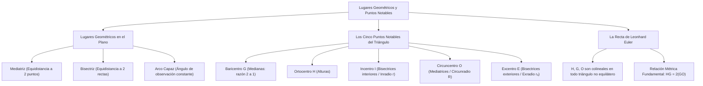

## 1. MARCO CONCEPTUAL Y ONTOLOGÍA
## 1. FICHA TÉCNICA Y MATRIZ DE COMPETENCIAS

| Parámetro | Detalle Institucional |
| :--- | :--- |
| **Resolución Oficial** | Resolución de Consejo Universitario N° 0028-2026 (Admisión UNSA 2027) |
| **Eje Curricular** | Eje 02: Matemática / Geometría del Triángulo y Lugares Geométricos |
| **Peso Ponderado UNSA** | **Ingenierías:** 1.658337400 pts/preg (4 preg. = 6.63 pts) \| **Biomédicas:** 1.265447400 pts \| **Sociales:** 0.824574000 pts |
| **Frecuencia en Exámenes** | **Alta (91%):** Se evalúan las propiedades métricas del baricentro (razón 2:1), el circuncentro en triángulos rectángulos y la Recta de Euler. |
| **Modelos de Examen** | UNSA (Ordinario, CEPREUNSA), UNMSM (DECO de centros de masa y antenas de telecomunicación), UNI (Geometría del triángulo órtico y propiedades de la Recta de Euler). |
| **Competencia Cardinal** | Definir lugares geométricos en el plano, localizar con exactitud los puntos notables del triángulo (baricentro, ortocentro, incentro, circuncentro y excentro), y aplicar las propiedades de concurrencia y la razón colineal de Euler. |

---

## 2. MAPA TAXONÓMICO Y ONTOLOGÍA DE CONCEPTOS

---

## 2. DESARROLLO TEÓRICO FORMAL - PARTE I
### EJE 02: MATEMÁTICA — GEOMETRÍA
### TEMA V: LUGARES GEOMÉTRICOS, PUNTOS NOTABLES DEL TRIÁNGULO Y RECTA DE EULER

---

### 3. DESARROLLO TEÓRICO FORMAL (ESTÁNDAR LUMBRERAS / CUZCANO / UNI)

### 3.1. Teoría de Lugares Geométricos (L.G.)
Un **Lugar Geométrico** es el conjunto de todos los puntos del plano, y solo ellos, que satisfacen una propiedad geométrica o métrica determinada:
\mathcal{LG} = \{P \in \mathbb{R}^2 \mid \mathcal{P}(P) \text{ es verdadera}\}

#### Lugares Geométricos Clásicos:
1. **La Mediatriz:** Lugar geométrico de todos los puntos del plano que equidistan de dos puntos fijos A y B:
   \mathcal{LG} = \{P \mid d(P, A) = d(P, B)\}
2. **La Bisectriz:** Lugar geométrico de todos los puntos que equidistan de los lados de un ángulo:
   \mathcal{LG} = \{P \mid d(P, \overrightarrow{OA}) = d(P, \overrightarrow{OB})\}
3. **La Circunferencia:** Lugar geométrico de los puntos que equidistan de un punto fijo central O:
   \mathcal{LG} = \{P \mid d(P, O) = R\}
4. **El Arco Capaz:** Lugar geométrico de los puntos desde los cuales un segmento dado \overline{AB} se observa bajo un mismo ángulo constante \alpha.

---

### 3.2. Los Cinco Puntos Notables del Triángulo

#### 1. Baricentro o Gravicentro (G):
Es el punto de intersección de las **tres medianas** del triángulo. Es el centro de gravedad físico de una placa triangular homogénea.
- **Teorema de la Razón 2 a 1:**
  El baricentro divide a cada mediana en dos segmentos cuya razón es de 2 a 1, siendo el segmento mayor el que conecta con el vértice:
  \mathbf{AG = 2(GM_a), \qquad BG = 2(GM_b), \qquad CG = 2(GM_c)}
- **Coordenadas Cartesianas del Baricentro:**
  G = \left(\frac{x_A + x_B + x_C}{3}, \ \frac{y_A + y_B + y_C}{3}\right)

#### 2. Ortocentro (H):
Es el punto de intersección de las **tres alturas** (o de las rectas que las contienen).
- **Ubicación según la naturaleza del triángulo:**
  - En un triángulo **acutángulo:** H es un punto estrictamente **interior**.
  - En un triángulo **rectángulo:** H coincide exactamente con el **vértice del ángulo recto**.
  - En un triángulo **obtusángulo:** H se ubica en la **región exterior**, detrás del ángulo obtuso.

#### 3. Incentro (I):
Es el punto de intersección de las **tres bisectrices interiores**.
- Es el centro de la **circunferencia inscrita** (tangente interior a los tres lados).
- Su radio se denomina **inradio (r)**.

## 3. FORMULARIO FUNDAMENTAL Y LEYES BASE
### 4. FORMULARIO MAESTRO (LATEX ESTRICTO)

| Punto / Teorema | Relación Matemática | Ubicación / Condición |
| :--- | :--- | :--- |
| **Baricentro (G)** | AG = 2(GM_a) | Razón métrica 2:1 |
| **Coordenadas G** | G = \frac{A + B + C}{3} | Media aritmética de vértices |
| **Poncelet** | a + b = c + 2r | Triángulos rectángulos |
