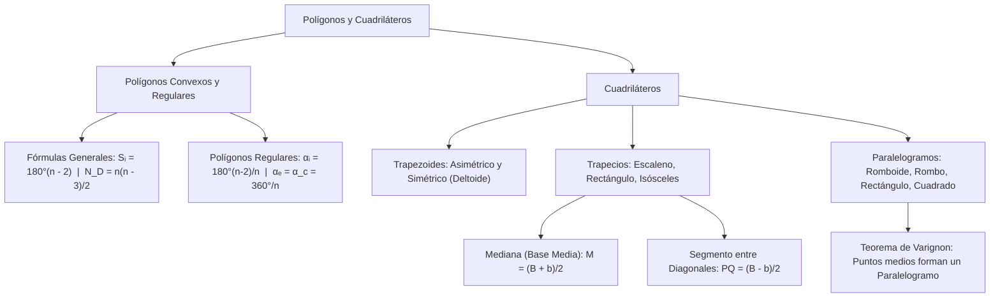

## 1. MARCO CONCEPTUAL Y ONTOLOGÍA
## 1. FICHA TÉCNICA Y MATRIZ DE COMPETENCIAS

| Parámetro | Detalle Institucional |
| :--- | :--- |
| **Resolución Oficial** | Resolución de Consejo Universitario N° 0028-2026 (Admisión UNSA 2027) |
| **Eje Curricular** | Eje 02: Matemática / Geometría Plana de Polígonos y Cuadriláteros |
| **Peso Ponderado UNSA** | **Ingenierías:** 1.658337400 pts/preg (4 preg. = 6.63 pts) \| **Biomédicas:** 1.265447400 pts \| **Sociales:** 0.824574000 pts |
| **Frecuencia en Exámenes** | **Alta (90%):** Se evalúan fórmulas de diagonales y ángulos de polígonos regulares, junto con medianas de trapecios y propiedades de rombos. |
| **Modelos de Examen** | UNSA (Ordinario, CEPREUNSA), UNMSM (DECO de pavimentación con teselados y estructuras de puentes trapeciales), UNI (Diagonales desde k vértices y Teorema de Varignon). |
| **Competencia Cardinal** | Deducir y aplicar las fórmulas generales de polígonos de n lados (suma de ángulos y diagonales), clasificar cuadriláteros convexos, y calcular medianas trapeciales y segmentos entre diagonales. |

---

## 2. MAPA TAXONÓMICO Y ONTOLOGÍA DE CONCEPTOS

---

## 2. DESARROLLO TEÓRICO FORMAL - PARTE I
### EJE 02: MATEMÁTICA — GEOMETRÍA
### TEMA VI: POLÍGONOS GENERALES, REGULARES Y CUADRILÁTEROS

---

### 3. DESARROLLO TEÓRICO FORMAL (ESTÁNDAR LUMBRERAS / CUZCANO / UNI)

### 3.1. Teoría General de Polígonos
Un **polígono** es una figura geométrica plana cerrada formada por una secuencia finita de segmentos de recta consecutivos coplanares que se intersecan únicamente en sus extremos:
\mathcal{P} = \overline{A_1 A_2} \cup \overline{A_2 A_3} \cup \dots \cup \overline{A_n A_1}

#### Clasificación por sus Características:
1. **Polígono Convexo:** Todo segmento que une dos puntos interiores queda completamente contenido en el polígono. Cualquier recta secante lo corta en a lo más dos puntos.
2. **Polígono Cóncavo (No Convexo):** Al menos un ángulo interior es mayor a 180^\circ.
3. **Polígono Equilátero:** Todos sus lados tienen longitudes iguales.
4. **Polígono Equiángulo:** Todos sus ángulos interiores tienen igual medida.
5. **Polígono Regular:** Es **equilátero y equiángulo simultáneamente**. Posee un centro geométrico común para la circunferencia inscrita y circunscrita.

#### Nomenclatura Oficial según el Número de Lados (n):
- n = 3: Triángulo
- n = 4: Cuadrilátero
- n = 5: Pentágono
- n = 6: Hexágono
- n = 7: Heptágono
- n = 8: Octógono u Octágono
- n = 9: Nonágono o Eneágono
- n = 10: Decágono
- n = 11: Endecágono o Undecágono
- n = 12: Dodecágono
- n = 15: Pentadecágono
- n = 20: Icoságono

---

### 3.2. Fórmulas Fundamentales en Polígonos de n Lados

Para **todo polígono convexo** de n lados:
1. **Suma de las medidas de los ángulos interiores (S_i):**
   \mathbf{S_i = 180^\circ(n - 2)}
2. **Suma de las medidas de los ángulos exteriores (S_e):**
   \mathbf{S_e = 360^\circ}
3. **Número de diagonales trazadas desde un solo vértice (d_1):**
   \mathbf{d_1 = n - 3}
4. **Número total de diagonales (N_D):**
   \mathbf{N_D = \frac{n(n - 3)}{2}}
5. **Número de diagonales trazadas desde k vértices consecutivos (D_k):**
   \mathbf{D_k = n k - \frac{(k + 1)(k + 2)}{2}}

Para **polígonos regulares o equiángulos**:

## 3. FORMULARIO FUNDAMENTAL Y LEYES BASE
### 4. FORMULARIO MAESTRO (LATEX ESTRICTO)

| Propiedad / Teorema | Fórmula Matemática | Alcance / Restricción |
| :--- | :--- | :--- |
| **Suma Ángulos Interiores** | S_i = 180^\circ(n - 2) | Todo polígono convexo |
| **Número de Diagonales** | N_D = \frac{n(n - 3)}{2} | Total de diagonales |
| **Ángulo Interior Regular** | \alpha_i = \frac{180^\circ(n - 2)}{n} | Polígonos regulares/equiángulos |
