## 1. MARCO CONCEPTUAL Y ONTOLOGÍA
## 1. FICHA TÉCNICA Y MATRIZ DE COMPETENCIAS

| Parámetro | Detalle |
| :--- | :--- |
| **Eje Temático** | 02. Matemática |
| **Área Disciplinar** | Geometría Plana |
| **Nivel de Complejidad** | Intermedio a Avanzado (Estándar CEPREUNSA, UNMSM-DECO, UNI) |
| **Ponderación UNSA** | Ingenierías: 1.6583 pts \| Biomédicas: 1.2654 pts \| Sociales: 0.8245 pts |
| **Tiempo Estimado de Estudio** | 3.5 a 4.5 horas |
| **Prerrequisitos** | Ángulos, Triángulos, Congruencia, Semejanza y Cuadriláteros |

### Competencias Clave del Prospecto
1. **Modelación Espacial y Angular:** Identificar, clasificar y calcular medidas angulares determinadas por cuerdas, secantes y tangentes en la circunferencia.
2. **Aplicación Teoremas de Contacto:** Utilizar con precisión los teoremas de Poncelet, Pitot y Steiner en triángulos rectángulos y polígonos circunscritos/exinscritos.
3. **Reconocimiento de Inscriptibilidad:** Reconocer y aplicar las condiciones necesarias y suficientes para que un cuadrilátero sea inscriptible o inscrito en la resolución de problemas geométricos de alta exigencia.
4. **Relaciones Métricas en la Circunferencia:** Relacionar métricamente cuerdas, secantes y tangentes (Teorema de cuerdas, de las secantes y de la tangente).

---

## 2. MAPA TAXONÓMICO Y ONTOLOGÍA

```mermaid
graph TD
    A[La Circunferencia] --> B[Elementos Asociados]
    A --> C[Posiciones Relativas]
    A --> D[Ángulos en la Circunferencia]
    A --> E[Teoremas Fundamentales de Tangencia]
    A --> F[Cuadrilátero Inscriptible]
    A --> G[Relaciones Métricas Circulares]

    B --> B1[Radio, Cuerda, Diámetro]
    B --> B2[Arco, Flecha o Sagita]
    B --> B3[Recta Secante y Tangente]

    C --> C1[Exteriores y Tangentes Ext.]
    C --> C2[Secantes y Ortogonales]
    C --> C3[Tangentes Int., Interiores y Concéntricas]

    D --> D1[Central e Inscrito]
    D --> D2[Semi-inscrito y Ex-inscrito]
    D --> D3[Interior y Exterior]

    E --> E1[Radio perpendicular a Tangente]
    E --> E2[Segmentos Tangentes Congruentes]
    E --> E3[Teorema de Poncelet: a+b=c+2r]
    E --> E4[Teorema de Pitot: a+c=b+d]

    F --> F1[Ángulos Opuestos Suplementarios]
    F --> F2[Ángulos 'Rebote' de Diagonales]
    F --> F3[Ángulo Exterior = Interior Opuesto]

    G --> G1[Teorema de las Cuerdas]
    G --> G2[Teorema de las Secantes]
    G --> G3[Teorema de la Tangente]
```

---

## 2. DESARROLLO TEÓRICO FORMAL - PARTE I
### 3. DESARROLLO TEÓRICO FORMAL

### 3.1. Definición y Elementos Asociados
La **circunferencia** es el lugar geométrico de todos los puntos de un plano que equidistan de un punto fijo denominado **centro** (O). La distancia constante entre el centro y cualquier punto de la circunferencia se denomina **radio** (R o r).
\mathcal{C}(O, R) = \{ P \in \mathbb{R}^2 \mid d(P, O) = R \}

*Diferencia con el Círculo:* La circunferencia es la línea curva cerrada perimetral (unidimensional). El círculo es la unión de la circunferencia con todos sus puntos interiores (región bidimensional).

#### Elementos Notables:
1. **Cuerda:** Segmento que une dos puntos cualesquiera de la circunferencia (ej. \overline{AB}).
2. **Diámetro (Cuerda Máxima):** Cuerda que contiene al centro. Mide exactamente 2R. Divide a la circunferencia en dos semicircunferencias de 180^\circ.
3. **Arco:** Porción continua de circunferencia limitada por dos puntos (\widehat{AB}).
4. **Flecha o Sagita:** Segmento perpendicular a una cuerda levantado desde su punto medio hasta la intersección con el arco subtendido.
5. **Recta Tangente (\mathscr{L}_T):** Recta coplanar que interseca a la circunferencia en un único punto denominado **punto de tangencia** o contacto (T).
6. **Recta Secante (\mathscr{L}_S):** Recta que corta a la circunferencia en dos puntos distintos.

---

### 3.2. Propiedades Fundamentales de la Circunferencia
1. **Propiedad del Radio y la Tangente:** Todo radio trazado al punto de tangencia es estrictamente perpendicular a la recta tangente.
   \overline{OT} \perp \mathscr{L}_T
2. **Perpendicularidad Centro-Cuerda:** Todo radio o diámetro perpendicular a una cuerda biseca a la cuerda y al arco que subtiende.
   \text{Si } \overline{OM} \perp \overline{AB} \implies AM = MB \quad \text{y} \quad m\widehat{AN} = m\widehat{NB}
3. **Cuerdas Congruentes:** A cuerdas de igual longitud les corresponden arcos de igual medida angular, y equidistan del centro.
   AB = CD \iff m\widehat{AB} = m\widehat{CD} \iff d(O, \overline{AB}) = d(O, \overline{CD})
4. **Cuerdas Paralelas:** Los arcos comprendidos entre dos cuerdas paralelas son congruentes.
   \overline{AB} \parallel \overline{CD} \implies m\widehat{AC} = m\widehat{BD}
5. **Tangentes desde un punto exterior:** Si desde un punto exterior P se trazan las tangentes \overline{PA} y \overline{PB} a la circunferencia:
   PA = PB \quad \text{y} \quad \overrightarrow{PO} \text{ es bisectriz del } \angle APB

---

### 3.3. Posiciones Relativas de Dos Circunferencias Coplanares
Sean dos circunferencias de centros O_1, O_2, radios R y r (R \ge r) y distancia entre centros d = O_1O_2:

1. **Circunferencias Exteriores:** No tienen puntos comunes.
   d > R + r
2. **Circunferencias Tangentes Exteriores:** Tienen un único punto común exterior. Los centros y el punto de tangencia son colineales.
   d = R + r
3. **Circunferencias Secantes:** Se cortan en dos puntos distintos.
   R - r < d < R + r
   *Caso Particular (Ortogonales):* Los radios trazados a uno de los puntos de intersección son perpendiculares: d^2 = R^2 + r^2.
4. **Circunferencias Tangentes Interiores:** Tienen un único punto de contacto y una está dentro de la otra.
   d = R - r \quad (R > r)
5. **Circunferencias Interiores:** No tienen puntos comunes y una está dentro de la otra sin compartir centro.
   0 \le d < R - r
6. **Circunferencias Concéntricas:** Mismo centro (d = 0). La región comprendida entre ellas es una corona circular.

---

### 3.4. Ángulos en la Circunferencia

| Tipo de Ángulo | Vértice | Lados | Fórmula de la Medida |
| :--- | :--- | :--- | :--- |
| **Central** | En el centro O | Dos radios | \alpha = m\widehat{AB} |
| **Inscrito** | En la circunferencia | Dos cuerdas | \alpha = \dfrac{m\widehat{AB}}{2} |
| **Semi-inscrito** | En la circunferencia | Una tangente y una cuerda | \alpha = \dfrac{m\widehat{TA}}{2} |

## 3. FORMULARIO FUNDAMENTAL Y LEYES BASE
### 4. FORMULARIO MAESTRO (LATEX ESTRICTO)

| Situación Geométrica | Identidad / Ecuación Rigurosa | Variables y Condiciones |
| :--- | :--- | :--- |
| **Ángulo Inscrito** | \theta = \dfrac{1}{2} m\widehat{AB} | Vértice en la circunferencia |
| **Ángulo Interior** | \theta = \dfrac{m\widehat{AB} + m\widehat{CD}}{2} | Intersección de cuerdas |
| **Ángulo Exterior** | \theta = \dfrac{m\widehat{AB} - m\widehat{CD}}{2} | Vértice exterior, arcos AB > CD |
| **Tangentes Exteriores** | \theta + m\widehat{AB}_{\text{menor}} = 180^\circ | Vértice formado por 2 tangentes |
| **Teorema de Poncelet** | a + b = c + 2r | \triangle rectángulo, c hipotenusa, r inradio |
