## 1. MARCO CONCEPTUAL Y ONTOLOGÍA
## 1. FICHA TÉCNICA Y MATRIZ DE COMPETENCIAS

| Parámetro | Detalle |
| :--- | :--- |
| **Eje Temático** | 02. Matemática |
| **Área Disciplinar** | Geometría Plana y Métricas de Regiones |
| **Nivel de Complejidad** | Intermedio a Avanzado (Estándar CEPREUNSA, UNMSM-DECO, UNI) |
| **Ponderación UNSA** | Ingenierías: 1.6583 pts \| Biomédicas: 1.2654 pts \| Sociales: 0.8245 pts |
| **Tiempo Estimado de Estudio** | 4.0 a 5.0 horas |
| **Prerrequisitos** | Triángulos, Semejanza, Cuadriláteros y Circunferencia |

### Competencias Clave del Prospecto
1. **Cálculo de Longitudes y Perímetros:** Determinar perímetros poligonales, longitud de la circunferencia y de arcos circulares con rigor dimensional.
2. **Dominio de Fórmulas de Áreas Triangulares:** Manejar fluidamente la fórmula básica, trigonométrica, Herón, función de inradio (A = pr), circunradio (A = \frac{abc}{4R}) y exradio.
3. **Relación de Áreas en Figuras:** Aplicar las propiedades de partición por medianas, cevianas, baricentro, semejanza geométrica y relaciones en trapecios/paralelogramos.
4. **Cálculo de Regiones Cuadrangulares y Circulares:** Resolver áreas de trapecios, rombos, cuadriláteros inscriptibles (Brahmagupta), sectores, coronas, segmentos circulares y lúnulas.

---

## 2. MAPA TAXONÓMICO Y ONTOLOGÍA

```mermaid
graph TD
    A[Métricas Planas: Perímetros y Áreas] --> B[Perímetros y Longitudes]
    A --> C[Áreas de Regiones Triangulares]
    A --> D[Relaciones de Áreas Triangulares]
    A --> E[Áreas de Regiones Cuadrangulares]
    A --> F[Áreas de Regiones Circulares]

    B --> B1[Perímetro Poligonal 2p]
    B --> B2[Longitud de Circunferencia: 2πR]
    B --> B3[Longitud de Arco: L = θR]

    C --> C1[Fórmula Básica y Trigonométrica]
    C --> C2[Fórmula de Herón]
    C --> C3[En función de radios: Inradio, Circunradio, Exradio]
    C --> C4[Triángulo Equilátero: L²√3 / 4]

    D --> D1[Proporcionalidad por Cevianas y Medianas]
    D --> D2[División Baricéntrica en 6 áreas iguales]
    D --> D3[Razón de Semejanza Cuadrática]

    E --> E1[Paralelogramo y Rombo]
    E --> E2[Trapecio: Base Media × Altura]
    E --> E3[Fórmula de Brahmagupta para Inscriptibles]
    E --> E4[Propiedad de Cuadriláteros: S1·S2 = S3·S4]

    F --> F1[Círculo y Sector Circular]
    F --> F2[Corona y Trapecio Circular]
    F --> F3[Segmento Circular y Lúnulas de Hipócrates]
```

---

## 2. DESARROLLO TEÓRICO FORMAL - PARTE I
### 3. DESARROLLO TEÓRICO FORMAL

### 3.1. Longitudes y Perímetros
- **Perímetro (2p):** Longitud total del contorno o frontera de una región plana cerrada. El **semiperímetro** se denota formalmente por p.
- **Longitud de la Circunferencia (L_{\mathcal{C}}):**
  L_{\mathcal{C}} = 2\pi R = \pi D
- **Longitud de Arco de Circunferencia (L_{\text{arco}}):**
  L = \theta_{\text{rad}} \cdot R = \frac{\pi R \theta^\circ}{180^\circ}

---

### 3.2. Áreas de Regiones Triangulares

#### 1. Fórmula Fundamental (Básica):
A = \frac{b \cdot h}{2}
Válida para todo triángulo (acutángulo, rectángulo u obtusángulo).

#### 2. Fórmula Trigonométrica:
A = \frac{a \cdot b \cdot \sin(\theta)}{2}
Donde a y b son dos lados adyacentes y \theta es el ángulo comprendido entre ellos.

#### 3. Fórmula de Herón de Alejandría:
Permite calcular el área conociendo únicamente las longitudes de los tres lados a, b, c:
p = \frac{a + b + c}{2} \quad (\text{semiperímetro})
A = \sqrt{p(p - a)(p - b)(p - c)}

#### 4. Triángulo Equilátero:
Para un triángulo equilátero de lado L y altura h:
A = \frac{L^2\sqrt{3}}{4} = \frac{h^2\sqrt{3}}{3}

#### 5. En Función de Radios Asociados:
- **Con el Inradio (r):**
  A = p \cdot r
- **Con el Circunradio (R):**
  A = \frac{a \cdot b \cdot c}{4R}
- **Con el Exradio (r_a relativo al lado a):**
  A = r_a(p - a)
- **Fórmula de los Exradios y el Inradio:**
  A = \sqrt{r \cdot r_a \cdot r_b \cdot r_c} \quad \text{y} \quad \frac{1}{r} = \frac{1}{r_a} + \frac{1}{r_b} + \frac{1}{r_c}

---

### 3.3. Relaciones y Partición de Áreas Triangulares
1. **Ceviana en un Triángulo:** Si desde el vértice B se traza la ceviana \overline{BD} hacia \overline{AC}:
   \frac{\text{Área}(\triangle ABD)}{\text{Área}(\triangle DBC)} = \frac{AD}{DC}
2. **Mediana:** Una mediana biseca el área del triángulo en dos regiones equivalentes:
   A_1 = A_2 = \frac{A_{\text{total}}}{2}
3. **Baricentro (G):**
   - Las tres medianas dividen al triángulo en **6 regiones triangulares de igual área**:
     S_1 = S_2 = \dots = S_6 = \frac{A_{\text{total}}}{6}
   - Al unir el baricentro G con los tres vértices A, B, C, se obtienen **3 triángulos de igual área**:

## 3. FORMULARIO FUNDAMENTAL Y LEYES BASE
### 4. FORMULARIO MAESTRO (LATEX ESTRICTO)

| Región | Ecuación de Área | Parámetros y Condiciones |
| :--- | :--- | :--- |
| **Triángulo (Herón)** | A = \sqrt{p(p-a)(p-b)(p-c)} | p = \frac{a+b+c}{2} |
| **Triángulo (Inradio)** | A = p \cdot r | p: semiperímetro, r: inradio |
| **Triángulo (Circunradio)** | A = \dfrac{abc}{4R} | R: circunradio |
| **Triángulo Equilátero**| A = \dfrac{L^2\sqrt{3}}{4} | L: lado del triángulo equilátero |
| **Cuadrilátero Convexo** | A = \dfrac{1}{2} d_1 d_2 \sin(\theta) | d_1, d_2: diagonales, \theta: ángulo de cruce |
