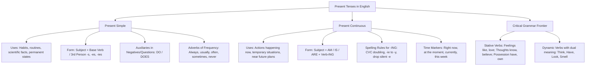

## 1. COURSE OVERVIEW & CONCEPTUAL FRAMEWORK
## 1. PORTADA Y METADATOS CURRICULARES

| Campo | Detalle |
| :--- | :--- |
| **Eje Temático** | Eje 07: Idioma Extranjero (Inglés) |
| **Materia** | Gramática y Sintaxis Inglesa (A2 - B1 CEFR) |
| **Nivel de Dificultad** | Preuniversitario Avanzado (UNSA / CEPRUNSA) |
| **Tiempo de Estudio Recomendado** | 4.5 horas |
| **Resolución Curricular** | R.C.U. N.° 0028-2026 (Admisión 2027) |
| **Prerrequisitos** | Pronombres personales, vocabulario verbal elemental |
| **Objetivo Pedagógico** | Dominar con exactitud la morfología, sintaxis y contraste pragmático entre el **Present Simple** (rutinas, hechos científicos, estados permanentes) y el **Present Continuous** (acciones en progreso, situaciones temporales y planes cercanos); aplicar las reglas de adición de *-s/-es/-ies* e *-ing*; y reconocer los **Stative Verbs**, que normalmente usan formas simples cuando expresan estados. |

---

## 2. MAPA CONCEPTUAL SINTÉTICO (MERMAID)

---

## 3. FUNDAMENTACIÓN TEÓRICA RIGUROSA

### 3.1. The Present Simple Tense
El **Present Simple** se utiliza para expresar acciones habituales, rutinas cotidianas, hechos generales y estados que se presentan como habituales o estables; no es necesario que sean eternos o invariables.

#### A. Morfología y Reglas Ortográficas de la Tercera Persona Singular (*He, She, It*)
En oraciones afirmativas, los sujetos singulares de tercera persona exigen la modificación del verbo base:

| Terminación del Verbo Base | Regla de Modificación | Ejemplos Ilustrativos |
| :--- | :--- | :--- |
| **Regla General (Mayoría)** | Añadir **-s** | *read \rightarrow reads*, *work \rightarrow works*, *eat \rightarrow eats* |
| **Terminados en -s, -ss, -sh, -ch, -x, -z, -o** | Añadir **-es** | *pass \rightarrow passes*, *wash \rightarrow washes*, *watch \rightarrow watches*, *fix \rightarrow fixes*, *go \rightarrow goes*, *do \rightarrow does* |
| **Consonante + 'y'** | Cambiar 'y' por **-ies** | *study \rightarrow studies*, *cry \rightarrow cries*, *fly \rightarrow flies* |
| **Vocal + 'y'** | Solo añadir **-s** | *play \rightarrow plays*, *enjoy \rightarrow enjoys*, *buy \rightarrow buys* |
| **Irregular: Verbo *Have*** | Forma propia supletiva | *have \rightarrow has* |

#### B. Estructura Sintáctica y Auxiliares (*Do / Does*)
- **Afirmativa:** \text{Subject} + \text{Verb (base / -s)} + \text{Complement}
  *She works at the university laboratory.*
- **Negativa:** \text{Subject} + \mathbf{do \ not \ (don't) \ / \ does \ not \ (doesn't)} + \mathbf{Base \ Verb} + \text{Complement}
  *She **doesn't work** at the hospital.* (Nótese: el verbo pierde la *-s* al estar presente el auxiliar *does*).
- **Interrogativa:** \mathbf{Do \ / \ Does} + \text{Subject} + \mathbf{Base \ Verb} + \text{Complement} + ?
  ***Does** he **study** civil engineering? \rightarrow Yes, he does. / No, he doesn't.*

#### C. Adverbios de Frecuencia y Posición Sintáctica
Indican con qué frecuencia se realiza una acción: *always* (siempre), *usually* (normalmente), *often* (a menudo), *sometimes* (a veces), *hardly ever* (casi nunca) y *never* (nunca). No equivalen a porcentajes fijos: su interpretación depende de la actividad y del contexto. Los porcentajes de algunas tablas son ayudas orientativas, no una regla de significado.
- **Regla de Posición 1:** Se colocan **antes del verbo principal**:
  \text{Subject} + \mathbf{Adverb \ of \ Frequency} + \text{Main Verb} + \text{Complement}
  *Carlos **always arrives** on time for lectures.*
- **Regla de Posición 2:** Se colocan **después del verbo *To Be***:
  \text{Subject} + \mathbf{To \ Be \ (am/is/are)} + \mathbf{Adverb \ of \ Frequency} + \text{Complement}
  *They **are often** busy with lab experiments.*

---

### 3.2. The Present Continuous Tense
El **Present Continuous** (o Progresivo) se utiliza para:
1. Acciones que ocurren exactamente en el **momento de hablar** (*happening right now*).

## 3. GRAMMAR PATTERNS & STRUCTURE TAXONOMY
## 4. FÓRMULAS, TAXONOMÍAS Y LEYES FUNDAMENTALES

### 4.1. Cuadro de Discriminación Pragmática y Marcadores Temporales

\begin{array}{|l|l|l|}
\hline
\textbf{Criterio} & \textbf{Present Simple} & \textbf{Present Continuous} \\ \hline
