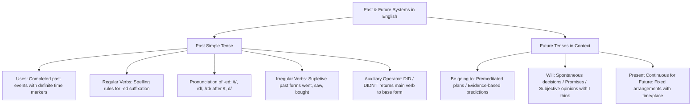

## 1. COURSE OVERVIEW & CONCEPTUAL FRAMEWORK
## 1. PORTADA Y METADATOS CURRICULARES

| Campo | Detalle |
| :--- | :--- |
| **Eje Temático** | Eje 07: Idioma Extranjero (Inglés) |
| **Materia** | Gramática y Sintaxis Inglesa (A2 - B1 CEFR) |
| **Nivel de Dificultad** | Preuniversitario Avanzado (UNSA / CEPRUNSA) |
| **Tiempo de Estudio Recomendado** | 4.5 horas |
| **Resolución Curricular** | R.C.U. N.° 0028-2026 (Admisión 2027) |
| **Prerrequisitos** | Tiempos de Presente y Auxiliares Básicos (Tema 01) |
| **Objetivo Pedagógico** | Dominar la flexión y sintaxis del **Past Simple** (reglas ortográficas de verbos regulares *-ed*, fonología de desinencias /t/, /d/, /ɪd/, catálogo de verbos irregulares clave y uso del auxiliar *did/didn't*); discriminar con precisión quirúrgica las formas de futuro: **Be going to** (planes premeditados y evidencia empírica presente) frente a **Will** (decisiones espontáneas, promesas y predicciones subjetivas). |

---

## 2. MAPA CONCEPTUAL SINTÉTICO (MERMAID)

---

## 2. FORMAL THEORETICAL FOUNDATIONS - PART I
## 3. FUNDAMENTACIÓN TEÓRICA RIGUROSA

### 3.1. The Past Simple Tense (Pasado Simple)
Se utiliza para expresar acciones, hechos o estados que **comenzaron y concluyeron definitivamente en el pasado**, acompañados o delimitados por marcadores temporales específicos (*yesterday, last night, two days ago, in 2020, when I was a child*).

#### A. Verbos Regulares: Reglas de Sufijación del Morfema *-ed*
1. **Regla General:** Añadir *-ed* a la forma base (*clean \rightarrow cleaned*, *work \rightarrow worked*, *open \rightarrow opened*).
2. **Terminados en 'e' muda:** Añadir únicamente *-d* (*live \rightarrow lived*, *arrive \rightarrow arrived*, *decide \rightarrow decided*).
3. **Consonante + 'y':** Cambiar la 'y' por **-ied** (*study \rightarrow studied*, *carry \rightarrow carried*, *try \rightarrow tried*).
4. **Vocal + 'y':** Solo añadir *-ed* (*play \rightarrow played*, *enjoy \rightarrow enjoyed*, *stay \rightarrow stayed*).
5. **Monosílabos CVC (Consonante-Vocal-Consonante):** Se duplica la consonante final (*stop \rightarrow stopped*, *plan \rightarrow planned*, *rob \rightarrow robbed*). (No aplica a terminaciones en *-w, -x*: *snow \rightarrow snowed*, *fix \rightarrow fixed*).
6. **Polisílabos con acento en la última sílaba:** Se duplica la consonante (*admit \rightarrow admitted*, *prefer \rightarrow preferred*). Si el acento va en la primera sílaba, no se duplica (*visit \rightarrow visited*, *listen \rightarrow listened*).

#### B. Fonología de la Terminación *-ed* (Reglas de Pronunciación)
En los exámenes de admisión y pruebas de suficiencia, la pronunciación de *-ed* responde a tres reglas fonéticas inviolables:

| Sonido Final del Verbo Base | Realización Fonética de *-ed* | Ejemplos |
| :--- | :--- | :--- |
| **Sonido /t/ o /d/** | **/ɪd/** (Añade una sílaba extra) | *wanted* (/ˈwɒntɪd/), *decided* (/dɪˈsaɪdɪd/), *started* |
| **Consonante Sorda (Voiceless):** /p, k, f, s, ʃ, tʃ, θ/ | **/t/** (Sin sílaba extra) | *worked* (/wɜːkt/), *watched* (/wɒtʃt/), *stopped* (/stɒpt/), *laughed* |
| **Consonante Sonora (Voiced) o Vocal:** /b, g, v, z, m, n, l, r/ y vocales | **/d/** (Sin sílaba extra) | *cleaned* (/kliːnd/), *lived* (/lɪvd/), *played* (/pleɪd/), *called* |

#### C. Catálogo de Verbos Irregulares Clave en Admisión
Los verbos irregulares no añaden *-ed*; modifican su raíz o adoptan formas supletivas:

\begin{array}{|l|l|l||l|l|l|}
\hline
\textbf{Base Form} & \textbf{Past Simple} & \textbf{Significado} & \textbf{Base Form} & \textbf{Past Simple} & \textbf{Significado} \\ \hline
\text{be} & \text{was / were} & \text{ser / estar} & \text{give} & \text{gave} & \text{dar} \\ \hline
\text{begin} & \text{began} & \text{empezar} & \text{go} & \text{went} & \text{ir} \\ \hline
\text{break} & \text{broke} & \text{romper} & \text{have} & \text{had} & \text{tener / haber} \\ \hline
\text{bring} & \text{brought} & \text{traer} & \text{know} & \text{knew} & \text{saber / conocer} \\ \hline
\text{buy} & \text{bought} & \text{comprar} & \text{make} & \text{made} & \text{hacer / fabricar} \\ \hline
\text{choose} & \text{chose} & \text{elegir} & \text{read} & \text{read (/red/)} & \text{leer} \\ \hline
\text{do} & \text{did} & \text{hacer} & \text{see} & \text{saw} & \text{ver} \\ \hline
\text{drive} & \text{drove} & \text{conducir} & \text{speak} & \text{spoke} & \text{hablar} \\ \hline

## 3. GRAMMAR PATTERNS & STRUCTURE TAXONOMY
## 4. FÓRMULAS, TAXONOMÍAS Y LEYES FUNDAMENTALES

### 4.1. Algoritmo de Decisión: ¿*Will* o *Be Going To*?
