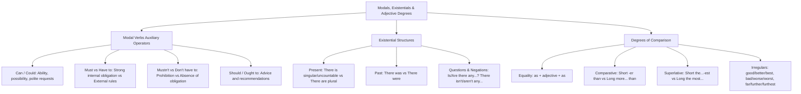

## 1. COURSE OVERVIEW & CONCEPTUAL FRAMEWORK
## 1. PORTADA Y METADATOS CURRICULARES

| Campo | Detalle |
| :--- | :--- |
| **Eje Temático** | Eje 07: Idioma Extranjero (Inglés) |
| **Materia** | Gramática y Sintaxis Inglesa (A2 - B1 CEFR) |
| **Nivel de Dificultad** | Preuniversitario Avanzado (UNSA / CEPRUNSA) |
| **Tiempo de Estudio Recomendado** | 4.5 horas |
| **Resolución Curricular** | R.C.U. N.° 0028-2026 (Admisión 2027) |
| **Prerrequisitos** | Tiempos Verbales Presente y Pasado (Temas 01 y 02) |
| **Objetivo Pedagógico** | Dominar el valor funcional de los verbos modales (*can/could* para habilidad y permiso, *must/have to* para obligación y prohibición *mustn't*, *should* para consejo); aplicar con precisión rigurosa las estructuras existenciales (*there is/are, there was/were*) con sustantivos contables e incontables; y estructurar adjetivos en grado comparativo y superlativo regular e irregular. |

---

## 2. MAPA CONCEPTUAL SINTÉTICO (MERMAID)

---

## 2. FORMAL THEORETICAL FOUNDATIONS - PART I
## 3. FUNDAMENTACIÓN TEÓRICA RIGUROSA

### 3.1. Modal Auxiliary Verbs (Verbos Modales)
Los verbos modales son operadores que modifican el significado del verbo principal para expresar nociones de habilidad, deber, prohibición, permiso o recomendación.
- **Reglas Sintácticas Universales de los Modales Puros:**
  1. Van seguidos invariablemente de un **Bare Infinitive** (verbo base sin *to*):
     \text{Subject} + \mathbf{Modal} + \mathbf{Base \ Verb} + \text{Complement}
  2. **No añaden '-s'** en la tercera persona singular (*He can, She must*, NUNCA *He cans*).
  3. No utilizan los auxiliares *do/does/did* para negar o preguntar (*Can you...?*, *You must not...*).

#### A. Can / Could
- **Habilidad o Capacidad:**
  - *Presente:* *She **can speak** three languages fluently.*
  - *Pasado:* *When I was five, I **could swim** very well.*
- **Permiso y Solicitudes:**
  - Informal: *Can I borrow your pencil?*
  - Formal / Cortés: *Could you explain this exercise again, professor?*

#### B. Must vs. Have To (Obligación)
- **Must:** Expresa una **obligación interna, personal o moral** que emana del propio emisor:
  *I **must study** harder if I want to pass the admission test.*
- **Have to:** Expresa una **obligación externa objetiva**, impuesta por leyes, reglamentos institucionales o autoridades:
  *Students **have to wear** an identification badge on campus.* (Reglamento universitario).
  *(Tercera persona: He **has to** submit the form).*

#### C. Mustn't vs. Don't Have To (La Gran Distinción de Examen)
- **Mustn't (Prohibición Absoluta):** Está terminantemente vedado; es ilegal o contra las reglas:
  *You **mustn't use** mobile phones during the entrance exam.* (Prohibición estricta).
- **Don't / Doesn't have to (Falta de Obligación / Opcionalidad):** No es necesario, pero si el sujeto lo desea, puede hacerlo:
  *Tomorrow is Sunday; we **don't have to get up** early.* (No hay obligación).

#### D. Should (Consejo o Sugerencia)
Se utiliza para dar o pedir consejos, recomendaciones médicas o juicios de conveniencia moral:
- *You have a severe cough; you **should see** a doctor.*
- *Applicants **should read** the instructions carefully before answering.*

---

### 3.2. Existential Structures: *There is / There are*
Expresan la existencia o presencia de entidades físicas o conceptuales en un lugar determinado (equivalente al español impersonal *«hay»*).

| Estructura Existencial | Tipo de Sustantivo Acompañante | Ejemplos Canónicos |
| :--- | :--- | :--- |
| **There is / There's** | Sustantivo **singular contable** o **incontable** | *There is a microscope on the desk.* *There is some water in the flask.* |

## 3. GRAMMAR PATTERNS & STRUCTURE TAXONOMY
## 4. FÓRMULAS, TAXONOMÍAS Y LEYES FUNDAMENTALES

### 4.1. Ecuación de Doble Grado Prohibida
Está terminantemente prohibido utilizar el adverbio *more* junto con el sufijo *-er*, o *most* con *-est*:
\times \ \text{more taller than} \quad \implies \quad \checkmark \ \mathbf{taller \ than}
\times \ \text{the most easiest} \quad \implies \quad \checkmark \ \mathbf{the \ easiest}
