## 1. COURSE OVERVIEW & CONCEPTUAL FRAMEWORK
## 1. PORTADA Y METADATOS CURRICULARES

| Campo | Detalle |
| :--- | :--- |
| **Eje Temático** | Eje 07: Idioma Extranjero (Inglés) |
| **Materia** | Gramática y Funciones Comunicativas (A2 - B1 CEFR) |
| **Nivel de Dificultad** | Preuniversitario Avanzado (UNSA / CEPRUNSA) |
| **Tiempo de Estudio Recomendado** | 4.0 horas |
| **Resolución Curricular** | R.C.U. N.° 0028-2026 (Admisión 2027) |
| **Prerrequisitos** | Tiempos de Presente, Pasado y Verbos Modales (Temas 01 al 03) |
| **Objetivo Pedagógico** | Expresar gustos y preferencias (*like, love, enjoy, prefer, hate + gerund / would like to + infinitive*); formular solicitudes, permisos e invitaciones formales e informales (*Could you, Would you mind, May I, How about*); ordenar procesos con secuencias temporales (*First, Then, Finally, before/after + -ing*); y articular párrafos con conectores lógicos de adición, contraste, causa, consecuencia y finalidad. |

---

## 2. MAPA CONCEPTUAL SINTÉTICO (MERMAID)

```mermaid
graph TD
    A[Communicative Functions & Connectors] --> B[Likes, Dislikes & Preferences]
    B --> B1[Verbs of feeling: like, love, enjoy, hate + Gerund -ING]
    B --> B2[Hypothetical preference: would like / would prefer + to-Infinitive]
    B --> B3[Prefer X to Y: Gerund to Gerund / Noun to Noun]

    A --> C[Social Formulae & Pragmatic Interactions]
    C --> C1[Polite Requests: Could you please...? Would you mind + -ING...?]
    C --> C2[Permissions: May I...? Can I...? Is it okay if...?]
    C --> C3[Suggestions & Invites: Why don't we...? How about + -ING...? Let's...]

    A --> D[Time Sequence & Process Markers]
    D --> D1[Chrono-markers: First, Secondly, Next, After that, Finally]
    D --> D2[Prepositional time clauses: Before + -ING, After + -ING, While...]

    A --> E[Logical Connectors Linking Words]
    E --> E1[Addition: and, furthermore, moreover, in addition]
    E --> E2[Contrast: but, however, although/even though, despite + noun]
    E --> E3[Cause & Effect: because vs because of, so, therefore, consequently]
    E --> E4[Purpose: to, in order to, so that + clause]
```

---

## 2. FORMAL THEORETICAL FOUNDATIONS - PART I
## 3. FUNDAMENTACIÓN TEÓRICA RIGUROSA

### 3.1. Expresión de Gustos, Preferencias y Aversiones

#### A. Verbos de Sentimiento General + Gerundio (*-ING*)
Cuando expresamos aficiones, hábitos placenteros o aversiones generales permanentes, verbos como *like, love, enjoy, fancy, don't mind, dislike, hate, can't stand* van seguidos preceptivamente de un **sustantivo** o de un **gerundio (-ING)**:
- *She **enjoys reading** scientific articles on biophysics.* (NUNCA: \times *enjoys to read*).
- *They **hate waiting** in long queues under the sun.*
- *I **don't mind helping** you with your mathematics assignment.*

#### B. *Would like / Would prefer* + *To-Infinitive*
Cuando se expresa un **deseo puntual, específico o hipotético en el presente o futuro**, se utiliza la estructura modal condicional *would like / would love / would prefer*, la cual exige **To-Infinitive**:
\text{Subject} + \mathbf{would \ like \ / \ 'd \ like} + \mathbf{to \ + \ Base \ Verb} + \text{Complement}
- *I **like swimming**.* \rightarrow Me gusta nadar como deporte o afición habitual.
- *I **would like to swim** this afternoon.* \rightarrow Deseo nadar hoy puntualmente.

#### C. Estructura de Preferencia: *Prefer A to B*
Para comparar dos actividades o entidades preferidas:
\mathbf{prefer} + \text{Noun / Gerund A} + \mathbf{to} + \text{Noun / Gerund B}
- *She **prefers studying** in the library **to working** at home.* (NUNCA: \times *than working*).

---

### 3.2. Solicitudes, Permisos, Sugerencias e Invitaciones

| Función Pragmática | Estructura Canónica | Grado de Cortesía | Ejemplo Ilustrativo |
| :--- | :--- | :--- | :--- |
| **Petición Cortés (Polite Request)** | \mathbf{Could \ you \ (please)} + \text{Base Verb...?} | Formal | *Could you please lend me your calculator?* |
| **Petición con "Mind"** | \mathbf{Would \ you \ mind} + \mathbf{Verb\text{-}ING...?} | Muy formal | *Would you mind **opening** the window?* (Respuesta afirmativa cortés: *No, not at all*). |
| **Petición Informal** | \mathbf{Can \ you} + \text{Base Verb...?} | Coloquial / Amigos | *Can you pass the salt, please?* |
| **Permiso Formal** | \mathbf{May \ I} + \text{Base Verb...?} | Muy formal e institucional | *May I ask a question, Professor?* |
| **Sugerencia / Invitación 1** | \mathbf{Why \ don't \ we} + \text{Base Verb...?} | Neutro | *Why don't we study together for the test?* |
| **Sugerencia / Invitación 2** | \mathbf{How \ about \ / \ What \ about} + \mathbf{Verb\text{-}ING...?} | Informal | *How about **having** lunch at the campus canteen?* |
| **Mandato Exhortativo** | \mathbf{Let's} + \text{Base Verb} | Inclusivo | *Let's review the biology notes now.* |

---

### 3.3. Secuencias Temporales y Marcadores de Proceso
Para describir instrucciones de laboratorio, recetas, algoritmos o itinerarios cronológicos:
1. **Marcadores de Orden:**
   - *First / Firstly:* Introduce el punto de partida (*First, wash the test tubes*).
   - *Next / Then / After that:* Describen los pasos intermedios (*Next, add 5 ml of acid. Then, stir gently*).
   - *Finally / Lastly:* Concluye el proceso (*Finally, record the temperature*).
2. **Preposiciones de Tiempo con Gerundio:**
   Cuando las preposiciones *before* y *after* van seguidas de un verbo sin sujeto explícito, este adopta obligatoriamente la forma de **gerundio (-ING)**:

## 3. GRAMMAR PATTERNS & STRUCTURE TAXONOMY
## 4. FÓRMULAS, TAXONOMÍAS Y LEYES FUNDAMENTALES

### 4.1. Ecuaciones Sintácticas de Selección Conectiva

\begin{array}{|l|l|}
\hline
\textbf{Estructura Gramatical Conectiva} & \textbf{Patrón Sintáctico Exigido} \\ \hline
\text{Although / Even though} & \mathbf{+ \ \text{Subject} + \text{Verb}} \ (\text{Cláusula completa}) \\ \hline
